1996\
Wir haben uns viel Arbeit und Mühe gemacht und immer wieder\
gute Kontakte geknüpft

Bis wir uns unseren Zuchtstamm mit "eigenen" Linien rausgezüchtet hatten, vergingen ein paar Jahre.

Das waren dann so die ersten 13 Jahre in unserer Zucht. Auch die nächsten Jahre wurde weitergeplant. Was bei uns älter kastriert wurde, durfte bleiben und bei uns alt werden. Aber die noch jung genug waren, wurden kastriert und teilweise als Pärchen zusammen an Liebhaberplätze abgegeben oder wurden in unserer tierlieben Familie untergebracht, wo sie in Ruhe alt werden können/konnten. Denn in einer Zucht geht das nicht, man kann nicht alles behalten.....**leider!!**

Und weiter ging es:

1996 dann, entschieden wir uns für einen blue tabby Kater. "Tweedy Cuddle Bear L.Joe", unserer damaligen Züchterfreundin Sibylle Westerweller, die ihre Zucht leider einstellte. Er hatte einen sehr schönen Typ mit ausgeprägter Schnauze und tollem Wildlook. Er war gezogen aus einer Kombination aus Starbushway/Tara, dem Kater "Tara Torrent".\
Er hatte mit verschiedenen Kätzinnen bei uns Babys im extremen Wildluchstyp.

Tweedys Cuddle Bears L.Joe

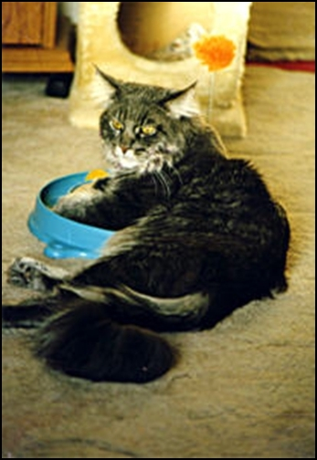

So gingen wir wieder auf die Suche für passende Mädchen für Blaubär. Die wunderschöne helle silvertabby "Blackmoon´s Happyend", eine sehr sehr zarte schlanke, aber typvolle MC-Lady (die leider nie über 3 Kg kam) und die aus Österreich importierte "El Dorados Destiny"

Blackmoons Happyend

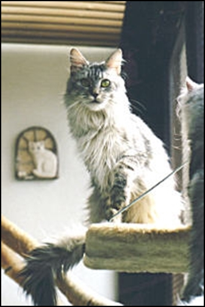

El Dorados Destiny

sowie die sehr sehr große, extrem kräftige 8 Kg - Wildlook-Kätzin "Macavity Fancy" zogen bei uns ein. Sie war aus den Linien "Mc Kittycreek Geoffrey" Diese schönen Tiere waren wieder ein paar Jahre Vererber bei uns und wir hatten einige schöne Kitten. Fancy wurde 17 Jahre alt. Sie lebte bis zu ihrem Tode bei Liebhabern in Köln.

Macavity Fancy, gerufen Pumi

Macavity Fancy war ein Mädel von extremem Wildlook, riesengross und von sehr sanftem lieben Wesen.

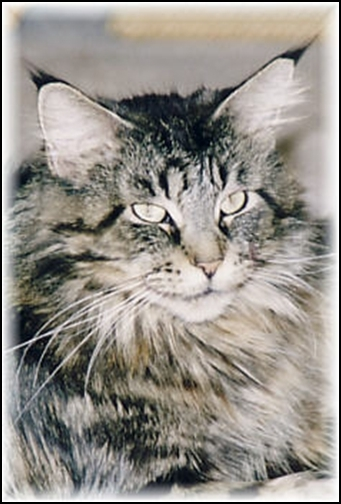

Im Jahr 2000\
gingen wir wieder ganz neue Wege

Uns führte der Weg zu unserer Züchterkollegin der Cattery "Langstteich" aus der wir unseren Ca´Bonero (Poshy gerufen) bekamen. Poshy, ein kräftiger Luchskater mit mächtigem Kopf, sehr starkem Knochenbau von ganz aussergewöhnlichem selbstbewussten dominanten Charakter. Poshy wurde mit 9 Jahren kastriert. Zahlreiche Söhne und Töchter der Superklasse hat er hervorgebracht.

Poshy mit 15 Wochen

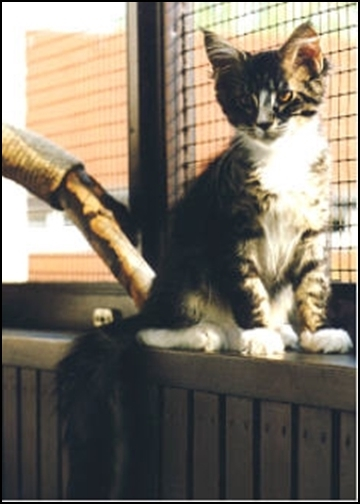

Poshy mit 5 Jahren

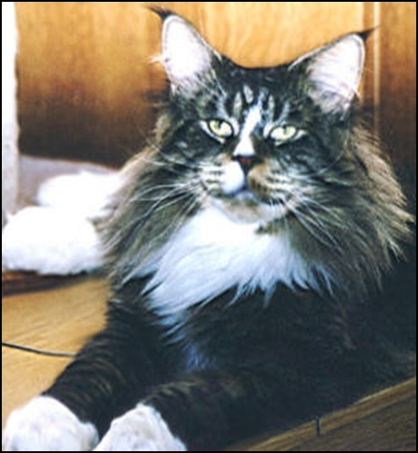

Mit eine seiner schönsten Töchter "Starbushway Orchidee" (die Fans im In - und Ausland hatte) züchteten wir 6 Jahre lang. Sie wurde dann kastriert und blieb bis zu ihrem Tod bei uns.

Starbushway Orchidee

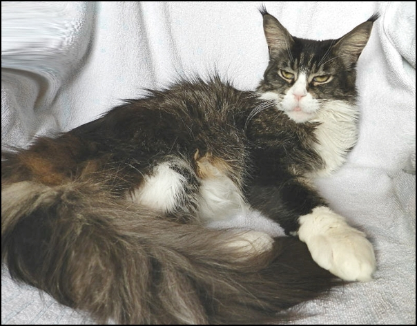

2001 bereicherte Dixi unsere Zucht, ein black tabby Mädchen vom Aussehen ein kleiner Luchs, vom Charakter ein Wölkchen. Ein Wildlook mit recht bösem Blick dazu der Gegensatz "IHR CHARAKTER". Ein sehr liebes ausgeglichenes soziales Mädchen schenkte uns traumhaften Nachwuchs, egal mit welchem Kater!! Wir bekamen sie von unserer damaligen Züchterfreundin Marianne Schönrock der Cattery Zanzabou.

Sie ist die Mutter unserer "Orchidee"\
Zanzabou Desperada Dixi

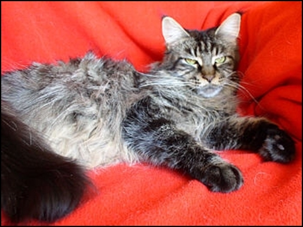

Es folgten aus der Cattery Langstteich: O´Hio, ein creme Kater.......

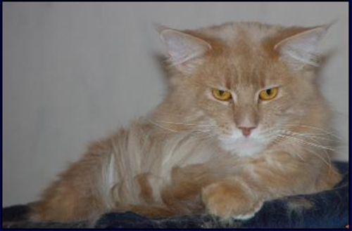

.......sowie Chalimar eine Tochter des gigantischen Lukas und die typvolle Mahagony

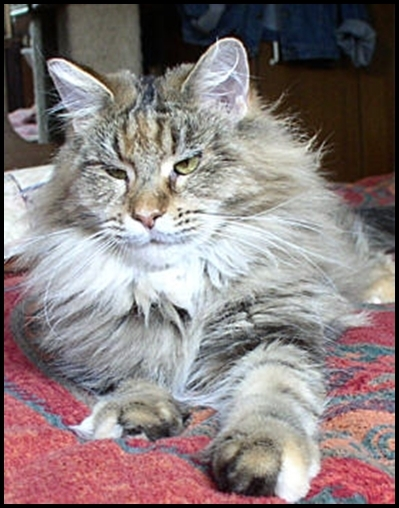

Immer noch arbeiteten wir in unseren Linien und verflochten interessante Kombinationen, hielten Ausschau nach dem ein oder anderen Tier was gut zu uns passen könnte, gingen hier und da mal zum Decken um uns das ein oder andere Schätzchen herrauszuzüchten.

Weiter ging es 2004

Aus der Cattery Pillowtalk bekamen wir ein sehr schönes Mädchen. Zsa Zsa war ein Mädel, so ein grosses und vor allen Dingen so ein kräftiges hatten wir noch nicht und hatten wir auch noch nicht gesehen. Zsa Zsa, eine extrem maskuline Kätzin, die tatsächlich die meisten Kater neben sich erblassen liess mit ehrlichen **\> 9 Kg,\<** ohne dick zu sein!! Nach 4 wunderschönen Würfen, (davon 2 mal 8 Kitten und einmal 10 Kitten) wurde Zsa Zsa kastriert.

Pillowtalk Zsa Zsa

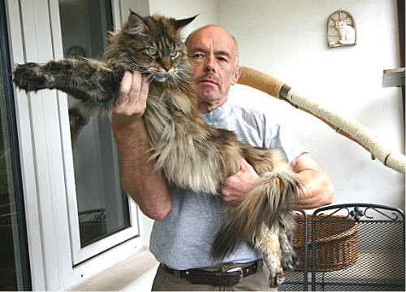

Wir gingen auf die Suche nach einem geeigneten Kater für Zsa Zsa. Ein Silberfischchen sollte es sein.\
Aus der Cattery "Superstar" zog 2004 der schöne und beeindruckende Sajan bei uns ein und sorgte für frischen Wind bzw. frisches Blut hier bei uns. In Kombinationen mit mehreren Kätzinnen aus ganz verschiedenen Linien. hatten wir erfolgreichen und sehr schönen und markanten Nachwuchs.

Superstar Sajan, bei uns Sanni gerufen

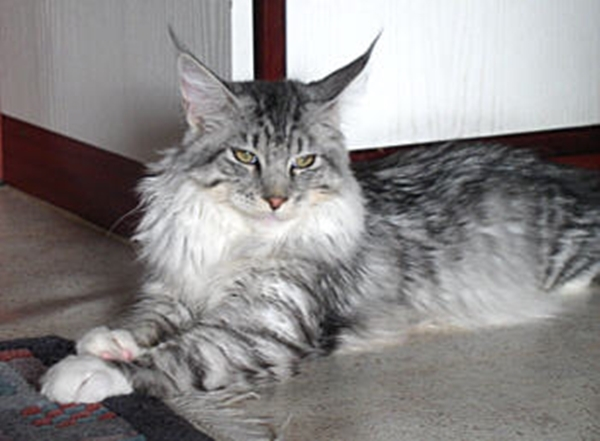

Sajan wurde mit 5 Jahren kastriert und wir behielten uns einen kräftigen Sohn "Nashota" von ihm und Zsa Zsa

Starbushway Nashota vetrat dann seinen Vater

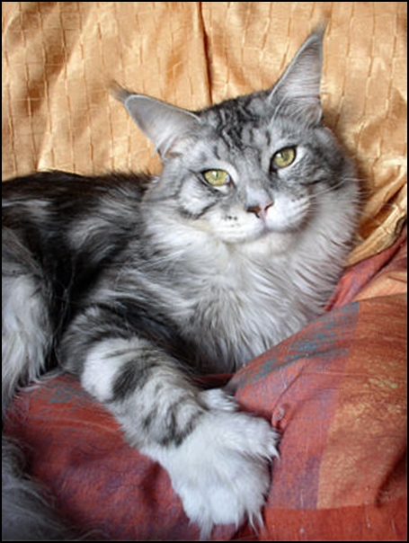

Zwei silberne Töchter von Nashota "Starbushway Minerva Bell" und "Starbushway Chocobon" blieben bei uns, nachdem Nashotas Zuchtzeit hier vorbei war und er kastriert wurde.

Starbushway Chocobon

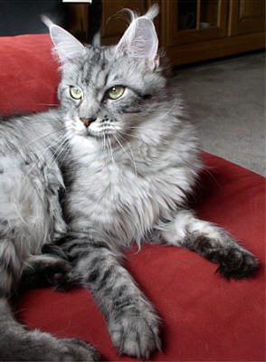

Starbushway Minerva Bell

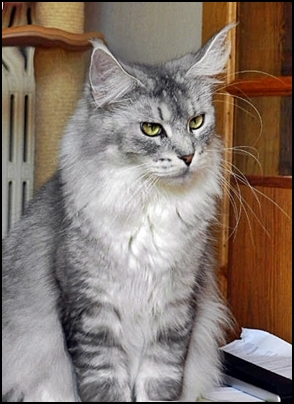

Über Minerva zogen wir uns die vom Typ außergewöhnliche "Starbushway Townwalk", (Foto: mit ihrem 3, Wurf) sie hatte ein extremes Aussehen, der Look glich fast einem Luchs, ihr Gewicht war immer 8-9 Kilo, das war das Erbe ihrer riesigen Eltern und Großeltern. Sie brachte uns sehr sehr schönen markanten Nachwuchs, z.B. die riesige "Push Balboa" die wir behielten.

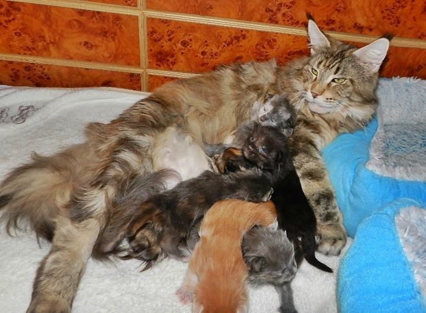

Push Balboa hatte bei uns nur einen Wurf von 12 Babys,\
wovon 10 gut gediehen, 2 starben. Da sie so eine extrem\
schwere Geburt hatte, wurde sie nach dem Wurf kastriert

**Im Jahr 2008**

Dann zog "Saxony Forest Jack Daniels" bei uns ein und brachte mal wieder andere Linien mit.

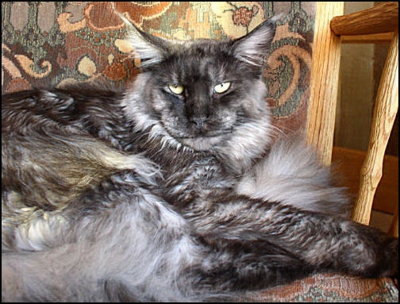

J.D. sorgte für schönen ausdruckstarken Nachwuchs, auch er wurde nach ein paar Würfen kastriert und wir behielten einen riesigen Sohn von 11 Kg für unsere Zucht. Starbushway Blue Bambule, Bambi gerufen, denn sein Wesen war so sanft so lieb so ruhig, im Gegensatz dazu sein Aussehen. Jeder der hier zu Besuch war trat einen Schritt zurück wenn Bambi erschien oder ich ihn präsentierte. Nach einigen Jahren und einigen Würfen ging auch er in den Ruhestand.

Bambi im Alter von 1 Jahr

und wir behielten uns von Bambi einen gigantischen Sohn, unseren\
12,5 Kg Deputi. Hier Sabine mit Deputi

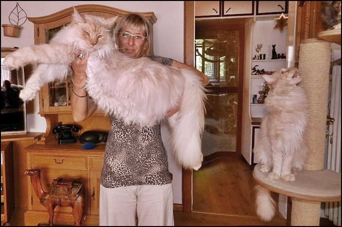

Die Mutter von Deputi ist auch ein Eigengewächs\
ein Traum in cremsmoke **"Starbushway Baby Jane"**\
bei uns kurz BJ (Bidschi ) gerufen

2011\
Die Jahre gingen dahin

Eine Traummädel aus der Zucht Big Giant kam in unsere Zucht und auch mit ihr hatten wir schönen Nachwuchs, sie hatte bei uns 4 Würfe bevor sie kastriert wurde. Behalten haben wir von ihr nichts, da ihr Charakter überaus schwierig war, den sie auch teilweise vererbt hat. Sie war auch keine gute Mutter.

Big Giant Resort Wishing Well

Einen neuen Kater in creamsmoke holten wir uns aus Österreich.\
Wir konnten uns einige typvolle Nachwuchs-Coons mit ihm erarbeiten

Mainefield Sgt.Pepper

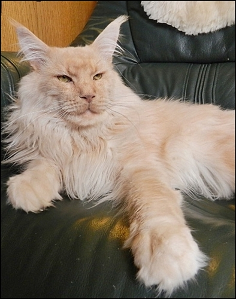

Hier ist Sgt.Pepper zusammen mit seiner Enkelin\
Baby Jane, BJ

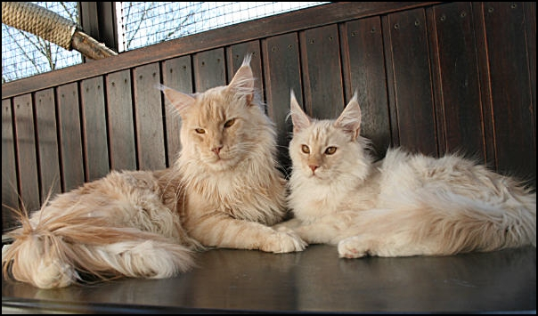

[Weiter geht es im Jahr 2013](/lesenswert/anfang3/)
