Das Jahr 2013 war das Jahr des großen Zuchterfolges für uns\
Wir hatten uns sehr schöne Mädchen gezogen aus unseren bewährten Linien

4 Starbushway-Sternchen bereicherten unsere Zucht, aus Linien die wir schon Jahre züchteten und auch gut beobachten konnten. Auch mit diesen Kätzinnen hatten wir erfolgreiche Kombinationen mit unseren großen schönen gesunden Katern.

Starbushway Perdita, eine Pepper-Tochter

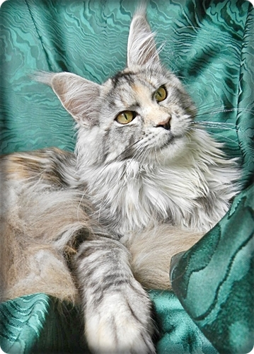

Dremdoll aus reiner Starbushway-Linie

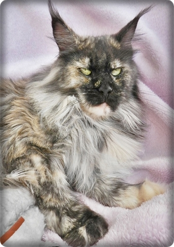

StarbushwaysYolanina aus\
bewährten Starbushway Linien

Starbushway Cara-Mia kam aus\
ebenso aus unseren eigenen Linien

**Die Mädels wurden nach einigen Würfen kastriert** **und in unsere ebenso tierliebe Familie gegeben für ein schönes Kastatenleben**

2015-2017\
Dann kam die Zeit als Zacko und Bossi bei uns einzogen und hier für wunderschönen gigantischen\
Nachwuchs mit den Mädels sorgten.

Zwei Kater die geradewegs aus den Wäldern Nordamerikas hätten stammen können. Sehr groß, robust mit sehr schwerem Knochenbau. Beide Kater waren um die 9 Kilo mit sehr liebem angenehmen Wesen, Charakterzüge die auch unsere Starbushways der Neuzeit sehr geprägt haben.

Big Giant Resort Quat Zack, Zacko gerufen

Big Giant Resort Bosswell, Bossi gerufen

Hier ist er mit einem seiner Babys

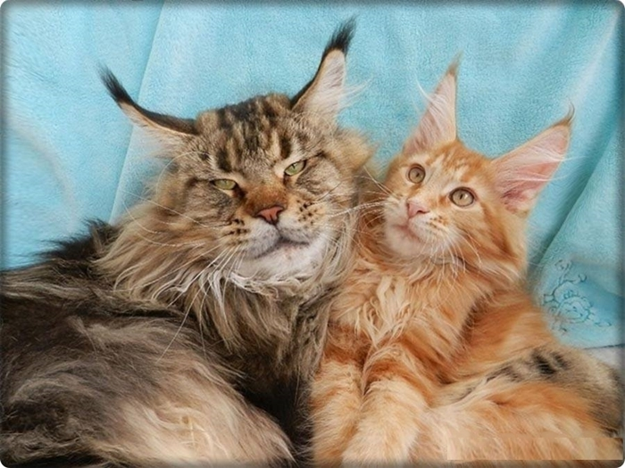

Dazu holten wir uns wieder ein schönes Mädchen aus anderen Linien.

Quilana vom Zeitzgrund

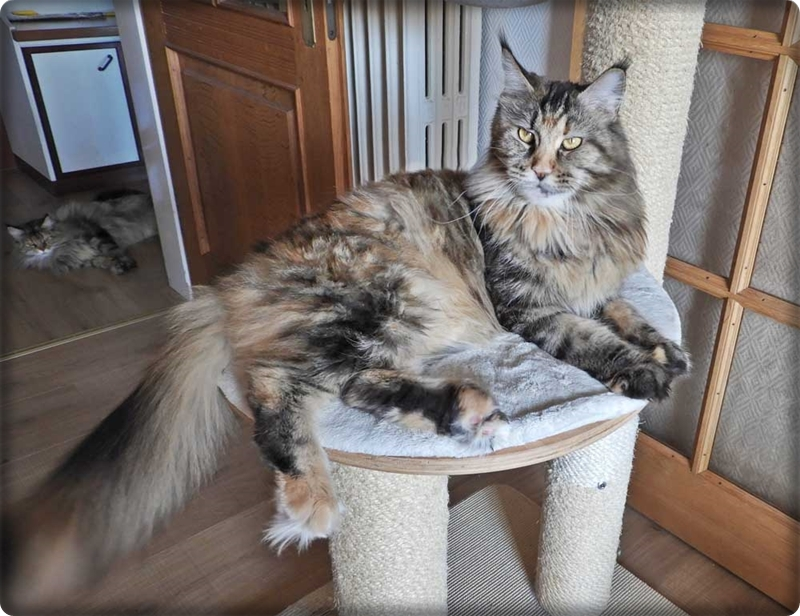

Als die Zuchtzeit von Bosswell und Ouat Zack vorbei war blieben 2 Töchter aus den Verbindungen

Von Quilana und Bosswell behielten wir uns eine Tochter, eine mächtige große Katze mit, zwar viel aber pflegeleichtem Fell.

Starbushway Priscilla

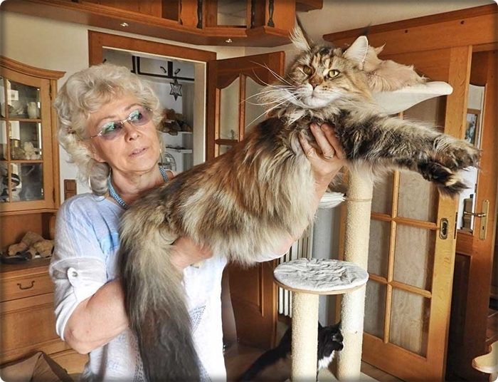

Aus der Verbindung Perdita mit Quat Zack behielten wir eine sehr helle silbertorbie "Starbushway Arizona". Beide Mädchen hatten schon einiges an Nachwuchs, der uns überzeugt hat. Gesund, schön, groß, typvoll mit einzigartigem Charakter.

Starbushway Arizona

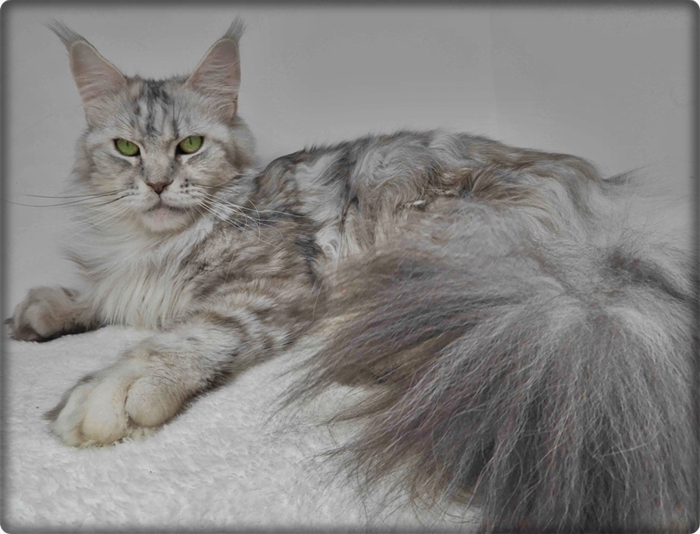

2018

zog ein black/white Kater der ganz besonderen Art ein. Auch groß und kräftig mit Pinselohren die man sehr selten sieht. Lieb und sensibel schlich er sich hier in unser aller Herzen. Alle Mädchen lieben ihn und er ist so ein liebevoller Vater seiner vielen Kitten die hier schon geboren wurden und ausgezogen sind.

Big Giant Resort Ouzo for me

dazu gesellten sich zwei eingekaufte blue silver tabby Mädels aus komplett anderen Linien.

Kajati vom Immelhausen

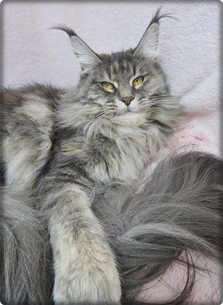

Cajana of Dantes Peak

**2019**

Wir zogen uns wieder ein eigenes Mädchen, eine Tochter von Arizona, als Geburtsgwicht schon 80g, entwickelte sie sich genauso weiter und wurde ein sehr großes und kräftiges Mädel

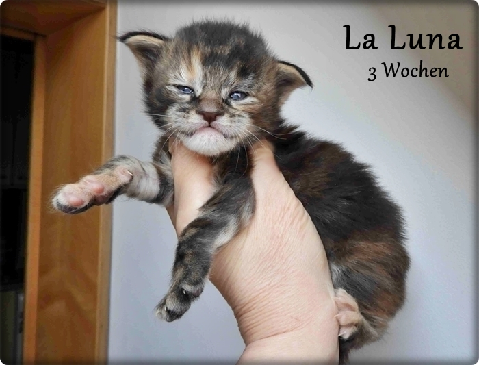
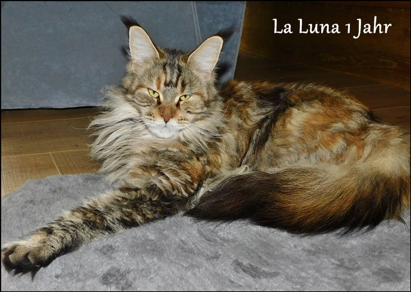

Mit "Starbushways La Luna" gingen wir 3 mal zur Fremdeckung zu meiner meiner Freundin Susanne "Big Giant Resort Perfect". Traumhafter Nachwuchs ist aus dieser Verpaarung hervorgegangen. Dieser rote Kater war einfach nur ein Eyecatcher dazu riesengroß, eine Erscheinung! 3 schöne Würfe gab es mit ihm und Luna.

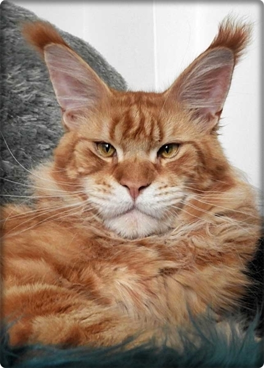

Und noch eine Tochter von Arizona mußte bleiben

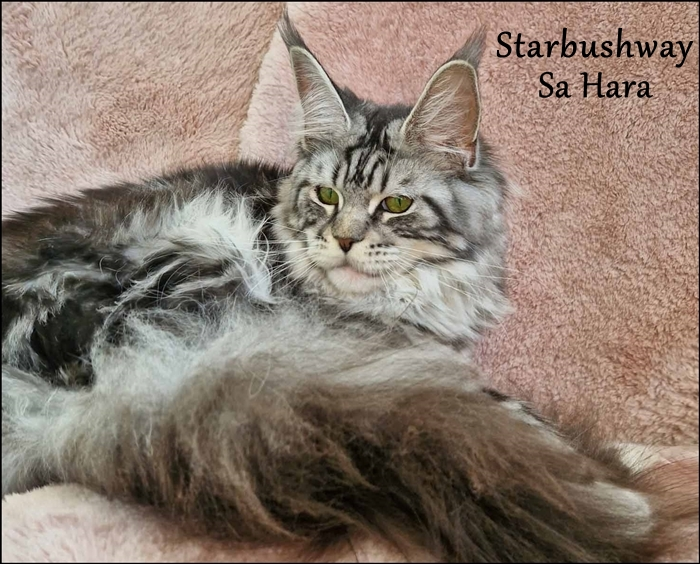

**2022**

Wir haben für unseren Ouzo 4 neue Mädchen eingekauft und von allen vier sind schon schöne Starbushways Würfe gefallen. Und weiter geht es.\
Ab 2027 haben wir wieder neue durchdachte Pläne!!

Of Watermill Manor Be Love hatte 1 Wurf

Legendarys Chinook Blue hatte\
bis jetzt 4 Würfe

Jechaburger Weides Tamalika\
bis jetzt 4 Würfe

The Dream Coons Su\`Perla\
hatte bis jetzt 3 Würfe

Durch Zusammenarbeit mit einigen MC-Züchtern, mit denen wir schon über viele Jahre Freundschaften pflegen, stehen uns ab und zu auch mal Deckkater zur Verfügung, die ansonsten nicht für Fremddeckungen freigegeben werden. Und darum planen wir für die nächsten Jahre einiges.

In unserer Zeit als aktive Aussteller habe ich bei unserer 100. Ausstellung aufgehört zu zählen und darum wird man uns auf Ausstellungen nur noch sehr selten bis gar nicht mehr sehen.

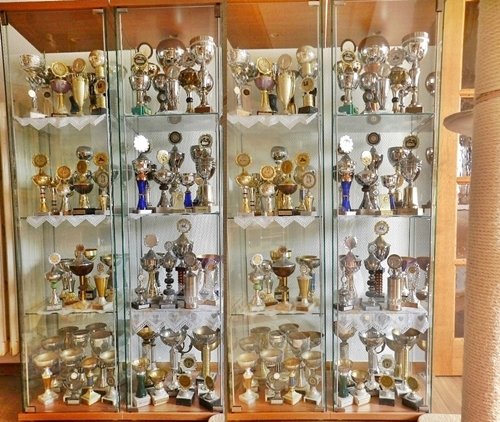

Unsere Trophäen im Laufe vieler Jahre. Stolz?? Ja natürlich!! Aber in einer erfolgreichen langjährigen Zucht zählen ganz andere Dinge, da wird mir jeder Züchter der schon länger dabei ist, recht geben.\
Ehrlich gesagt habe ich sie fast alle entsorgt. Ein paar schöne und große stehen noch in der Schrankwand im Keller

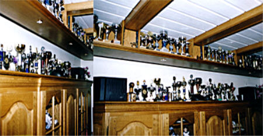

So long\
Karin Lemanowicz

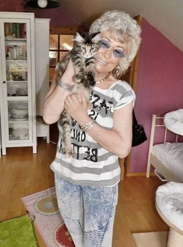

[Unser Züchterjubiläum 2021](/lesenswert/zuchtcronik/)

[](/lesenswert/zuchtcronik/)

[[Klick](/neuigkeiten/jubilaeum/)](/lesenswert/zuchtcronik/)[[hier](/neuigkeiten/jubilaeum/)](/lesenswert/zuchtcronik/)
