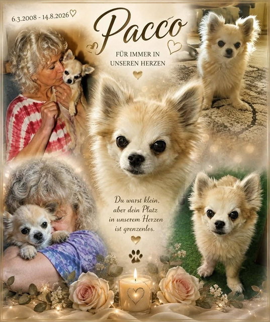
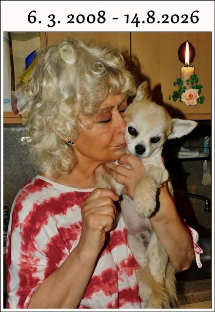
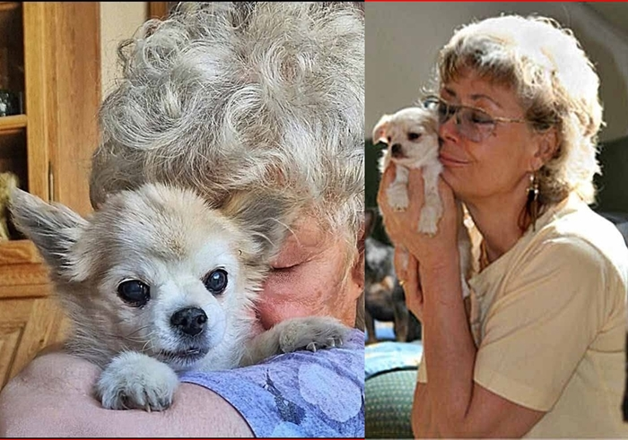
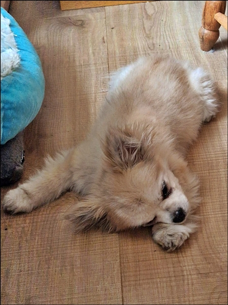

Gestern war hier ein Tag der Trauer. Um 18:15 hörte Pacos Herz auf zu schlagen. Er konnte nicht mehr, wurde immer schwächer. Gestern zog er nur noch seine Hinterbeinchen hinter sich her. Wir wußten der Tag kann ganz schnell kommen, aber es ist so schwer. Wir haben unseren geliebten Zwerg mit 18,5 Jahren erlösen müssen.\
**Es ist sehr still im Hause Starbushway.**

Paco ein Chihuahua, wie er lieber und pflegeleichter nicht sein konnte. Jeder der ihn hier kennenlernte wurde sofort zum Chihuahua-Fan.

Pacolino, nun bist du bei deinem geliebten Monti, bei Sara und bei Chiqua. Hier hinterläßt du ein großes Loch und unendliche Traurigkeit. Mach es gut mein blonder lieber Junge. Der Himmel wird Freude mit dir haben.\
Der einzige kleine Trost ist.....er hatte bei uns so ein schönes Leben mit unseren anderen 3 Hunden war es ein tolles Rudel. Danke Paco das es dich in unserem Leben gab.

Sein letzter Tag bei uns

