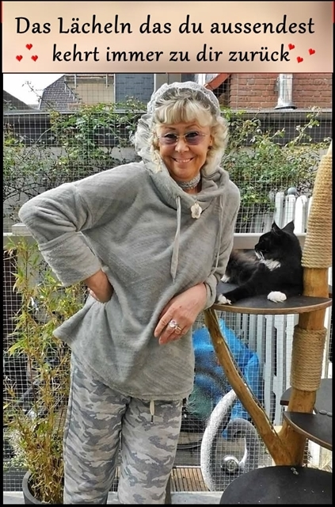
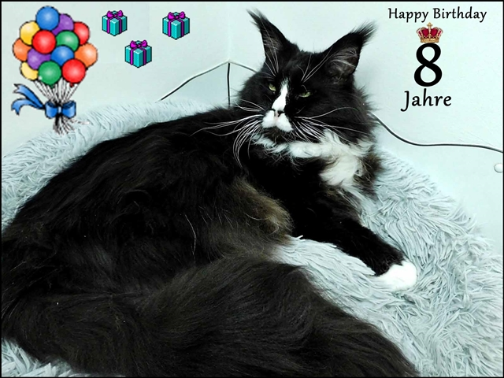
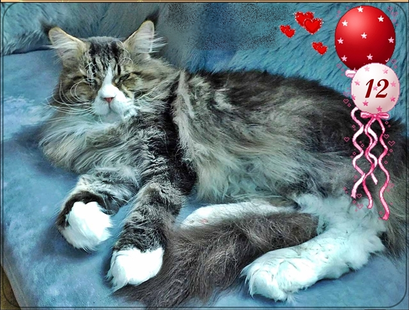
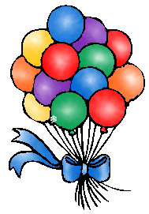

[Super Fotoshooting](/neuigkeiten/1abab8/)

[Mutter und Sohn !!](/neuigkeiten/site1/)

[Deputis Gallerie](/neuigkeiten/1abab27/)

[Gallerie 1](/neuigkeiten/galleria/)

[Ich möchte Euch einfach nur mal Danke sagen!](/neuigkeiten/ineigenersache7/)

Und hier das Neueste aus unsererem Hause

Diese Nachricht bekam ich heute. Also nicht wundern wenn ab und zu mal meine HP nicht aufzurufen ist. Sie kommt aber wieder\
\*

23.10.2026 Die Webserver laufen seit Heute Nacht wieder :-)

Es wird aber demnächst ( wann genau weiss ich noch nicht ) nochmal kürzere\
Abschaltungen geben.\
Wir haben uns entschieden das wir alle Systeme komplett aktualisieren ....\
das dauert aber noch vermutlich einige Wochen ...\
Wenn alles auf dem aktuellsten Stand ist, werden wir alle Seiten auf die\
neuen Maschinen umziehen, mit Glück gibt es keine Ausfälle.\
Aber ganz ausschließen kann man das leider nicht.

Gruß IWSR Thomas Schreiber

[23,9,2026 Neuigkeiten im Hause Starbushway](/neuigkeiten/1abab11/)

Zwischendurch mal einen lieben Gruß an\
alle meine Homepagebesucher!\
**Mein Zähler sagt 986.045 Besucher!!**

[29.8.2026 Geliebte Kastraten (Teil 2)](/neuigkeiten/seite12/)

[29.8.2026 Geliebte Kastraten (Teil 1)](/neuigkeiten/seite18a/)

17.8.2026\
Sooo... heute war HCM Schalltag bei Dr. Kresken. Alle unsere Zuchttiere sind nun aktuell fertiggeschallt mit allerbesten Werten.\
Nächstes Jahr im Spätherbst werden wieder neue Schalltermine gemacht. Und nun warten wir auf die Rolligkeiten unserer bezaubernden Mädels.

Somit wäre dann unsere Pause beendet und ich hoffe im November wieder meine Starbüschen präsentieren zu können. Einige Vorbestellungen stehen schon

[16.8.2026 Vorbei ist die Zeit.....](/neuigkeiten/1abab445/)

[15.8.2026 Gestern war ein sehr trauriger Tag bei uns](/neuigkeiten/1abab446/)

[25.6.2026 Wie geht es uns bei 38° Hitze](/neuigkeiten/abgabe4v/)

[10.6.2026 Ein schönes Event bei unseren Tierärzten](/neuigkeiten/1abab44/)

[19.5.2026 Bald bald, noch haben wir Sommerpause!](/neuigkeiten/defu/)

24.4.2026

Heute ist sein Geburtstag Unser "Ouzo".

💞

Er ist heute 8 Jahre alt und immer noch Deckkater hier bei uns. Zuverlässiger Decker, lieb mit den Mädels und zärtlich und verspielt mit den Kitten. Ein Schoßkater. Vater, Großvater Ur Ur.....unzähliger toller und schöner Babys. Bis 7 Jahre HCM geschallt mit Bestwerten. Wir arbeiten an einem würdigen Nachfolger, denn in Kürze wird er kastriert

Da wir von ihm aus seinem letzten Würfen 1-2 Mädels behalten wollen gehen wir auf die Suche nach einen linienfremden Kater.\
Ich schaue nach den Farben silber, egal ob cl tabby, mac tabby oder ticked tabby, auch smoke, auf jeden Fall weiße Pfötchen. Ich bin gespannt was ich hier im nächsten Jahr präsentieren kann.

[11.4.2026 Wir haben unser Zuchtjubiläum gefeiert im kleinsten Kreis](/neuigkeiten/jubilaeum/)

3.4.2026\
Unser \*Zacko\* hat heute seinen 12. Geburtstag. Unser Junge lebt nun 12 Jahre an unserer Seite. Er ist unser Menschenkater, unser Baby. Wir lieben ihn und hoffen ihn noch ganz viele Jahre zu verwöhnen, denn er liebt sein Zuhause, seine Menschen und seine Mitkatzen!!

[22.3.2026 Die Kitten sind ausgezogen. Wir haben wieder viel Zeit für uns](/neuigkeiten/1abab9pumi/)

[16.3.2026 Aktuelles auf der Kittenseite](/wuerfe/)

[7.3.2026 Ein besonderer Geburtstag](/neuigkeiten/1abab6/)

[22.2.2026 Schnappschüsse](/neuigkeiten/gifs/)

[19.1.2026 Mütter und ihre Babys. Nun wirds eng bei uns](/neuigkeiten/1abab10/)

[8.Jan.2026](/neuigkeiten/trauerchi/) [Eine traurige Nachricht](/neuigkeiten/trauerchi/)

2025

31.12.2025 [**Guten Rutsch**](/neuigkeiten/silvester/)

[24.12.25 Heiligabend](/neuigkeiten/weihmarkt/)

[24.12.25 Die Weihnachtsbabys von Susi sind geboren und die Kittenseite ist aktualisiert](/wuerfe/)

[22.12.25 So ist unser Weihnachten](/neuigkeiten/weihntag1/)

[6.12.2025 Alljährliche Nikolausparty](/neuigkeiten/besucht4/)

[17.11.2025 Es wird Winter](/neuigkeiten/klimmge/)

10.9.2025 [Mal wieder Fotos](/neuigkeiten/seite15/)

**7.6.2025** [Unsere Katzenfamilie in der Übersicht](/neuigkeiten/abgabe5/)

**4.6.2025** [Unsere Zucht ist und bleibt spannend](/neuigkeiten/abgabe/)

**28.5.2025** [Fotoshoot](/neuigkeiten/abgabe2/)

[8.5.2023 Traurige Nachricht](/neuigkeiten/trauer/)\
[Das Herz unserer Katzengemeinschaft ist gestorben](/neuigkeiten/trauer/)

[12.11.2021 Das erste Fotoshooting mit meinen kleinen Jungs (5 Wochen),](/neuigkeiten/verpaarung/) [**aber vorsicht Zuckerschock!!!!!**](/neuigkeiten/verpaarung/)

[Zurück](/)
