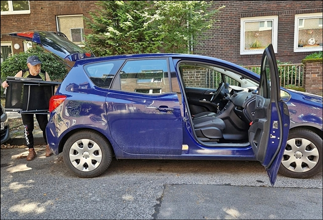
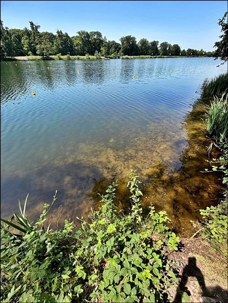
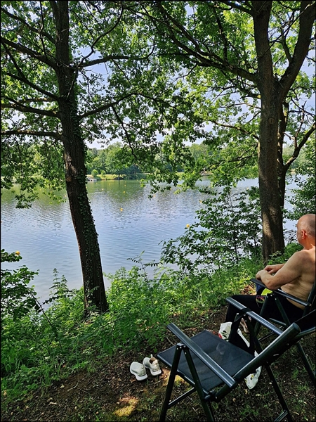
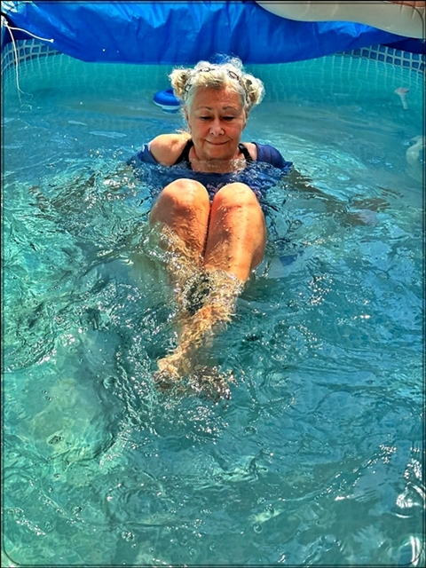
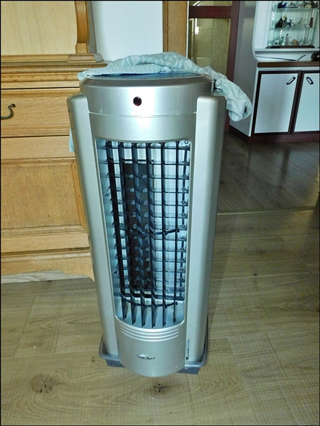
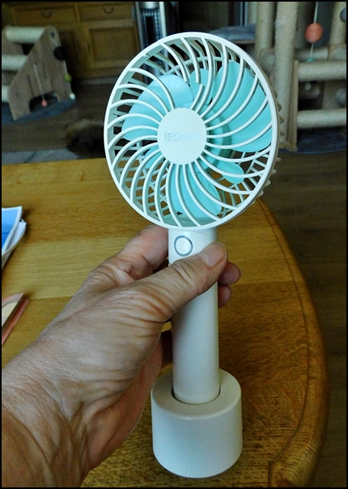
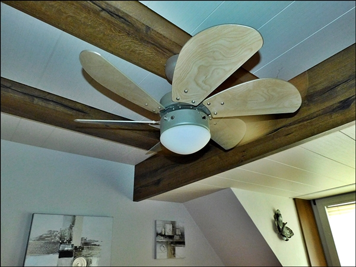
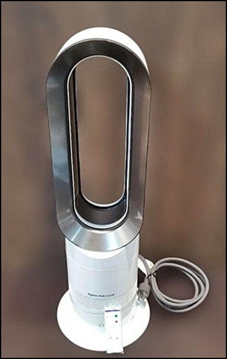
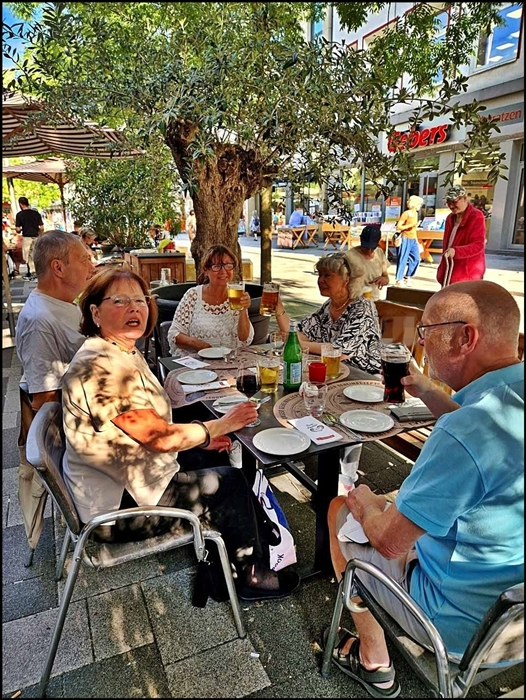
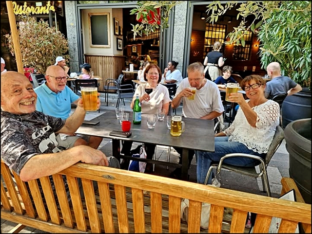

Wie geht es uns bei der Hitze??\
Gut!!\
Wir machen Sommerpause in der Zucht und sind nur ganz selten am Compi. Darum bitte Geduld wenn ich keine Emails im Moment beantworte.\
In der Hitze, bei uns 35-38° machen wir unsere Wohnung dicht und kühlen die Räume runter. Von 11:00 bis in den Nachmittagstunden sind wir an unseren Seen, 10 Min. Autofahrt

11:00 Auto wird gepackt

Und wir verweilen an unserem herrlichen See den ganzen Tag

So schön hier

Schattige Plätze haben wir genug

Im Schatten den Tag verteiben und schwimmen

Oder im Minipool bei Freunden mit anschl. grillen.

Wir haben für heiße Tage Vorsorge getroffen und diverse Kühlgeräte

Unser Kühlgerät mit Kaltgebläse

Mein Tischvenilator. Den habe ich überall dabei

Große Deckenventilatoren

In Kürze holen wir noch 2 neue Dyson Raumkühler

Und Abends treffen wir uns mit Freunden un Familie zum Essen und zum Plaudern.\
Und es ist immer lustig.

**Nein wir meckern nicht übers Wetter, wir genießen den Sommer!!**

[Und wie geht es unseren Tieren hier klick auf Teil 2](/neuigkeiten/abgabe4/)
