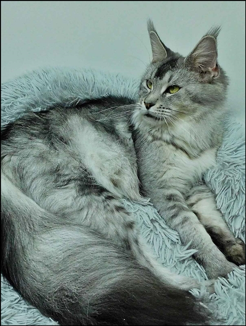
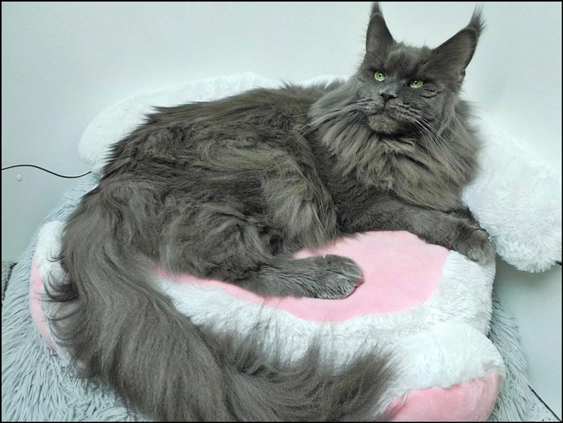
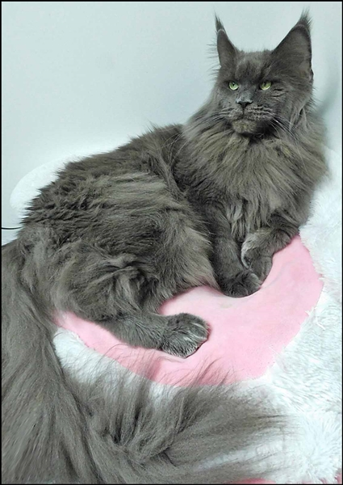
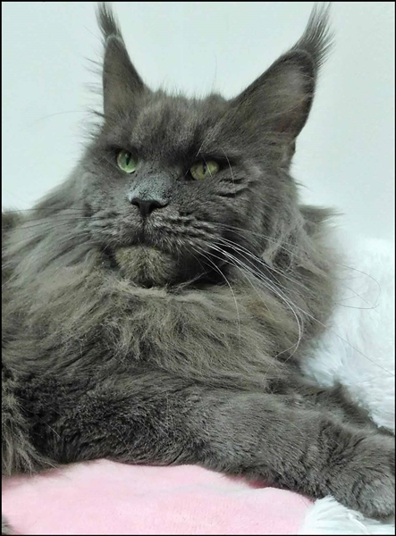
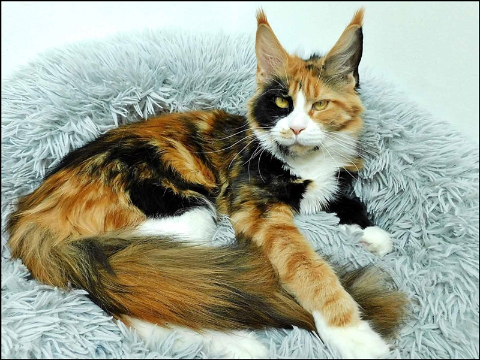
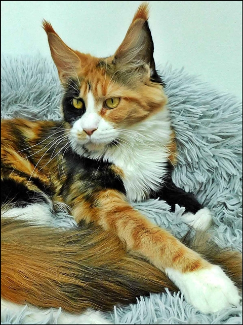
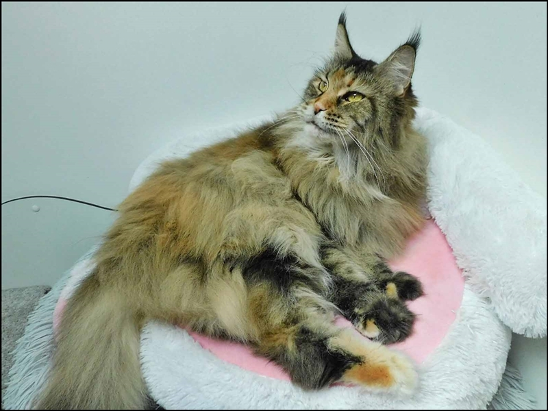
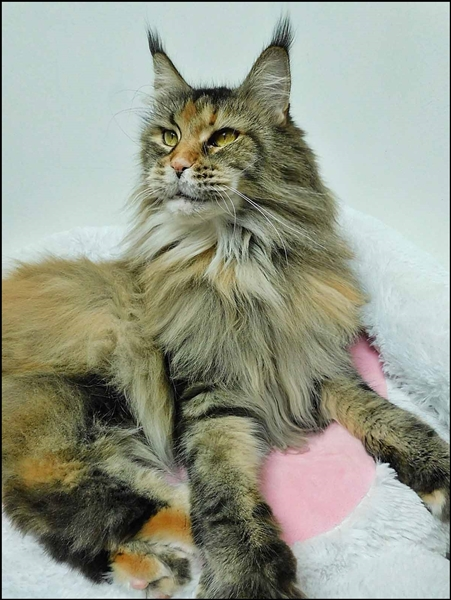
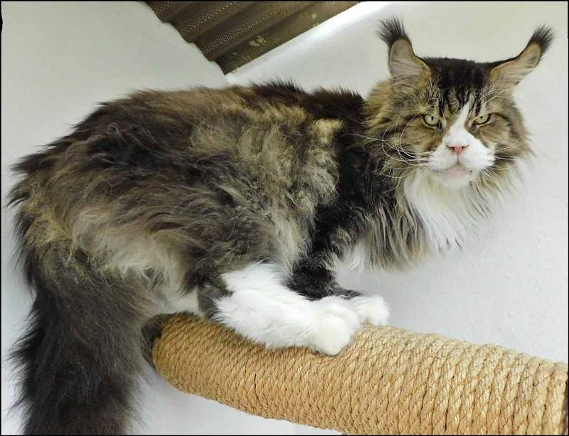
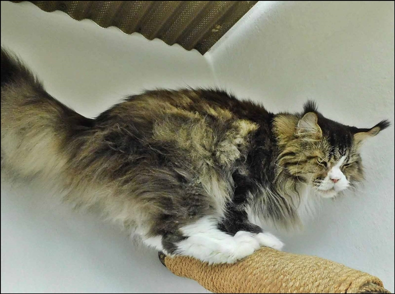

**Unsere Katzenfamilie in der Übersicht**

Unser Silberluchs-Mädchen \*Tamalika\* Sie wird im kommenden Winter wieder Babys haben

Unser blaues Mädchen \*Chinook\* im absoluten Wildlook. Sie wird im Winter wieder Babys haben

Unsere überaus temperamentvolle Springmaus \*SuPerla\* Sie wird Anfang 2026 wieder Babys haben

Unser buntes Feuerwerk \*Be Love\* Einen wunderschönen Kater haben wir für sie ausgesucht Ende 2025 wird sie auf Hochzeitsreise gehen

DER Vererber ist hier verantwortlich das seine Mädchengruppe stimmt. Der absolute Chef im Hause "Starbushway" 7 Jahre alt. \*Ouzo for me\*, seine Kitten sind allesamt kleine Juwelen und sind vom Phänotyp sowie vom Genotyp sowie im Charakter\
E I N Z I GA R T I G!!

\*Unsere Kastratin\* Quilana\* eine Diva der Extraklasse. Man kann sagen, sie liebt **sich** sehr! Sie geht nun ins 10.te Jahr! Ja und sie hat hier alle Privilegien einer Königin. Und! sie wird verwöhnt

\*Quat Zack\* unser Kastrat, der bei uns geblieben ist......das Herz unserer Zucht, geht nun ins 12. Jahr. Ja so langsam wird er ein Senior, alles wird langsamer und er liebt seine Gemütlichkeit, die Fernsehabende und Schmusestunden mit uns sind ihm sehr wichtig. Das Futter schmeckt und die Gesundheit kann nicht besser sein! 7 Jahre war er hier Deckkater. Viele Kinder, Enkel, Urenkel, Urur..... usw. tragen seine Gene. Wir hoffen er bleibt noch lange!

