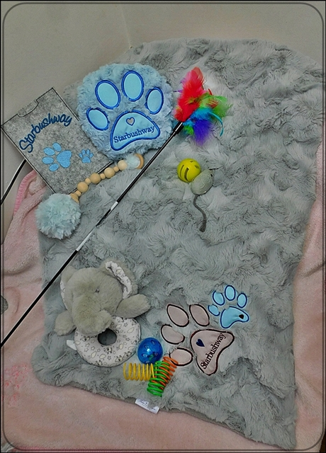
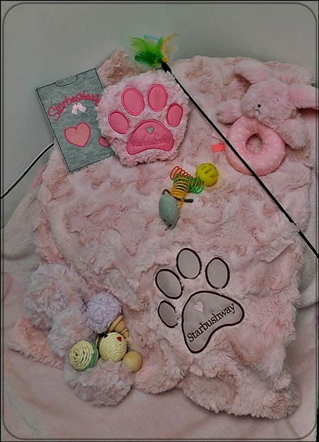
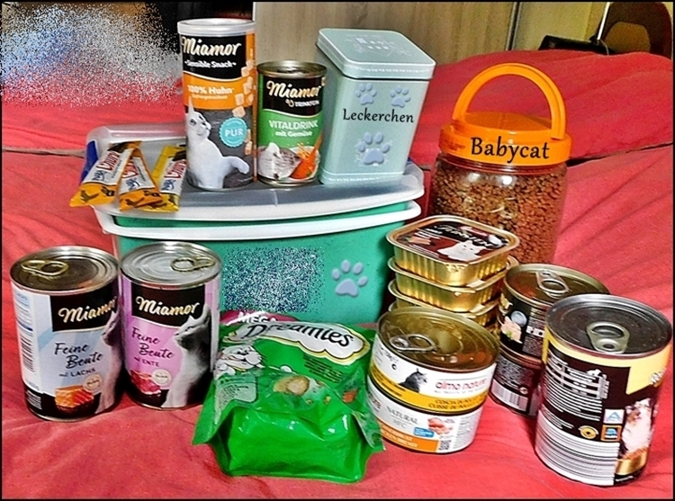

Es dauert zwar noch ein bißchen, aber demnächst werden wieder zwei unserer Mädels auf Hochzeitsreise gehen. Dann gibt es im Herbst Kitten.

Jechaburger Weides Tamalika\
**black** **silver ticked tabby**

Legendarys Chinook Blue\
**blue smoke**

Wir haben unsere Starterpäckchen und Präsente noch ein bißchen aufgewertet und zeigen euch hier eine fantastische genähte und gestickte Handarbeit. Unsere Präsente und Starterpäckchen gehen mit jedem Kitten aus dem Haus und bestehen aus:

1 sehr hochwertige Kuscheldecke mit aufwendiger Stickerei fürs Sofaplätzchen\
1 dazu passende weiche Kuschelminzpfote\
1 selbsthergestelltes weiches Klingelbällchen\
1 gestickte Impfpasshülle aus hochwertigem Filz\
Diverses niedliches Spielzeug mit Geräusche\
1 Spielangel

Für die Kater in blau für die Katzen in rosa

Reichlich Futter und Leckereien für die ersten Tage im neuen Zuhause. Alles was sie hier gewöhnt sind, sortiert in einer schönen Box oder Tasche, jenachdem was bei mir verfügbar ist.

Wir stellen unsere Präsente und Starterpäckchen auf eigene Koste liebevoll zusammen und nehmen nicht die Umsonstpäckchen von Firmen!!
