Ja wie schon geschrieben

1 Jahr ohne Hund und ich schaute sehnsüchtig jedem Hundehalter mit seinem Hund hinterher. Mir fehlten die Spaziergänge und die Gassigänge mit unseren Hunden, die Wohnung war trotz Katzen irgendwie leer und ruhig.

Dann sprach mein Mann Toni aus was wir beide dachten. Ein Hund muß wieder her und er sagte:

"Es wird auf jeden Fall wieder ein Irish Terrier sein und diesmal aus einer Spitzenzucht, aus der Zucht der Frau Peters, Zwinger\
aus dem Imperium". Ich nahm Kontakt auf zu der Züchterin in Meerbusch.

Ein Wort zu Frau Peters. Eine verantwortungsbewußte Züchterin mit enormer Zuchterfahrung der Irish Terrier. Seit 35 Jahren züchtet sie in ganz kleinem Rahmen mit einem Rüden und 2 Hündinnen. Traumhaft schöne, bestens geprägte vom Charakter einzigartige und vor allen Dingen gesunde Welpen verlassen ihre Zucht. Noch heute, nach 14 Jahren geht Monti 4 mal im Jahr dorthin zum Trimmen und zur Rundumpflege und er freut sich jedesmal, jault und fiept schon im Auto wenn wir in die Straße einbiegen. Dafür fahren wir immer 35 km nach Meerbusch.

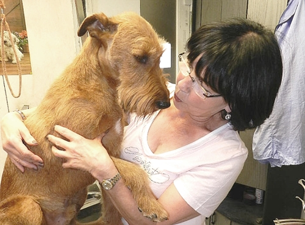
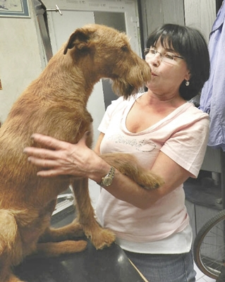

Es war sehr schwierig aus dieser Zucht einen Welpen zu bekommen. Frau Peters war nicht gerade soooo sehr interessiert über eine Anfrage und hielt uns ziemlich am langen Arm. Sie hatte schon einige Vorreservierungen und konnte uns nicht sagen ob aus dem nächsten Wurf ein Rüdenwelpe für uns dabei wäre. Erstmal mußte die Hündin zu einem Rüden zum Decken woraus sie sich selber eine Hündin ziehen wollte.

So dann....erstmal warten auf die Hitze der Hündin, ob die Deckung geklappt hat und ob sie denn auch aufgenommen hatte. Wir durften nicht nerven, das machte sie uns deutlich.

Am 10. Juni 2007 ein Anruf von Frau Peters, die Welpen waren am 31.Mai geboren. 7 Stck. 3 Hündinnen und 4 Rüden und wir könnten einen davon haben, welchen bestimmte sie. Sie sagte, sie sucht uns den richtigen aus.... Punkt!

Erste Fotos von Venus und ihren Welpen

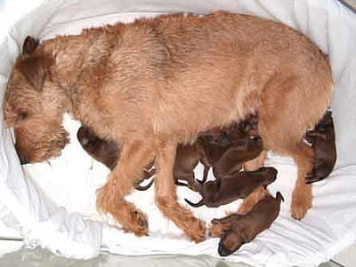
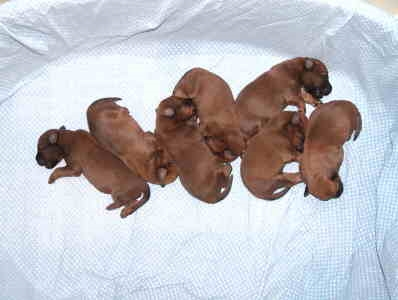

Erster Besuch und wir durften die Welpen anschauen und ich zolle meinen Respekt der Aufzucht von Hundewelpen. Unglaublich arbeitsaufwendig und nervenaufreibend.

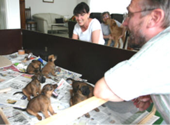
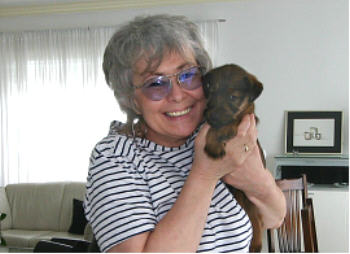

Mit 11 Wochen durften wir unseren Welpen abholen. Mit stolzgeschwellter Brust und Tränen der Freude in den Augen trug ich meinen dicken, lieben, ruhigen und wunderschönen Hund ins Auto und ab mit ihm in sein neues Zuhause.

Gerade angekommen\
"Montecore aus dem Imperium"\
Rufname: "Monti"

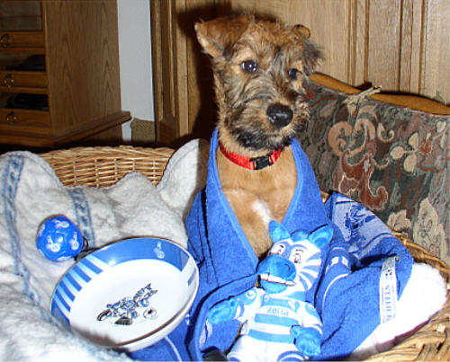

Erste Mahlzeit wie von der Züchterin vorgegeben. Trockenfutter mit Wasser und Joghurt. Später haben wir umgestellt auf hochwertiges Dosenfutter.

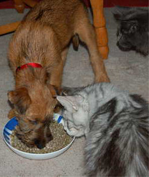

Erstes Schläfchen mit seinem Lieblingstier

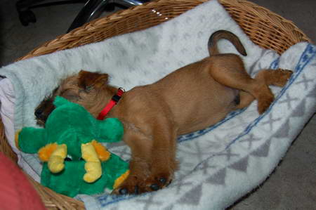

Gerade angekommen

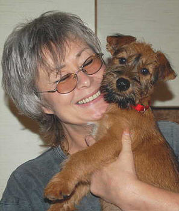
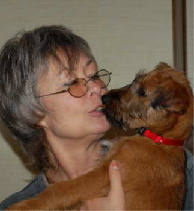
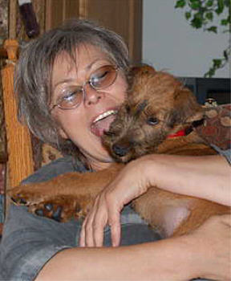

Die Welpenzeit war anstrengend, manchmal war ich am Ende meiner Nerven, aber das weiß jeder, der schon mal einen Welpen in die Familie und ins Alltagsleben in derWohnung einfügen und stubenrein erziehen mußte, bei Laune halten mußte und dazu noch kontinuierlich mindestens 6 mal am Tag Gassigehen. Bei uns aus der 3. Etage Welpe rauf und runtertragen. Aber das kannte ich und wußte ich von meinen vorigen Welpen.

Da kriegt man nichts mehr geschafft bei der Hausarbeit......

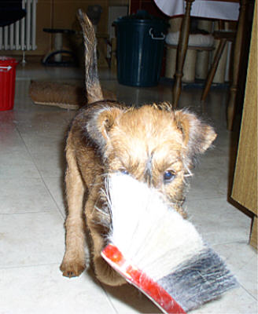
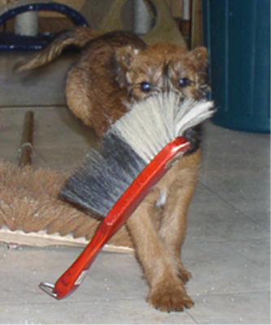
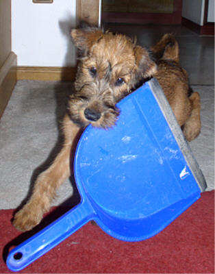
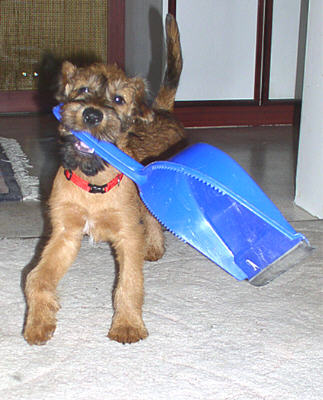

.......und er hatte solche Freude zu helfen

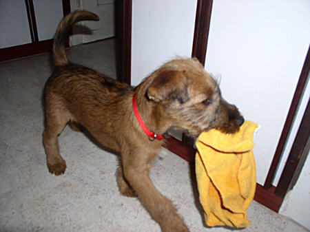

Ich habs zerbissen und dahinten in\
der Ecke hab ich Pipi gemacht

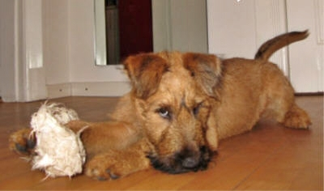

Monti war schon supergeprägt von der Züchterin und paßte sich sehr schnell unseren Lebenumständen an, mit Katzen kein Problem, er lernte sehr gut mit ihnen umzugehen.

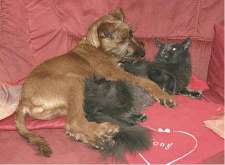
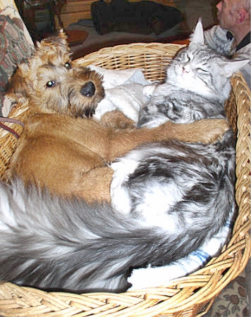

Ich legte mein ganzes Wissen und Können in die Erziehung und Weiterprägung. Monti hatte zwar alle Freiheit, aber er mußte immer ein Blick auf Frauchen haben, eigene Wege gehen, Nein, das gab es nicht!! Sofort Hierhin! Das ist Erziehung mit unsichtbarer Leine.

Mit Geduld und ohne Druck, Konsequenz und viel Spiel und Freude habe ich den besten Hund ever erzogen. Und darauf bin ich stolz, denn Irish Terrier sind seeeehr speziell und nicht für Jederman geeignet, man braucht viel Ruhe und Geduld ihm beizubringen, das Häschen und Rehe tabu sind ebenso wie andere Leute, Kinder, Fahrradfahrer und Jogger.

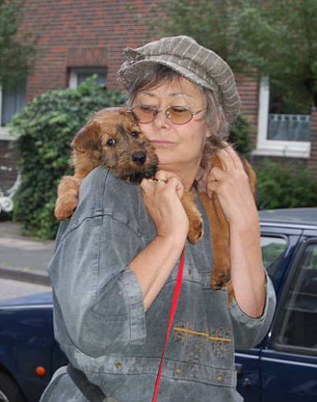
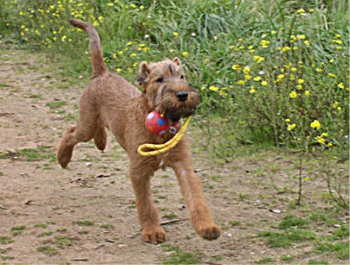

Er wuchs gut. Und nach einem Jahr hatten wir einen Hund wie er besser für uns nicht passen konnte.

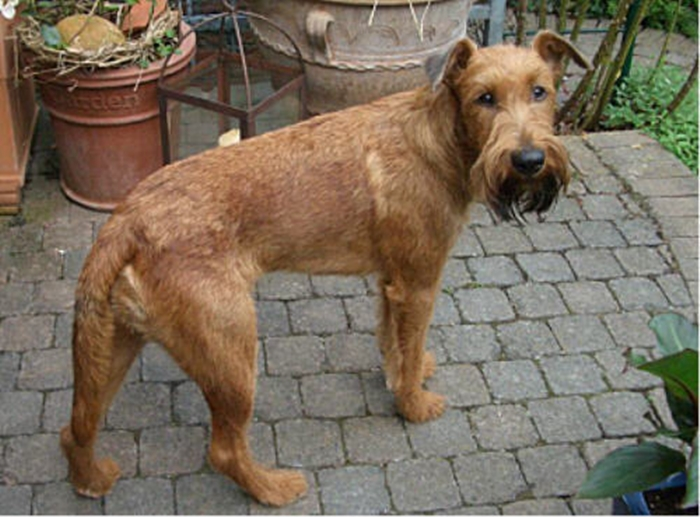
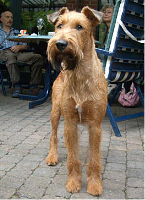

Und dann rief ich mal so in den Raum:\
**"Jetzt will ich auch wieder einen kleinen Hund dazu!!!!!"**

"Jooooo"........so mein Mann, "Holst du dir wieder einen kleinen Pudel dazu".

"Nein....ein Chihuahua will ich haben". Mein Mann wurde grün im Gesicht und O-Ton: "Also....kleiner Hund ist voll o.k. ........aaaaber keinen Chihuahua".

Es war nun an der Zeit Überzeugungsarbeit zu leisten und ich wäre nicht **\>Frau\<** wenn das nicht klappte. Wir besuchten eine damalige Freundin, die Chuahuas züchtete und drückten Toni gleich zwei solcher kleinen Scheisser in den Arm.

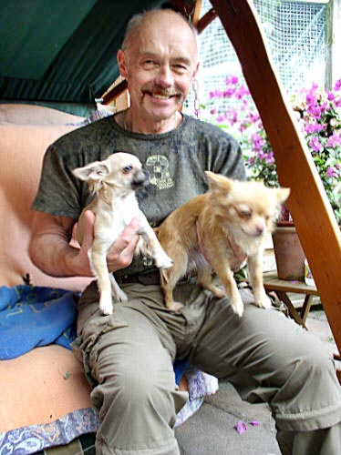

Es ging ruckizucki und er mochte sie dann doch und meinte:\
"Naja....wenn erstmal einer bei uns einzieht werde ich ihn auch liebhaben." Es wäre nicht Toni mit dem weichen Herz für Tiere, wenn es anders gelaufen wäre.\
So ging ich auf die Suche nach einem guten Züchter

[Klick hier, es geht weiter \>\>\>\>\>\>\>](/neuigkeiten/geschichten/)
