Zeitlebens, schon als kleines Kind, hatte ich mir immer einen Hund gewünscht. Zuhause bei meinen Eltern gab es nur eine Katze. Für einen Hund hatte keiner Zeit.\
Als ich erwachsen war arbeitete ich immer in Vollzeit, somit war ich 9 Stunden außer Haus. Mit 38 Jahren hörte ich auf zu arbeiten und so zog 1988 unser erster Hund ein. Der 9 Wochen alte Pudelmischling. Rico war ein kleiner Einstein, der keine Mühe in der Erziehung machte. Ein unglaublich putziger temperamentvoller Charmbolzen der aufs Wort hörte und zwar aufs Allererste!!

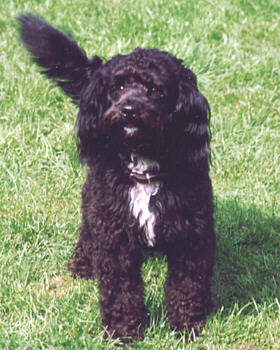
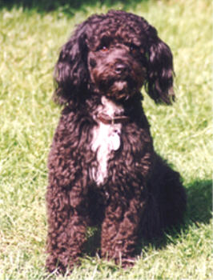

Rico 1991

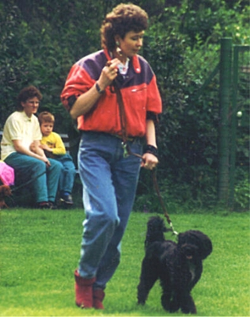

Leider durften wir mit Rico nur 3 sehr schöne Jahre haben. Er wurde von einem Rottweiler gejagd, lief in Panik davon und trotz intensiver Suche blieb er verschollen (für immer!)

Diese Anzeige ging\
durch alle Zeitungen

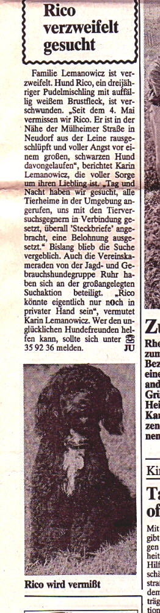

3 Monate später erfüllten wir uns unseren Traum mit einem Irish Terrier. Unser Gedanke war **der**.....wenn Rico wieder kommt, haben wir eben 2 Hunde. Obwohl wir diesen Irish Terrier bei einem Züchter gekauft hatten, er Papiere hatte und auch einen stolzen Preis hatte, war er im Nachhinein nicht sehr rassetypisch. Er war viel zu lockig für einen Irish und seine Kippohren die ein Irish haben sollte, hingen als Schlappohren zu weit seitlich. So also zog 1993 mit 14 Wch. unser Irish Terrier Sandino bei uns ein. Vom Wesen, obwohl ein bißchen stur, war er ein Traumhund und sehr lieb zu allen unseren Katzen. Und wir liebten ihn auch wenn er nicht perfekt im Aussehen war. Egal!!

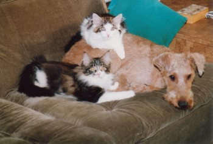
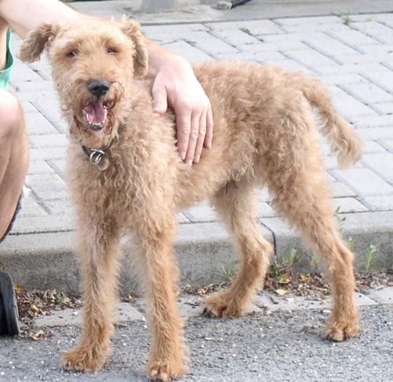
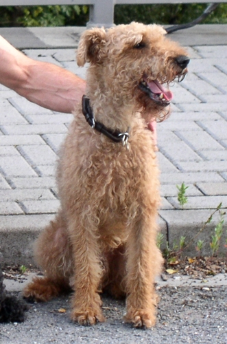

Ein Jahr später nahmen wir den Kleinpudel Landow bei uns auf, der von seinen Vorbesitzern einfach rausgeschmissen wurde, weil keiner mehr mit ihm zurecht kam. Wir merkten sehr schnell Warum!

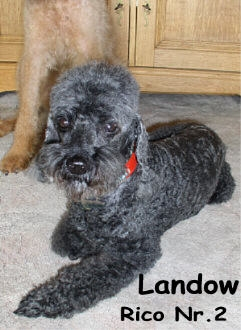

Er rammelte alles an. Menschen, Katzen, Decken und er biß nach uns.....und mit beißen meine ich richtig blutiges zubeißen mit ungeheuerem Agressionsverhalten. Wenn wir es wagten ihn auch nur minimal zu reglementieren oder zu Ermahnen fletschte er sofort die Zähne. Er biß mir sogar sehr heftig ins Gesicht.\
**Aber nicht mit mir!!**\
Mit ruhiger Dominanz machte ich ihm klar, das er hier nicht Chef ist und geduldig und konsequent zeigte ich ihm wo hier sein Platz im Leben bei uns war, nämlich ganz unten. Ich zeigte ihm, das ich sowas hier nicht duldete.

Auf diesem Foto ist er **nicht** mehr agressiv und hat auch nicht mehr gebissen. Das auf dem Foto war nur noch eine spielerische Scheinagression, die wir immer mal wieder gespielt haben, mit absoluter Beißhemmung. Er hat nie wieder zugebissen.

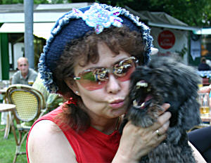

Dann wurde Landow, den wir **\>Rico\<** nannten, kastriert und nach intensivem\
Trainig hatte wir einen lammfrommen Pudel und ein super Hundeteam.

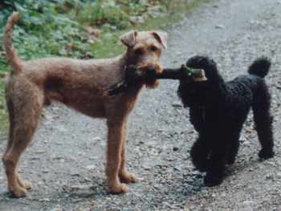

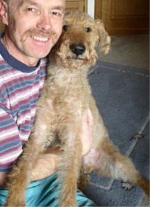
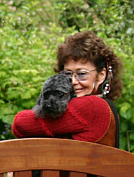

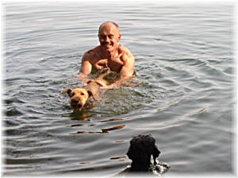
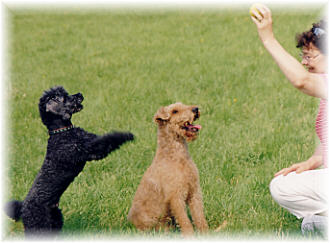

**Schöne Jahre waren es mit diesen beiden Hunden.**

Mit 9 Jahren wurde Sandino schwer Herzkrank, aber wir konnten ihn gut auf Tabletten einstellen, dank Dr. Kresken. Er konnte weiter damit leben, wenn auch ein bißchen eingeschränkt.

Mit 12 Jahren wurde er wieder sehr schwer krank. Ein Lebertumor. Die sehr teuere OP hätten wir ihm und uns ersparen können (das meine ich jetzt nicht im finanziellen Sinne), denn drei Wochen später mußten wir ihn gehen lassen.

Bevor meine tierärztin kam um ihn zu erlösen, habe ich eine Stunde mit meinem Hund im Arm auf dem Bett gelegen, er war zu schwach überhaupt noch zu laufen und ich habe ihm Danke gesagt und ihm gesagt, das ich ihn jetzt gehen lassen muß und wir uns wiedersehen. Er war nur noch Haut und Knochen.

Pudel Rico, der sehr an Sandino hing, war zu der Zeit 14 Jahre alt und er ist irgendwie mitgestorben. Er hat nie gezeigt das er seinen Kumpel vermißt hat, er hat ihn nie gesucht. Er hat sich einfach in sich zurückgezogen und hatte keine Freude mehr am Leben. Dieser aufgedrehte immer gutgelaunte Pudel war nur noch still. Ein Jahr lebte er noch, bekam dann einen Schlaganfall, erholte sich nochmal und wir mußten ihn dann doch gehen lassen, denn der stubenreine Hund pinkelte und kotete in die Wohnung trotz Gassigänge. Er zeigte uns das er unglücklich war und nicht mehr leben wollte. Dann kam der zweite Schlaganfall und es war aus.\
Wir waren uns einig. Kein Hund mehr!!! Es tut alles viel zu weh.

**Ein ganzes Jahr hielten wir es ohne Hund aus.**

[Hier geht es weiter\>\>\>\>\>](/neuigkeiten/geschichte/)
