Wir waren uns nun einig das ein kleiner Chihuahua unser nächster Zweithund werden sollte.

Toni unterstützte meine Suche nach einem guten Züchter, fuhr mich in der Gegend umher um Züchter zu besuchen und endlich fanden wir unseren kleinen Chihuahua bei einem Züchter in Holland. Die Eltern waren keine Kläffer, ruhige, keine überdrehten Chis, gut in der Familie sozialisiert, menschenfreundlich und sehr angenehm. Was ich in einigen Zuchten anders erlebt habe. Es war eine kleine Minizucht mit nur einer Hündin bei der Familie Hooger in Holland in Lomm. In dem Wurf waren nur 2 Rüden, den dicken suchte sich Toni für uns aus. Es wurde unser Paco, richtig heißt er \>Clinton van Hooger\<. Wir konnten ihn sofort mitnehmen, er war 13 Wch alt. Das war im Juni 2008

Hier sind wir gerade zu Hause angekommen. Ich war komplett geschafft, den ganzen Tag unterwegs. Mir ging es nicht so gut.

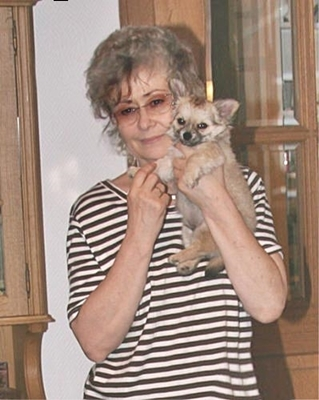

Paco 13 Wch. alt

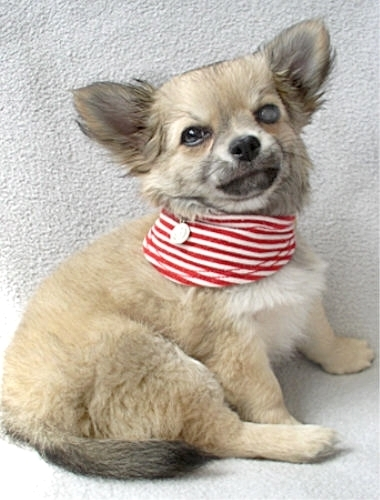

Erste Zusammenführung

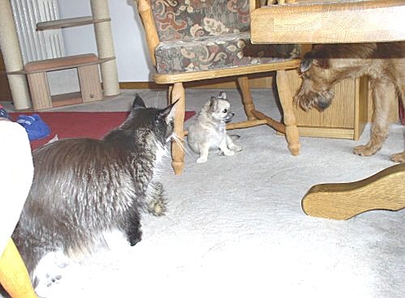

Mit Monti war er sofort ganz dick Freund.

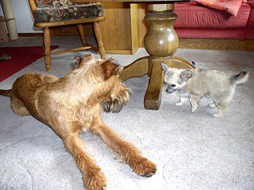

An meinem Bett bekam er seinen Platz. Bis\
er stubenrein war, erstmal eingegrenzt.

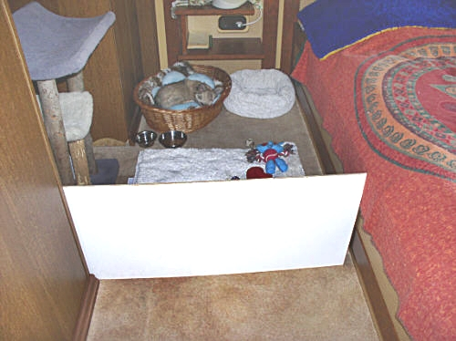

Alles klappte sofort. Mit Monti und Katzen, kein Problem.

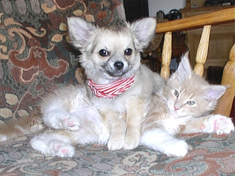

Paco orientierte sich an den gehorsamen Monti und kannte die ganze Welpenzeit kaum eine Leine. Rief ich Monti ab, kam auch er. Spaziergänge waren entspannt, er blieb nur in der Nähe von Monti und Monti geht nie weiter wie max. 3 Meter von mir weg.

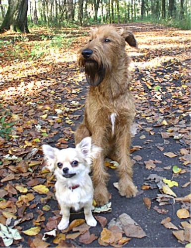

Wenn Monti Platz machte, machte Paco es auch

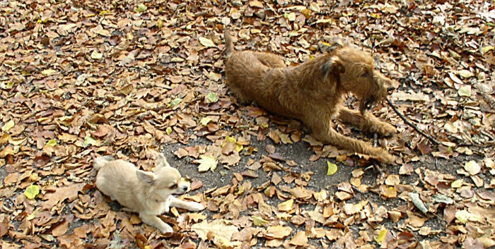
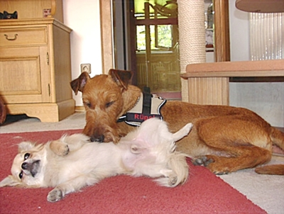

Ein Jahr verging. Beide Hunde verstanden sich gut.

Bei meiner damaligen Freundin wurde dann ein kleines Chihuahua-Mädchen geboren und in mir reifte der Wunsch für eine kleine Zucht und wieder ein Jahr später zog die kleine Chiqua bei uns ein. Das war im Frühjahr 2010

Chiqua 8 Wch alt (400g), hier mit Patenfrauchen Iris

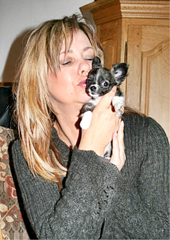

Chiqua wurde sofort gut aufgenommen und machte keine Probleme

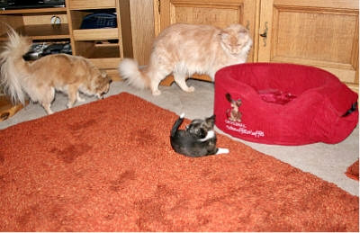
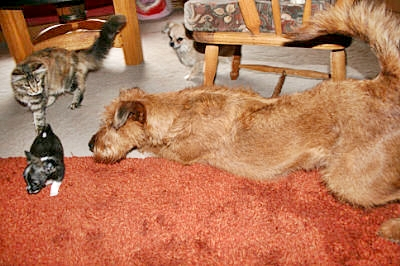

Hier wieder an meinem Bett bis sie stubenrein war.

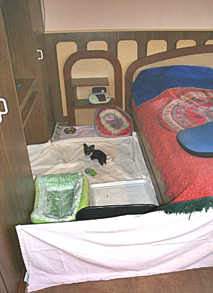

Und die Welpenzeit ging wieder los. Sehr viel Spaß und Freude, aber auch war es wieder anstrengend. Ich hatte wieder groooße Hilfe bei meiner Hausarbeit. Hier noch Fotos die ich damals gemacht hatte

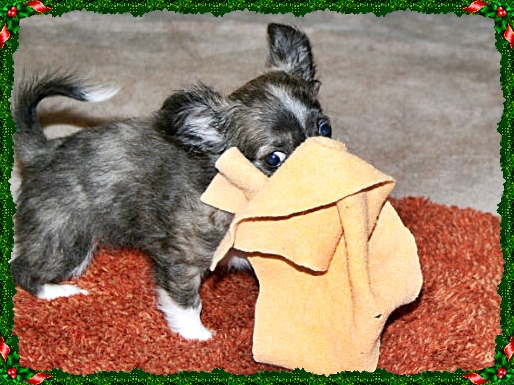
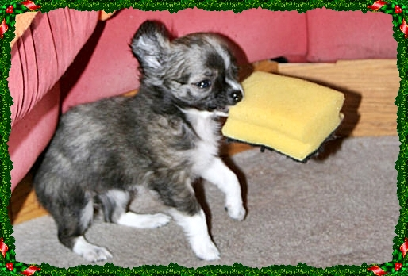

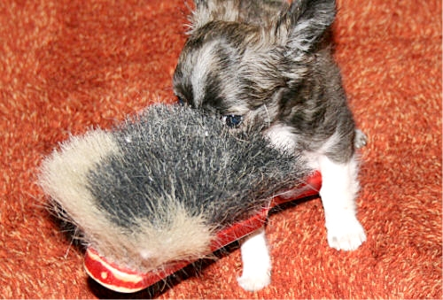
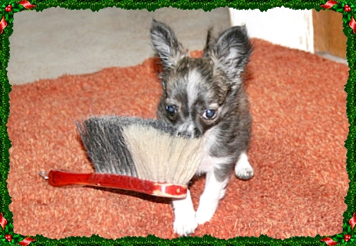

Sie klaute ALLES und ich war nur hinterher. Was auch runterfiel oder ungesichert lag oder stand....alles ihrs!

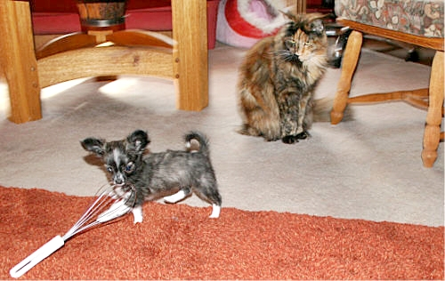

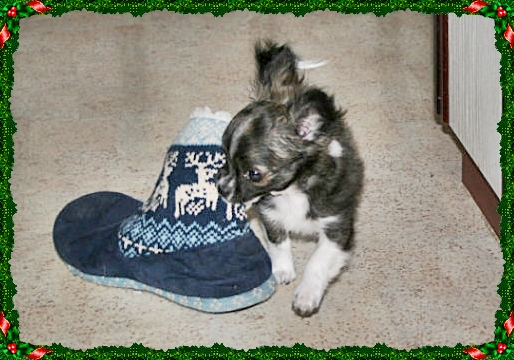
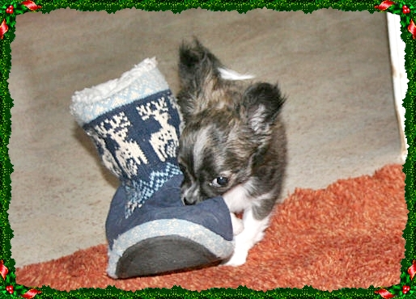

Paco übernahm die Rolle des großen Bruders und paßte auf klein Chiqua auf, überwachte draußen jeden ihrer Schritte. Kam ein Hund, stellte er sich davor und dann kam auch Monti, es war schön anzusehen wie die drei zu einem Rudel wurden.

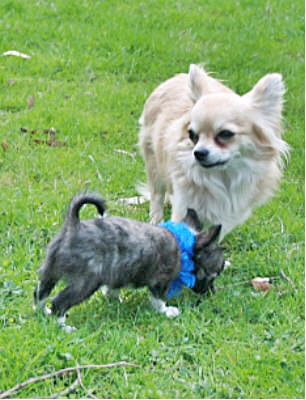
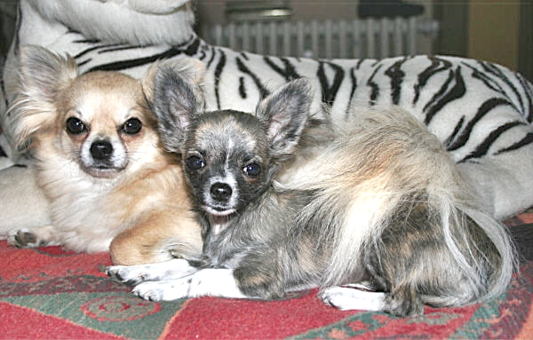

Wurde Chiqua den Katzen zu stürmisch und nervig legten sie einfach die Pfote drauf oder es gab einen ordentlichen Watschen mit großem Gejaule von Chiqua. Viel Gekreische um Nichts....typisch Mädchen. Eine kleine Diva.

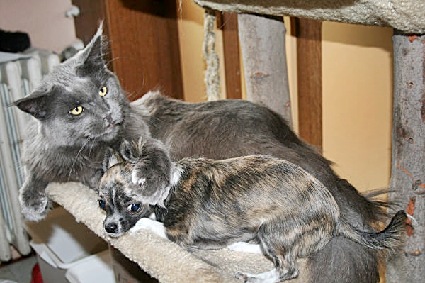

Ich war glücklich und plante meine kleine Chihuahua-Zucht. Zusammen wollten wir was aufbauen, vielleicht würde ja eine kleine Zuchtgemeinschaft klappen. Ich war voller Pläne.

v.l. Romy, Heike, Karin

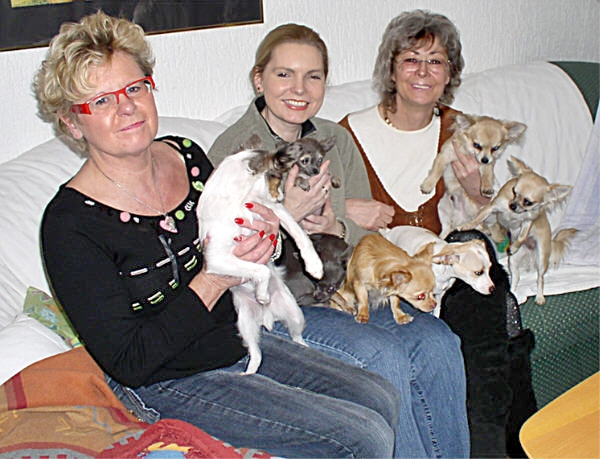

Die Ernüchterung kam. Paco hatte nur einen Hoden und Chiqua war für eine Zuchthündin zu klein, sie wog nur 1,6Kg. Im Verein war die Mindestgrenze 2,0 Kg, möglichst mehr.

Joooo....das wars.

Nein ich war nicht traurig. Beide Minis wurden kastriert und wir hatten ein superschönes gut erzogenes Hunderudel. Wir hatten jeden Tag Spaß und Freude.

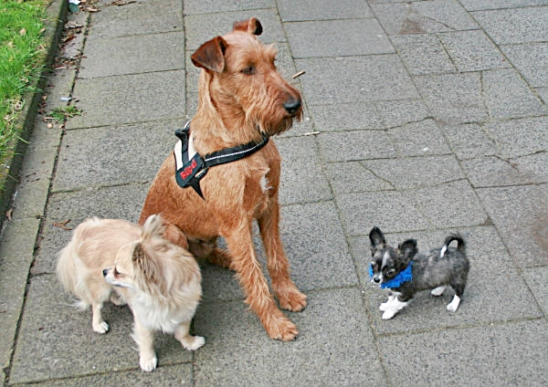

Es sollte nicht bei den 3 Hunden bleiben. Wir erlösten ein Chihuahua-Mädchen aus ihrem Leid von den Menschen die sie sehr schlecht behandelten. Das hatten wir nicht geplant. Es hat sich so ergeben, wir konnten die Kleine nicht ihrem Schicksal überlassen, obwohl unsere Kapazität für Hunde schon überschritten war. Wir nahmen sie erst zu Vermittlung auf, merkten aber schnell das sie nicht vermittelbar war. Die Geschichte wie sie sich in unser Herz schlich kommt in Kürze. Leider durfte sie nur 2 Jahre bei uns bleiben. Wahrscheinlich ihre glücklichsten Jahre!

Somit kam Sara in unser Leben. Meine große Liebe!!

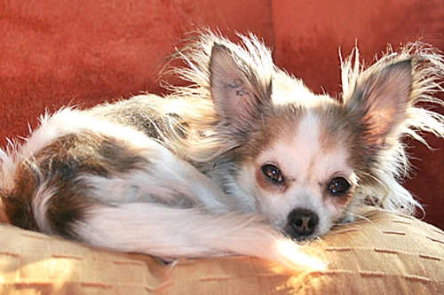

[Die unsagbar traurige Geschichte mit gutem Ausgang geht hier weiter](/neuigkeiten/geschichten1/)\
**Taschentuch bereithalten!!**
