Das ist die Geschichte meiner Sara.\
Die meisten kennen ihre Geschichte, aber einige vielleicht noch nicht

Ich liebe alle meine Hunde, aber dieses Hündchen habe ich geliebt wie ein liebstes Kind und es treibt mir heute noch die Tränen in die Augen wenn ich ihre Bilder sehe. Sie war zu kurze Zeit bei uns und das kann ich kaum ertragen das sie nicht die schöne Zeit hier weiter genießen konnte. Ich hätte noch sehr viel mehr gut gemacht von dem was ihr angetan wurde. Zuerst nahmen wir sie bei uns auf um ihr ein schönes Zuhause zu suchen. Den folgenden Bericht habe damals 2010 geschrieben:

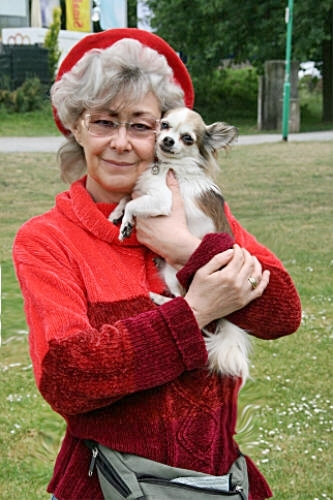

21\. Juli 2010\
Wir suchen für Sara ein schönes Zuhause\
Sara hat ein trauriges Vorleben. 5 Jahre lebte sie bei einem Massenzüchter in einer Zwingeranlage. Sie kannte keinen menschlichen Kontakt, keine streichelnde Hand, keine lieben lobenden Worte. Nur Welpen kriegen war ihre Arbeit, in einem kleinen Käfig. Dort holten wir sie raus und da der alte Dackel meiner Schwiegermutter gestorben war, zog Sara bei ihr ein.\
Nun hatte sie ein schönes Zuhause mit einem ganz eigenen Frauchen, so dachten wir.

Wie sich jetzt rausstellte war es für Sara nicht ideal, und diese 8 Monate bei meiner Schwiegermutter taten ihr überhaupt nicht gut, es muß für sie die psychische Hölle gewesen sein. Schwiegermutter hatte kein Händchen für das verstörte verängstigte Tierchen. Sara wurde noch verstörter und noch unsicherer, außerdem liess die Krankheit meiner Schwiegermutter eine Versorgung von Sara nicht mehr richtig zu, sie konnte mit dem Hund nicht mehr Gassi gehen. Sara machte nur noch in die Wohnung, bellte hysterisch bei jedem kleinen Anlass und frass schlecht bis garnicht.\
Es kam der Hilferuf meiner Schwägerin um 23 Uhr Abends das der Hund dort raus muß, da Sara nur noch geschimpft und angeschrien wurde. Sie war so verängstigt das sie, wenn sie in die Wohnung gekotet hatte, ihren eigenen Kot auffraß. Am nächsten Tag fuhren wir nach Wuppertal und holten Sara zu uns. Ihr flehender Blick war mitleidserregend.

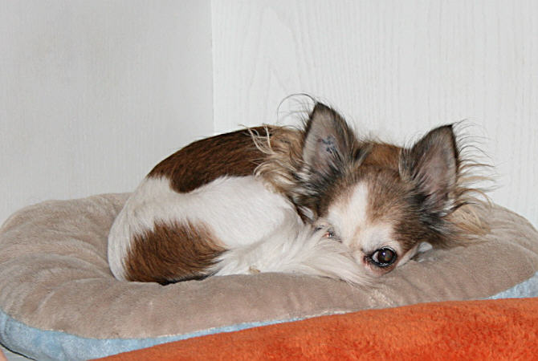

Sara ist einfach nur lieb, kommt mit unseren Hunden und Katzen gut aus, aber sie ist psychisch total kaputt und hat auch einige Macken. Wenn man in ihre flehenden, leeren Augen schaut (sie sucht immer den Blick und schaut direkt in die Augen) und man ein bisschen Hundeverstand hat, sieht man das ihre Seele gebrochen ist. Dieser Hund ist eine einzige Verunsicherung. Sara ist eine liebe Hündin, aber sehr scheu und schreckhaft. Sie weiß einfach nicht wie sie sich richtig verhalten soll.

Sara hat einen verkrüppelten Oberkiefer und einen extremen Vorbiss, was man optisch aber nicht sieht von aussen. Sie kriegt hier bei uns eine Zahnsanierung und wird in Kürze kastriert. Wir haben sie aktuell durchgeimpft, sowie durchgecheckt mit grossem Blutbild. Sie hat leichte Lungengeräusche was von einer verschleppten Bronchitis kommt, aber nicht von Bedeutung ist und sie nicht behindert. Nachts schnarcht sie.

Sie hat so gut wie keine Muskulatur und kann noch nicht mal auf einen Sessel oder auf das Bett springen.Wir werden ihre Muskeln langsam aufbauen, durch immer längere Spaziergänge. Sara ist eine liebe sehr sehr schöne Hündin, frei von jeder Agression!! Sie ergibt sich jedesmal neu in ihr Schicksal.

**Wir suchen für sie ein Zuhause mit Geduld und Hundeverstand. Sie soll zu Leuten, die die Hundesprache verstehen und auch dem Hund Sicherheit geben können und Sara ein bißchen therapieren können und nichts von ihr erwarten, sondern langsam mit ihr erlernen.**

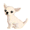

Und das ist Zukunft\
26\. August 2010. Sechs Wochen später.\
Und so hat sie sich verändert. Sara lebt nun bei uns und wir geben sie auch nicht mehr ab!

Wer uns kennt weiss, das, wenn wir uns entscheiden, es auch mit allen Konsequenzen machen. Da scheuen wir keine Kosten und schon gar keine Mühen. Bequem war diese Entscheidung sicher nicht.

Bei uns hat Sara nun ihr endgültiges Zuhause. Unser regelmässiger Tagesablauf hier und unsere anderen Hunde haben ihr so gut getan und Sicherheit gegeben und sie hat sich innerhalb von 6 Wochen nach und nach (jeden Tag ein bisschen) zum Positiven verändert.

Anfänglich war diese kleine Hündin eine einzige Verunsicherung und es brauchte Geduld. Die Zeit war alles andere als bequem und kostete uns ganz schön Nerven. Sie war nicht stubenrein, machte dort hin wo sie wollte und fraß ihren eigenen Kot. Um ihr den Stress ein bisschen zu nehmen und um unsere Wohnung sauberzuhalten, bekam sie ein Schutzhöschen mit saugfähiger Einlage an. Später kauften wir kleine Windelhöschen, die sie auch ohne Probleme annahm und sie sich an und ausziehen ließ. Diese Höschen war 4-5 mal am Tag nass, obwohl ich 4 mal am Tag mit ihr rausgegangen bin und sie auch draussen ihr Pfützchen und Häufchen gemacht hatte. Blasen und Nieren wurden untersucht, alles war gesund.

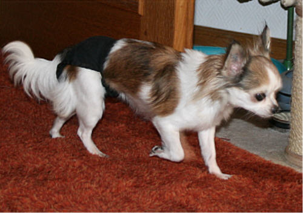

Eine Hundetherapeutin sagte: "Bei Sara weint die Blase! Da heisst es Geduld, die Zeit wird es bringen und es wird sich geben wenn sie Sicherheit hat. Man kann es vergleichen mit Kinder die Bettnässer sind."

Und genau so war es auch

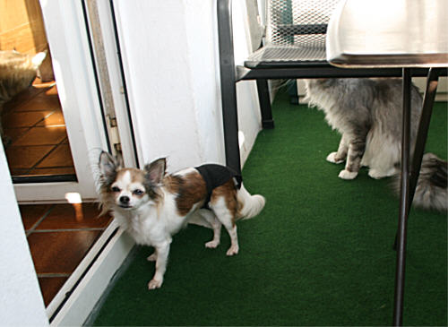

Die Windelhöschen waren nach 4 Wochen immer seltener nass, nun hatte sie sich an unseren "4 mal am Tag Gassigang" gewöhnt und sie konnte immer öfter ohne Höschen bei uns leben.

Wir wußten nicht was sie erlebt hatte. Anfänglich hatte sie grosse Angst vor Toni und zitterte wenn er nach Hause kam und er konnte sie auch nicht locken. Mittlerweile begrüsste sie ihn fiepend in unserem kleinen Rudel mit wedelndem Schwänzchen.

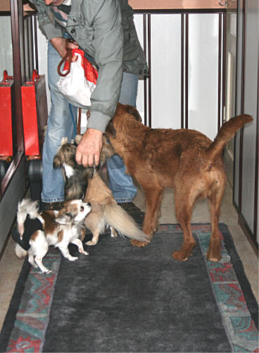

Sie war sehr bellfreudig und wenn es schellte wurde hysterisch gekläfft, kam der Besuch rein verkroch sie sich in die hinterste Ecke der Wohnung, mittlerweile bellt sie überhaupt nicht mehr und springt Besuchern auf den Schoss und begrüßt sie freudig und zwar ohne Gekläffe!.

Sara hatte einen Termin zur Kastration. Bei der OP kam herraus das sie schon 2 Kaiserschnitte hatte mit sehr stümperhaften Operationen, die Gebärmutter war verstümmelt mit Verwachsungen und Vernarbungen und war katastrophal zusammengenäht, einfach nur zusammengeschnürt, das sich ein Blutstau gebildet hatte, was ihr auch Schmerzen bereitet haben muss. So musste unser Tierarzt eine Totaloperation machen. Sie hatte eine 8 cm lange Narbe (bei diesem kleinen Körper!) und es ging ihr nicht gut. Sie hat sich sehr schwer getan sich zu erholen. Sie ist ja auch schon 6 Jahre alt.\
Mittlerweile ist sie fit.

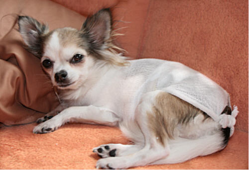

2 Tage nach der OP ging es ihr immer noch sehr schlecht

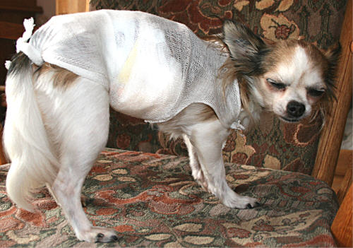

Nach 5 Tagen war sie immer noch total wehleidig,\
verliess ihren Liegeplatz kaum.

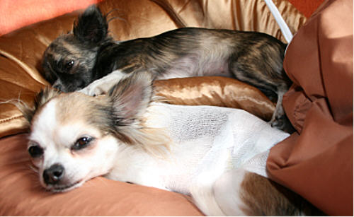

Chiqua lag immer bei ihr, putzte sie und wich\
kaum von ihrer Seite

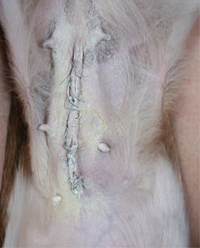

Die Wunde nach 1 Woche\
war supergut verheilt

Sara mussten einige Zähne gezogen werden, das Gebiss wurde saniert und von Zahnstein befreit. Zuvor war sie sehr wählerisch, was das Futter anging und aus dem Napf wollte sie gar nicht fressen, man musste sie immer überreden ein paar Happen zu sich zu nehmen. Mittlerweile hat sie ihren Napf genauso schnell leer wie unsere anderen Hunde.

Durch unsere Spaziergänge, die wir für sie immer wieder ein bisschen verlängert haben (im Anfang habe ich sie oft zwischendurch noch in einer Hundetasche getragen), hat sie Muskulatuer aufgebaut. Anfänglich humpelte sie oft. Durch Schwimmtherapie und vorsichtigem Springtraining hält sie nun mit unseren anderen Hunde mit, springt auf Sessel, Sofa und Bett.

Sie läuft sehr gut an der Leine und wir können sie auch im Wald ableinen, sie trödelt zwar immer, aber bleibt bei uns. Sie hört sehr gut und reagiert super auf Anweisungen und Kommandos.

Es ist nun so, das der 4. Hund eigentlich zuviel für uns ist, aber Sara ist so unkompliziert geworden, so lieb und so ruhig und so sehr dankbar, das es tatsächlich irgendwie klappt.

**In ein anderes Zuhause zu ziehen,**  **wäre für Sara fatal und würde sie wieder komplett zurückwerfen und darum haben wir beschlossen, das sie bei uns bleiben darf, denn sie zeigt uns jeden Tag wie sehr sie ihr Zuhause hier liebt.**

2 Jahre danach, im Juni 2012\
Nun lebt die kleine zierliche Sara schon 2 Jahre bei uns und es gibt ausschliesslich Positives zu berichten.\
Wir haben uns sehr um sie bemüht, haben Rat einer Tierpsychologin und Therapeutin eingeholt und haben mit ihr viel gearbeitet, damit sie lernt zu verstehen wie sie sich in unserem Hunderudel und Katzenclan einzufügen hat und wie sie Vertrauen zu uns aufbauen kann. Und man soll es nicht glauben wie schlau und gelehrig diese kleinen Chihuahuas sind.\
Sie hat jetzt schon 150% Lebensfreude mehr. Wie wir sie anfänglich bekamen war sie nur verunsichert und traurig und sehr verhaltensgestört.

Nun tobt sie über die Wiesen, die sie erst mit 6 Jahren kennengelernt hat

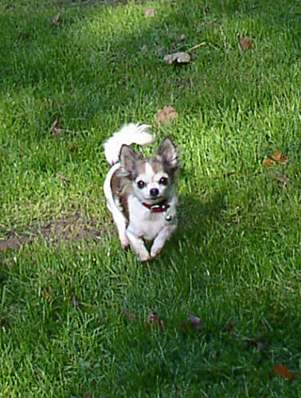
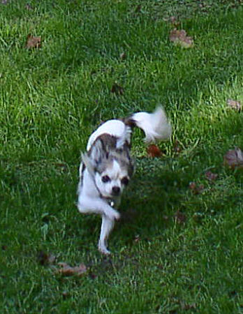

Sie ist in der gesamten Hunde - Katzen - Menschenfamilie voll integriert, sie ist eine fröhliche Hündin geworden, liebt ihr Zuhause, ihre eigene Kuschelhöhle, die sie auch schon gegen unsere anderen Hunde verteidigt, ihr Selbstbewusstsein steigt, wir müssen sie schon ab und zu bremsen.

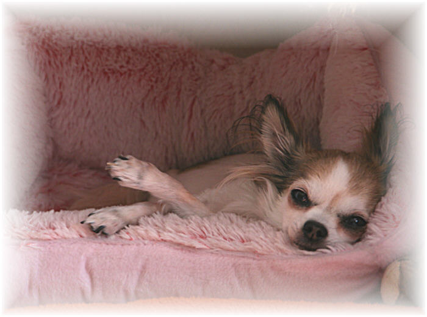

und sie liebt unsere täglichen Spaziergänge im Wald.

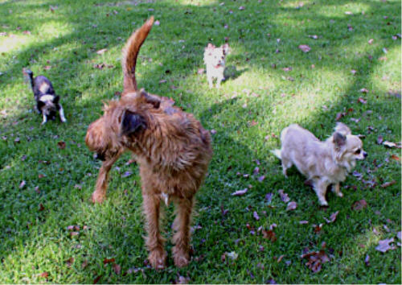

Was ist mit euch Zwergen, kommt ihr??

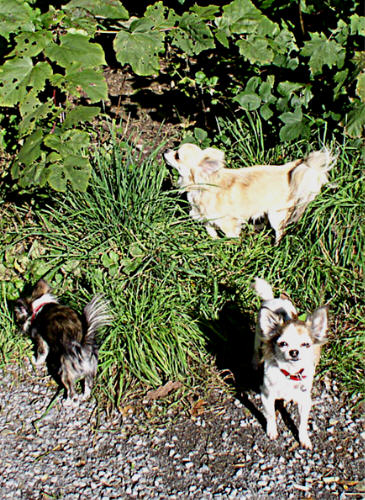

So gerne sie aber spazieren geht - man muss es gesehen haben, wie sie die Treppe hochflizt\
und sich auf ihr Zuhause freut, wenn ich unten die Haustüre aufschliesse.

Es gibt keine Probleme mehr bei der Fütterung. Ihr langes Verharren am Futternapf ohne zu\
fressen und wie hypnotisiert abwechselnd das Futter und mich anzustarren, ist Vergangenhheit.

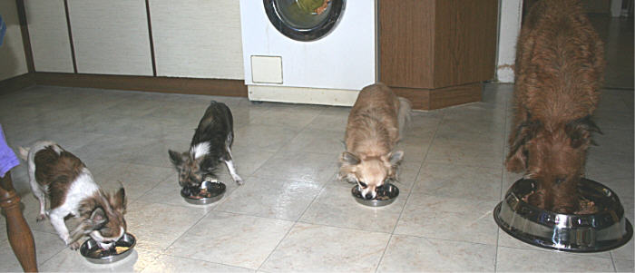

Es wird mit Freude und Appetit in der Zwergenrunde gefressen. Und sie hat jetzt auch zugenommen,\
nun müssen wir aufpassen das sie nicht rund wird. Nach ihrer Zahnsanierung kaut sie auch jeden Tag\
ihr Büffelhautröllchen.

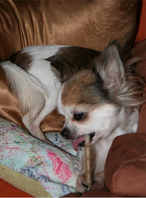

Sara bringt uns allen, besonders mir eine grosse Zuneigung entgegen, sie sucht extrem meine Nähe,\
will alles richtig machen und ist kreuzunglücklich wenn ich ihr mal eine Ansage machen muss.\
Aber ohne geht es auch nicht. Disziplin muss sein!!

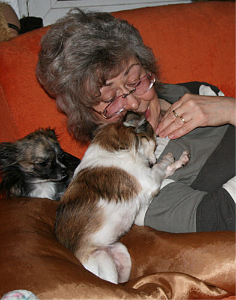

**Sara klebt an mir wie ein.......**

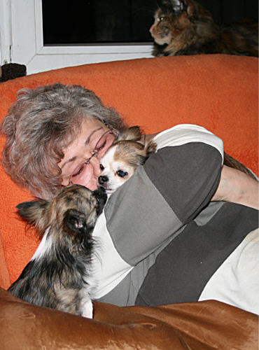

**.....kleines Bienchen am Honig**

Sie versteht schon gut was ich von ihr will, das Vertrauen wächst jeden Tag mehr

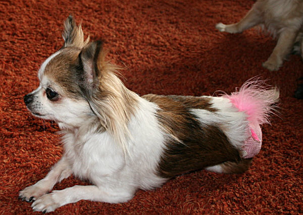

Das Höschen ist Vergangenheit, ich ziehe es ihr nur noch an wenn Besuch kommt, da macht\
sie noch hier und da ein Pfützchen, warum wissen wir nicht.

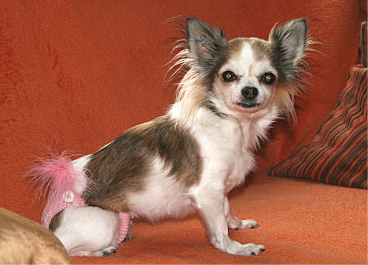

Alles in allem ist Sara unser Sonnenscheinchen!!\
Wir lieben sie und sie wird den Rest ihres Lebens bei uns verbringen müssen.

Da lacht das kleine Chihuahuagesicht.

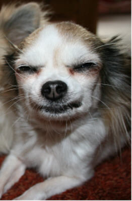
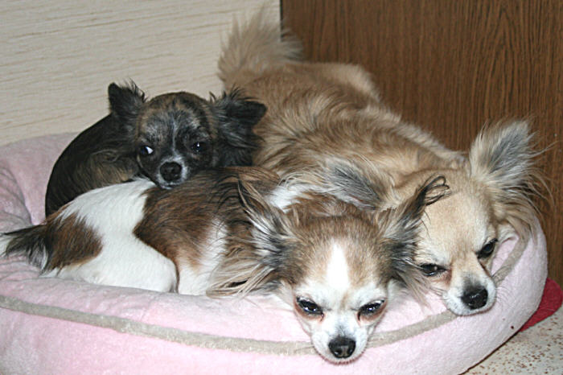

Aber dann ging es so schnell im September 2012\
Im Januar 2012 wurde bei Sara ein schwerer Herzklappenfehler diagnostiziert. Sie wurde von Dr. Kresken gründlich untersucht und geschallt und auf Tabletten eingestellt, da ging es ihr wieder richtig gut. Wir hofften, so wird sie bei uns alt. Aber leider durfte sie nur 2 Jahre bei uns sein.

Wir trauern um unsere Sara\
22.10.2004 - 28.09.2012

Wir wußten es kommt der Tag. Durch ihre schwere Herzkrankheit war sie so belastet und trotzdem wurde sie bei uns zu einem fröhlichen kleinen Hund bis zum Schluß (mein Herzenshundi!!) In meinen Armen ist sie still, friedlich und bescheiden wie sie war, mit großen dankbaren Augen gestorben. Ihr kleines Herz konnte nicht mehr. Für uns, besonders für mich ist der Schmerz fast unerträglich und ich kann kaum loslassen. Ich werde ihre flehenden Augen nie nie nie vergessen

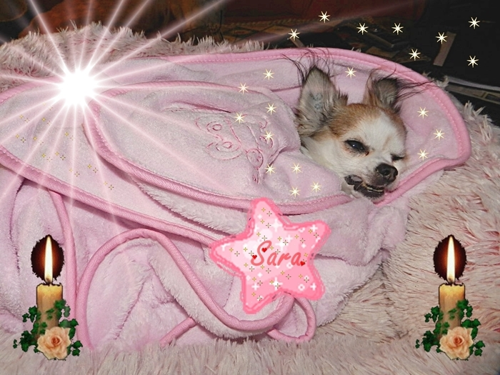

Sara, unser lieber Schatz, auch wenn wir mit dir und deiner Krankheit enorm belastet waren, du warst mit das BESTE was in unser Leben getreten ist. Wir haben dir versucht viel Liebe die du 6 Jahre nicht hattest zu geben, aber Du hast uns viel viel mehr gegeben! Ich weiß das Deine kleine Seele hiergeblieben ist. Viel zu sehr hast du dein Zuhause hier geliebt als ganz zu gehen. Oft erscheinst du in meinen Träumen.

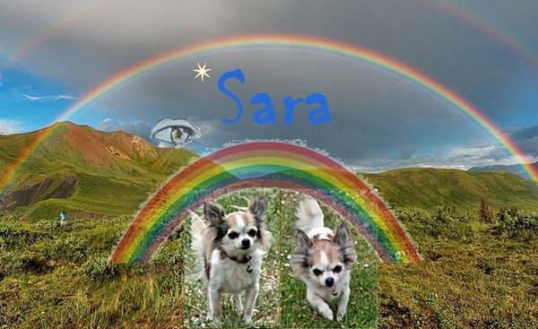
