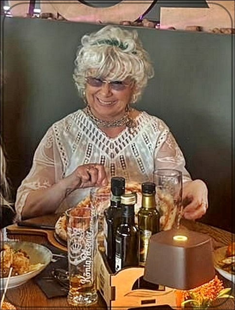
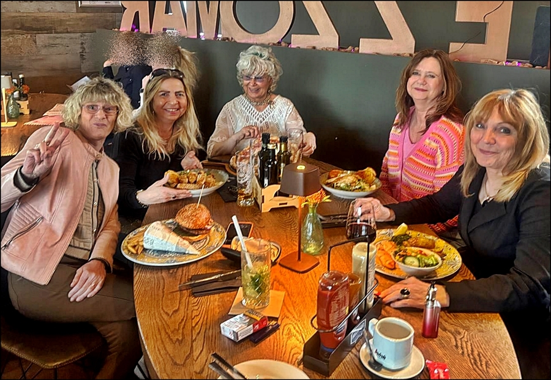
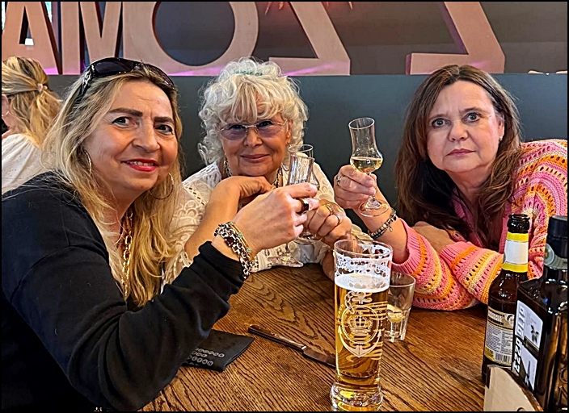
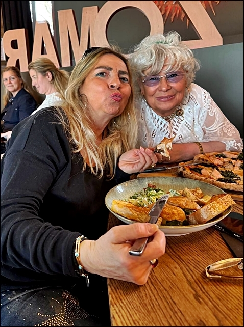
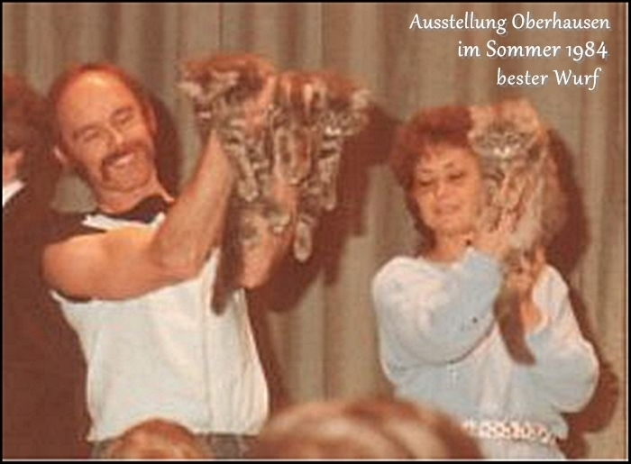
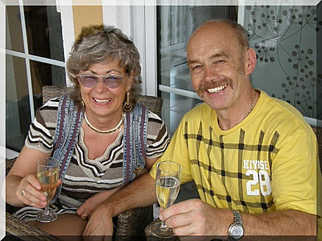

**In kleinsten Kreis mit einigen guten Freunden haben wir unser Jubiläum gefeiert**

44 Jahre Starbushway!

Ich habe mich gefreut und es waren vertreten:\
von links\
Heike, Julia, ich, Iris, Susanne

......Züchter Cronik!\
Maine Coon Cattery \>Starbushway\<

44 Jahre besteht unsere Zucht schon und zwar ohne Pause, ohne Austieg und wieder Einstieg, ohne aufhören und wieder anfangen, sondern durchgängig und beständig

Ja - eine Maine Coon Zucht seit **über 4 Jahrzehnten**, die gibt es. Sie begleitet uns tatsächlich schon zweidrittel unseres Lebens\
Damals vor vielen vielen Jahren, als wir unsere ersten Maine Coons gekauft haben, hätten wir nicht geglaubt und hatten es eigentlich auch nicht vorgehabt, unser weiteres Leben fast ausschliesslich "FÜR DIE KATZ" zu leben.\
Was daraus geworden ist? Schauen Sie selbst.\
Eine Maine Coon Zucht wie sie erfolgreicher und beständiger kaum sein kann!

1982 war unser erster Kontakt zu dieser Rasse und kurz darauf war unser offizieller Einstieg in die Zucht. Vereinsbeitritt und Zwingerregistrierung im 1. IMCCC. Ein paar Monate später wurde unser erster Wurf geboren. Zu der Zeit kannten die meisten Leute die Rasse Maine Coon nicht und mit einer Handvoll Züchter haben wir damals noch Infoshows organisiert um die Rasse bekannt zu machen. Heute dominiert die Rasse MC leider den Rassekatzenverkaufsmarkt.

1 Jahr später, im Juli 1984 wechselten wir in den DRV, dem wir 20 Jahre die Treue hielten. Weil der DRV sich auflöste, traten wir im Jahre 2004 dem RVDE bei, in dem wir heute noch wären, wenn es ihn noch geben würde. Nun sind wir seit 2008 in dem Verein "DELICAT".

40 Jahre Jahre später...... noch immer haben wir Freude an der Arbeit in unserer Zucht und mit unseren Tieren. Auch weiterhin wird an oberster Stelle, vor allen unseren Zuchtzielen, die Liebe zu unseren Tieren stehen, sowie die Gesunderhaltung und Optimierung der Rasse und vor allen Dingen gute Plätze und liebe Menschen für unsere Jungtiere auszusuchen.\
Auch nach diesen vielen Jahren haben wir noch ein paar Ziele. Wir werden, wie in den letzten 2 Jahren als wir unsere Zucht verkleinert haben, unseren Zuchtbestand weiterhin klein halten und nur mit ausgesuchten Tieren züchten*.* Es gibt bei uns in der Zukunft immer nur wenige Würfe im Jahr.

Ich habe in all den 40 Jahren so unglaublich viele Züchter kommen und schnell wieder gehen sehn, ich habe viele Züchter fallen sehn. Ich habe Ehen wegen der Zucht auseinander gehen sehen. Ich habe erlebt wie sich Züchter finanziell ruiniert haben. Ich habe erlebt wie Zuchten die aus dem Ruder liefen vom Vetamt geräumt wurden und ich habe auch nicht nur einmal erlebt wie Züchter psychisch total fertig waren wegen Überforderung und Streitigkeiten mit ihren Mitzüchtern.

Es ist nicht immer einfach und auch oft mit viel Sorge, Leid und menschlichen Entäuschungen behaftet, mit solch einer unglaublichen Verantwortung und solch enormem Arbeitsaufwand 365 Tage im Jahr zu leben, ohne Urlaub. Aber wir werden noch ein bißchen weitermachen mit allen Höhen und Tiefen einer Zucht. Wir werden auch weiterhin die Schattenseiten in der Zucht ertragen und uns über die Sonnenseiten um so mehr freuen, in demütiger Dankbarkeit!

Und so haben auch weiterhin Liebhaber und manchmal auch der ein oder andere Züchter das Glück, bei allen Unwägbarkeiten des Lebendigen, bei uns ein Jungtier zu bekommen, deren Gesundheit und Charaktereigenschaft nicht dem Zufall überlassen bleibt.\
Denn - wer für eine Katze 15 Jahre und mehr (manchmal auch weniger), eine Verantwortung übernimmt, hat ein Recht darauf, das auch der Züchter seine Verantwortung ernst nimmt!

Wenn wir gesund bleiben und unsere Welt nicht aus den Fugen gerät, werden wir auch noch einige Zeit dabei bleiben und in ganz kleinem Rahmen unsere unvergleichlichen Starbushway-Katzen weiterzüchten.

Wir werden unsere bewährten Bekanntschaften, die wir zur Zeit haben, pflegen. Züchterfreunde gibt es nur zwei und das seit schon vielen Jahrzehnten. Es werden neue Bekanntschaften entstehen und alte werden evtl. gehen, was immer schade ist, aber es passiert eben, da lassen wir los, wenn sie keinen Bestand haben.

Und so freuen wir uns weiterhin auf nette Katzenfreunde, die den Kontakt zu uns suchen.

Ihre Züchter\
Karin und Toni Lemanowicz

[Klicken Sie hier und sie lesen alles über unsere Zuchtanfang bis heute](/lesenswert/)

