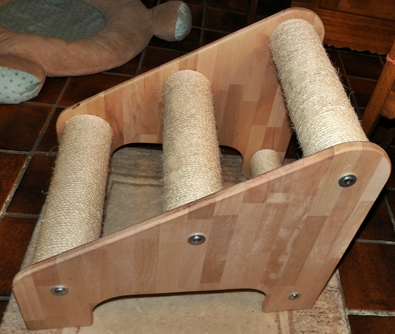
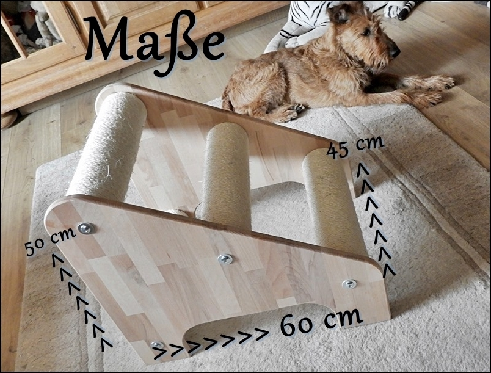
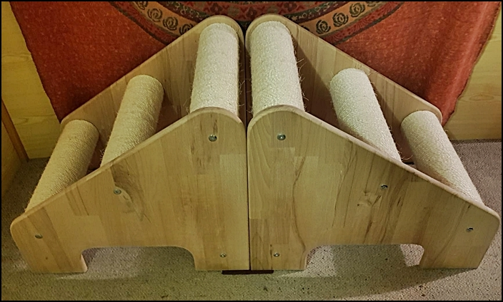
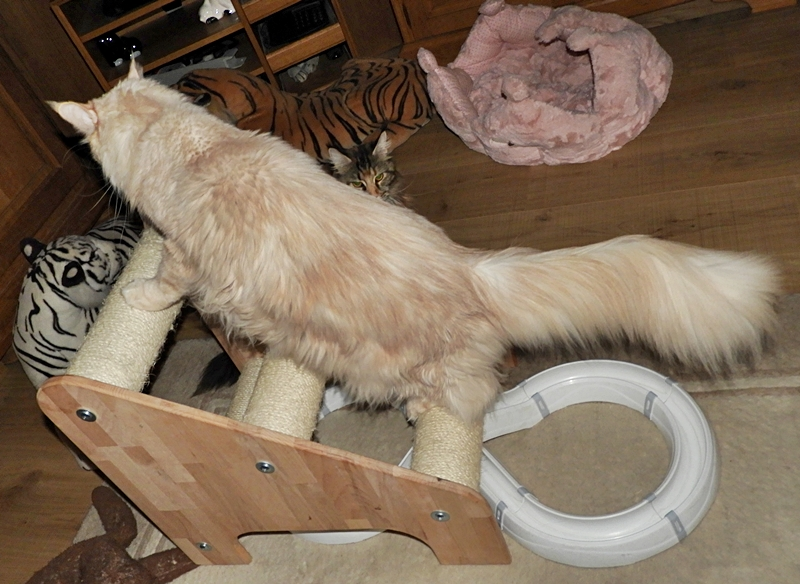
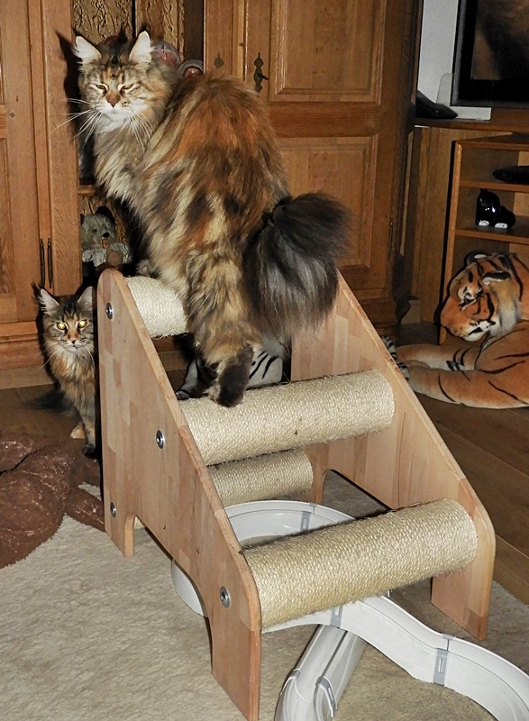
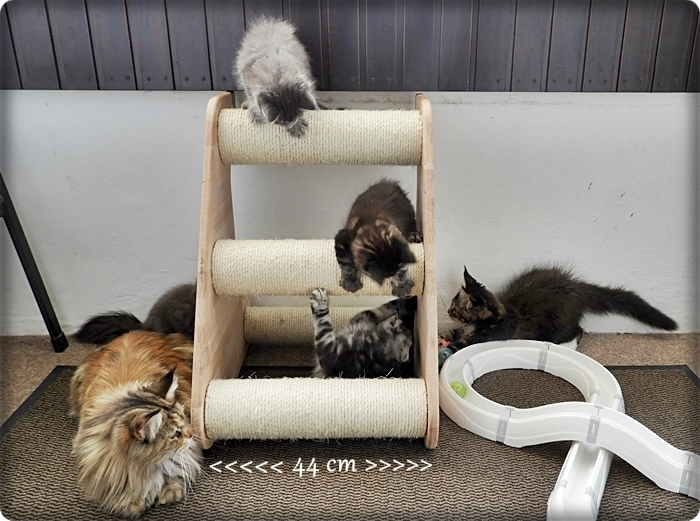
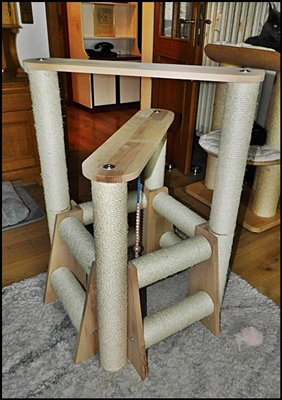
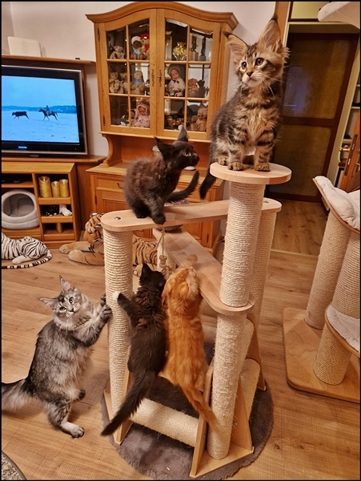

28.11.2025

Alle reserviert für unsere Kittenkäufer!!

Tony hat wieder 2 Klimmtreppen für Kitten und Jungtiere gebaut. Stehen fertig zum abholen.\
Die schweren und sauber verarbeiteten Sisaltreppen lieben die Kleinen sowie die Großen.\
Auch für alte Katzen die nicht mehr so springen können dienen sie als Aufstieg

Falls Interesse bitte Kontakt. Wir verschicken nicht!!

Die Kletter und Klimmtreppe für Kitten und auch erwachsene Coonies

Ganz toll sind 2 die man aneinanderstellen kann. Dann haben\
die Katzen ein richtiges Spieleparadies und unten eine schöne Höhle

Auch unser 12 Kilo Kater konnte daran kratzen

Auch sehr begehrt ist unser Kletterturm

