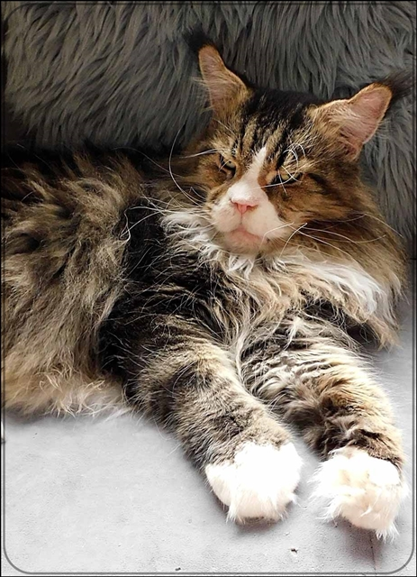
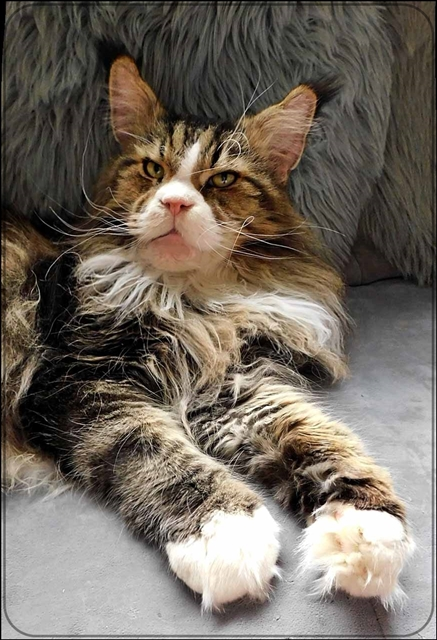

Nun ist er lange kastriert und geht stramm in sein 13. Lebensjahr. Der Älteste in unserer Maine Coon Crew. Lange Jahre war Zacko bei uns Deckkater und Vererber. Und er ist bei uns geblieben!! Hier unser ganz besonderer Schatz, der extrem verwöhnt wird. Immer noch hat er eine mächtige Präsenz. Trotz seiner Arthrose ist er beweglich. Sogar Ouzo hat vor ihm Respekt. Seine Zähne sind alle noch vollzählig und weiß, sein Fell schön und dicht. Unverkennbar seine krausen Schnurrhaare, die er auch weitervererbt hat.\
Und ja - wer seinen Grummelblick sieht glaubt mir kaum was er für ein unglaublich liebes zärtliches Seelchen ist und Jeder der in zum erstenmal hier sieht fragt: "Darf man den auch anfassen?"\
Ein gesprächiger Schmuser. Wir lieben ihn so sehr und hoffen das wir ihn hier noch lange haben.

