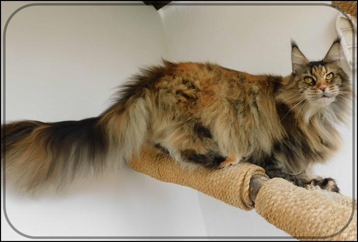
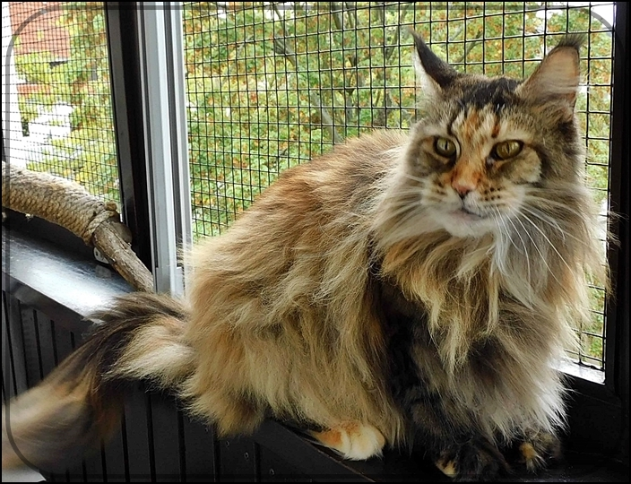

Quilana, unser über alles geliebtes Quillemädchen, unsere Königin geht nun stramm ins 11.Jahr. Einige Würfe hatten wir von ihr.

Sie ist auch als Kastratin bei uns geblieben. Ein unkompliziertes Kastratenmädchen die sich in der Gruppe auch bei unseren Katern Respekt verschafft. Eine immer noch traumhafte Erscheinung mit dickem fließendem pflegeleichtem Fell. Sie besitzt noch alle Zähne vollständig. Tipitopi gesund, sie springt und tobt und spielt hier wie eine 1-2jährige. Eine Diva, sehr lieb aber extrem fordernd. Sie bestimmt wann ich Futter zu machen habe!!

Wir hoffen auf noch viele Jahre denn sie ist hier nicht wegzudenken

Juli 2016\
Hier holten wir sie bei ihrer Züchterin in Thüringen ab

