Traurige Nachrichten im Hause Starbushway\
Heute morgen mußten wir eine Entscheidung treffen und unsere kleine Chiqua nach 2 schweren Anfällen im Alter von 16 Jahren gehen lassen. Traurigkeit und viele Tränen und es ist bei uns ganz still. Meine kleine tapfere geliebte Diva, auch wenn wir darauf vorbereitet waren ist es schwer. Trotz der Prognose unseres damaligen Tierarztes das du es mit deinem Nervenleiden nur max. 5 Jahre schaffst hast du an deinem schönen behüteten ruhigen Leben festgehalten und es gab ein auf und ab. Meine Süße, lange wird es dauern bis ich es akzeptiert habe. Der einzige Trost....du hattest ein sehr sehr schönes Zuhause bei uns.

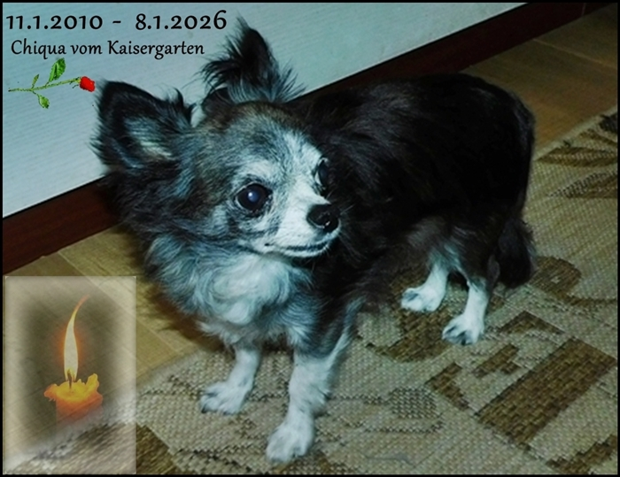

Noch vor 2 Tagen am 6.1.

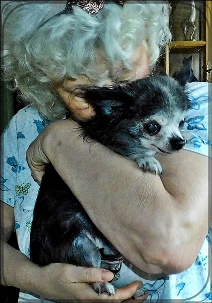
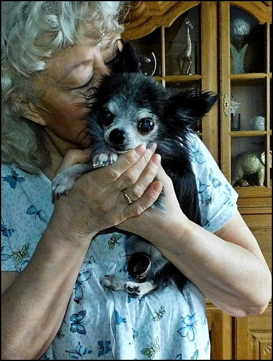

Rückblick 2010\
Unsere kleine Küchenhilfe hat uns im Welpenalter ganz schön Nerven gekostet, alles hat sie geklaut\
Aber natürlich hat sie uns auch zum Lachen gebracht!!

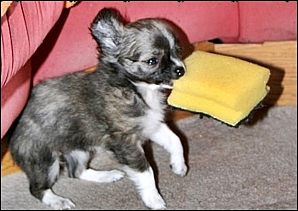
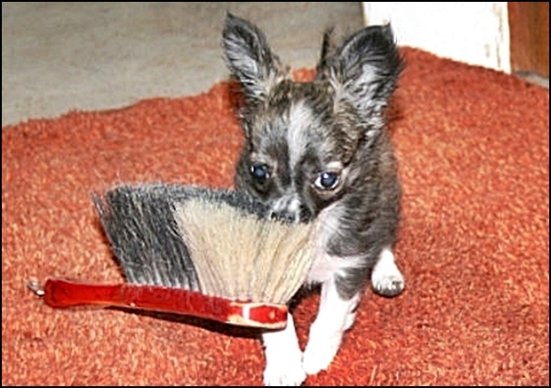

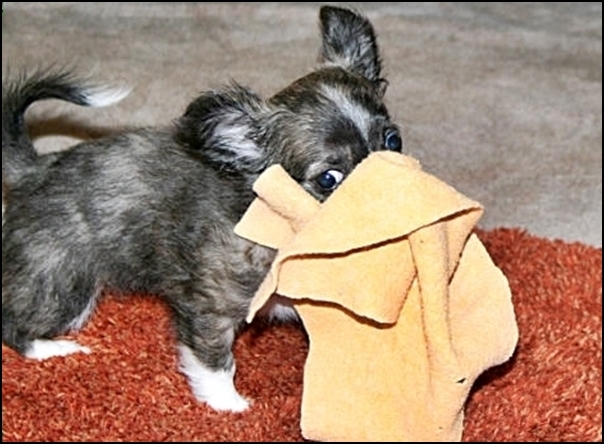
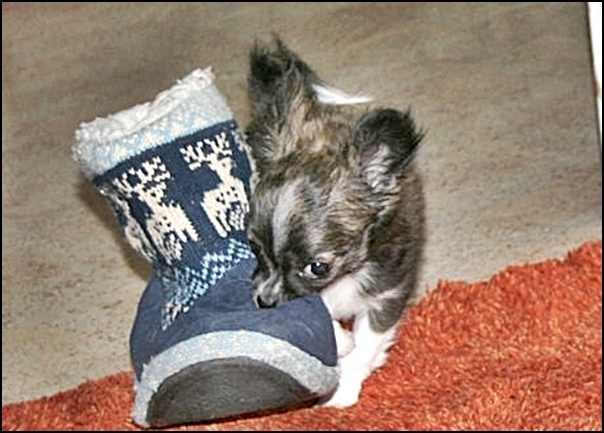

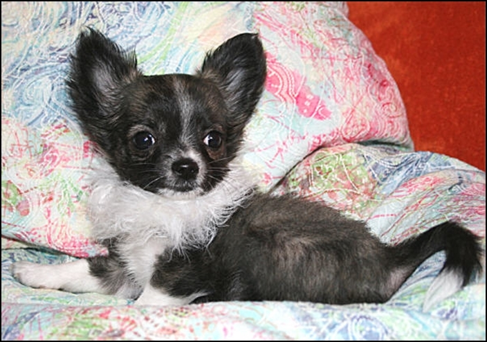

Chiqua mit ihrer Sara (gest.2012)

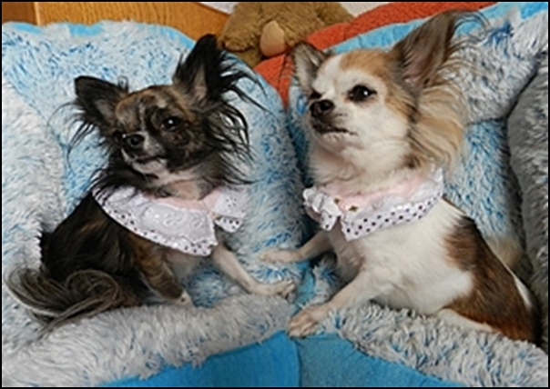

Chiqua und ihr Paco

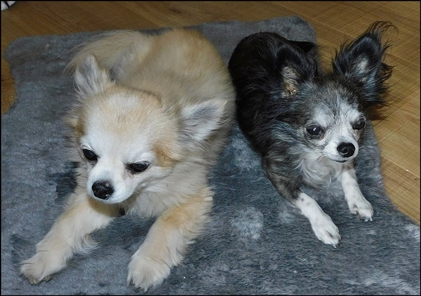

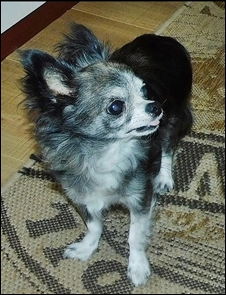
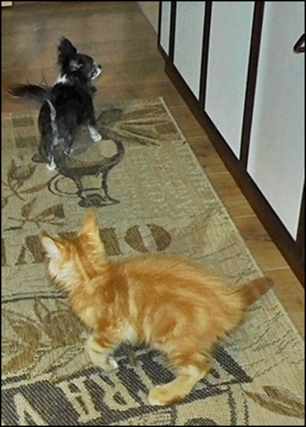

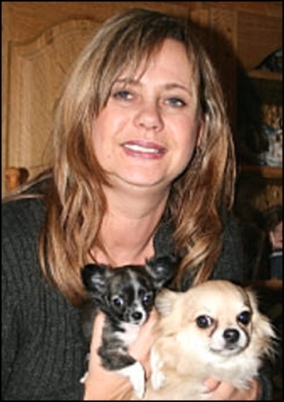

Iris, eine Freundin des Hauses ist Patenfrauchen\
Hier kurz nach Einzug bei uns

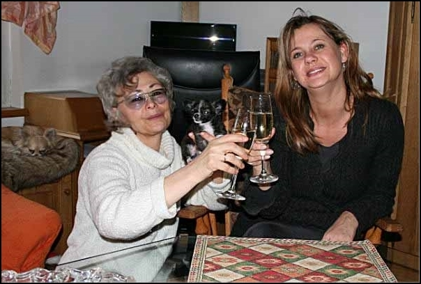
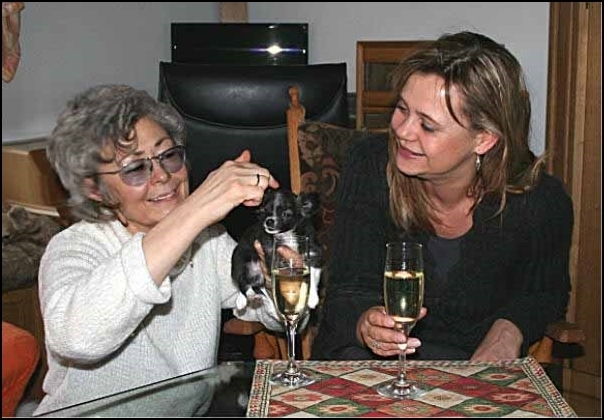
