Eine ungepflegte verknotete Maine Coon ist ein unschöner Anblick und die ganze Rasse ist dahin. Noch schlimmer ist eine geschorene Maine Coon. Das ist für mich ein Anblick des Jammers! Der Stolz einer Maine Coon ist ihr schönes halblanges gepflegtes Fell!!

Ich höre immer wieder das es für Besitzer von Coons nicht möglich ist ihre eigenen Katzen zu kämmen. Ich höre von Verknotungen, von Kratzen und Beißen ihrer Tiere und das End vom Lied ist, die Katzen müßen manchmal unter Narkose geschoren werden.\
Warum können viele Besitzer dieser herrlichen Rasse ihre Katzen nicht kämmen? Immer wieder lese ich und höre, das sie zu Bestien werden. Warum? Das ist die Folge von Nichtvertrauen zu ihrem Besitzer und die Katze ist nicht auf Fellpflege konditioniert. Ein Tier auf eine ganz bestimmte Situation zu konditionieren bedeutet viel Geduld, Arbeit und Ausdauer.\
Wenn man eine Halblanghaarkatze über Wochen in der Fellpflege vernachläßigt, dann ist das Resultat KNOTEN!\
Und dann zu versuchen eine verknotete Katze zu kämmen? Ja klar, das wird zu einer Herausforderung. Besser ist, das sich erst gar keine Knoten entwickeln können, sprich..... mehrmals in der Woche kämmen.

Eine gutgepflegte Maine Coon ist eine Augenweide

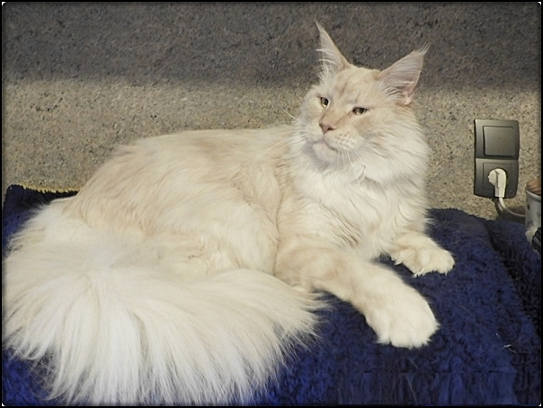

Wie konditioniere ich eine Katze auf Bürsten und Kämmen?\
Wie erarbeite ich mir ihr Vertrauen?\
Als erstes braucht man einen Bereich den man ein wenig kuschelig macht, der nach Leckerchen riecht. Ein kleiner Raum WC, Bad oder einen Platz erhöht auf Brusthöhe des Menschen. Am besten hinten und an den Seiten zu, so das sie nicht einfach nach allen Seiten weg kann. Dort wird sie erstmal raufgesetzt und bekommt Leckerchen, es wird ein bißchen gespielt mit einem Federwedel und es wird geschmust und gestreichelt bis sie schnurrt.\
Dann fängt man an. Jeden Tag, erst 5 Minuten, dann erhöhen auf immer mehr bis 15 Minuten. Es muß sich in den Kopf der Katze einbrennen, das JEDEN TAG, am besten immer um die selbe Zeit gekämmt wird. Ausreden wie "keine Zeit" geht nicht, wenn man sich für eine Halblanghaar oder Langhaarkatze entschieden hat. Dann muß man auch die Fellpflege übernehmen. Ansonsten besser eine Kurzhaarrasse.\
Der Rest ist hier von mir bebildert. Ich habe seit 38 Jahren Maine Coons und kann sagen, bei mir wurde noch nicht eine Katze geschoren oder ein Schergerät benutzt. Und bei mir haben sehr viele Coonies gelebt. Und was ich kann müssen eigentlich andere auch können. Ich habe auch schwierige Katzen gehabt und von Besitzern übernommen, die vernachlässigt waren und keinen Kamm kannten. Es geht trotzdem, man muß nur wollen!

Das hier ist unsere Pflege-Ecke. Hier wird gekämmt, gebürstet, in die Ohren und ins Maul geschaut. Bei uns wird **täglich** gekämmt. Hier auf dem Tisch ist eine Wohlfühlatmosphäre. Ich habe meine Katzen darauf konditioniert das es hier auch Leckerchen gibt. Ich setze sie auch mal darauf zum Spielen und vor allen Dingen zum Schmusen.

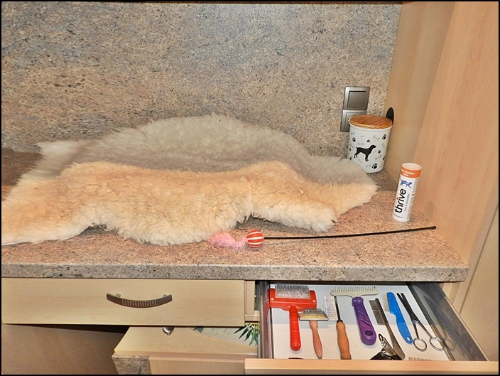

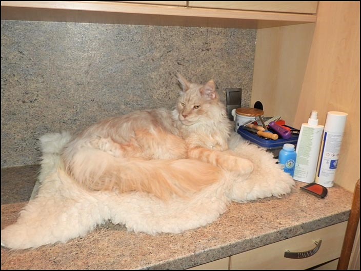

Meine verschiedenen Kämme und Bürsten, sowie Ephilierscheren.\
Die Zange ist für die Hundekrallen

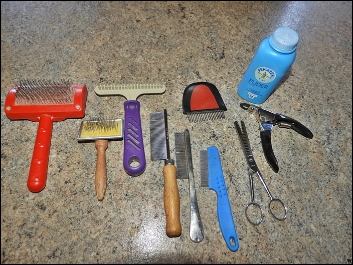

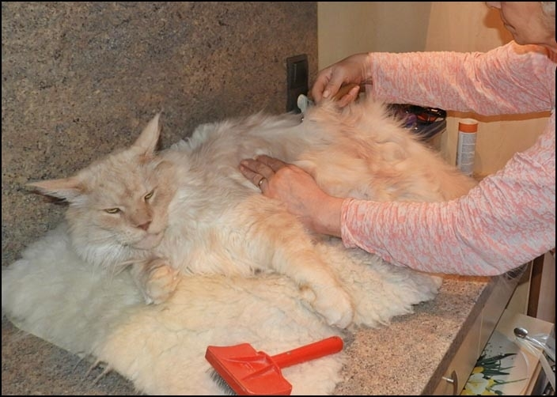

Meine Katzen wissen, das sie hier nicht eher wegkommen bis ich die Kämm/Bürst-Aktion abgeschlossen habe. Ich bestimme wann wir fertig sind. Konsequent und mit unglaublicher Geduld werden meine Katzen hier gekämmt und gebürstet bis das Fell fluffig ist. **Knoten gibt es bei meinen Tieren nicht!!**

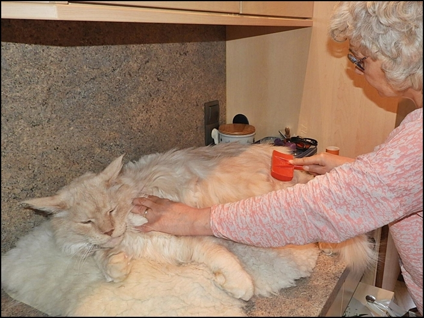

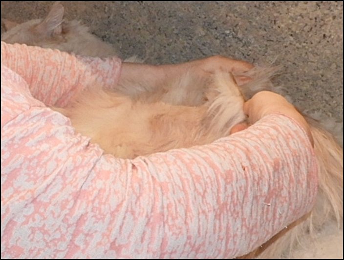

Ohren, Mäulchen, Augen, überall schaue ich rein, das kennen sie und empfinden es nicht als unangenehm. Dementsprechend hat auch meine Tierärztin keine Probleme meine Katzen zu untersuchen

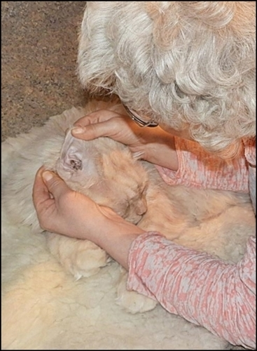
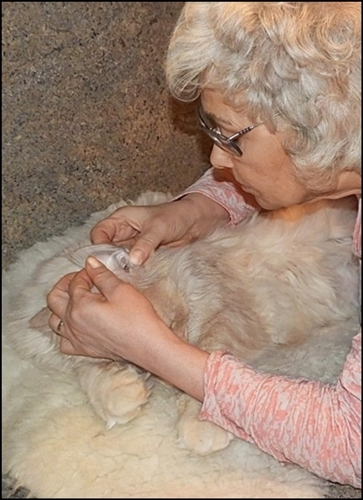
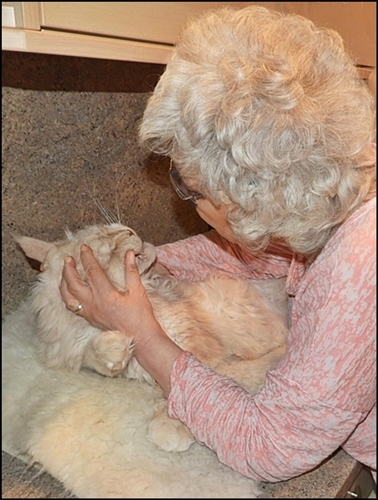

Danach gibt es eine Schmuseminute mit Leckerchen, damit sie sich danach entspannen und einen positiven Abschluss haben

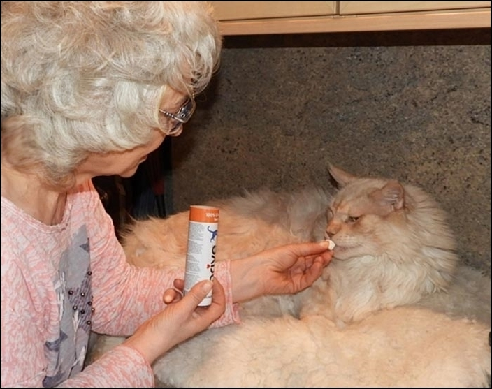

Und ich hebe sie dann vom Tisch runter und lasse sie nicht einfach runterspringen und davonrennen. Das hat den Sinn, das sie eben merken das sie mit Wegrennen keinen Erfolg haben. Meist bleiben sie dann auch unten stehen, weil sie wissen, es ist vorbei.

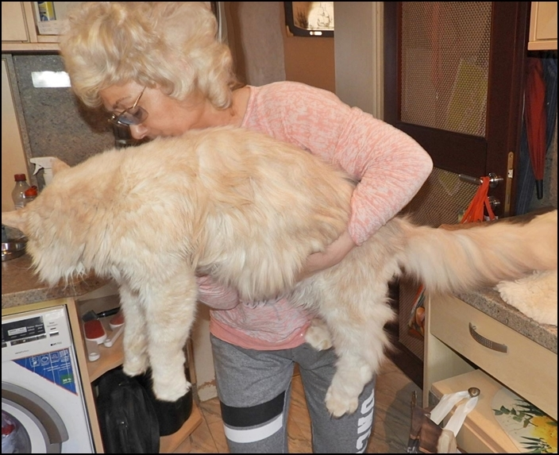

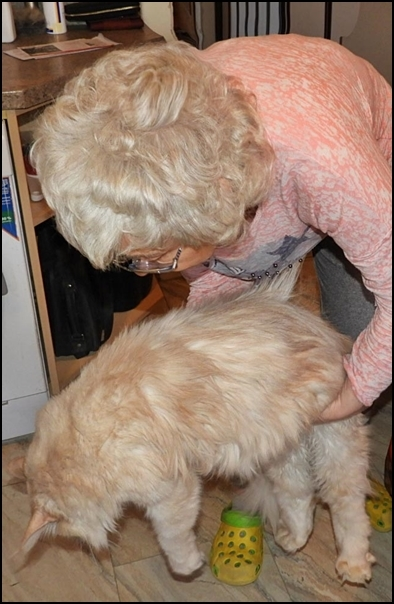

Damit meine Katzen den Tisch nicht nur als Kämmtisch sehen, setze ich sie auch mal darauf um zu spielen und für eine kleine Schmuseminute mit Leckerchen

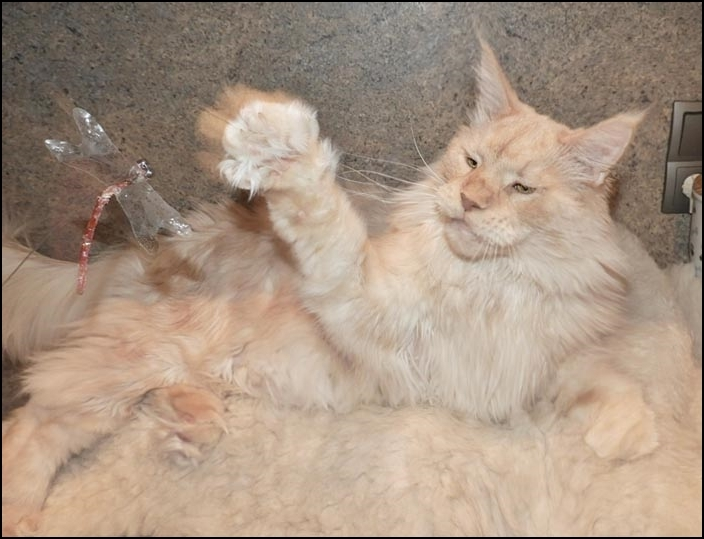

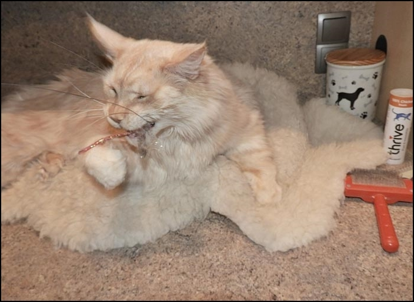

Auch die Hunde werden hier gekämmt

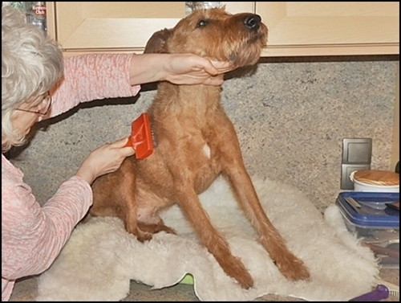
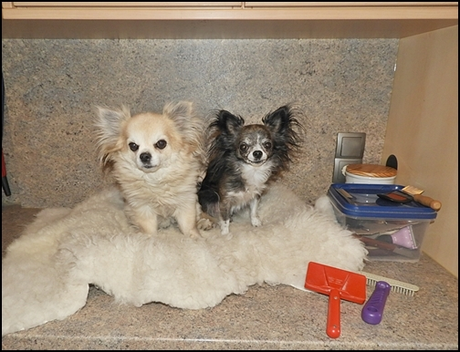

Für Ausstellung und Show muß natürlich gebadet werden. Eine Katzenausstellung ist eine Schönheitsshow und die Richter wollen da auch nur topgepflegte Katzen sehen und keine durchgefetteten verknoteten schuppigen Tiere.

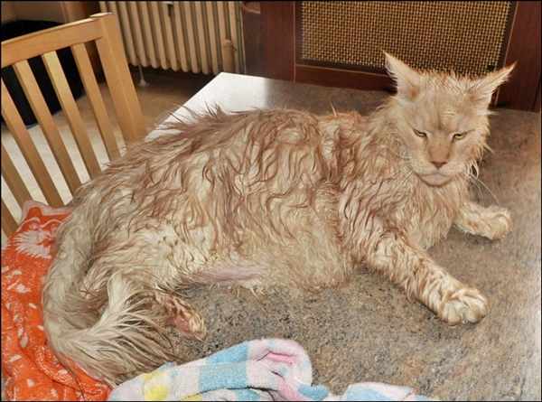

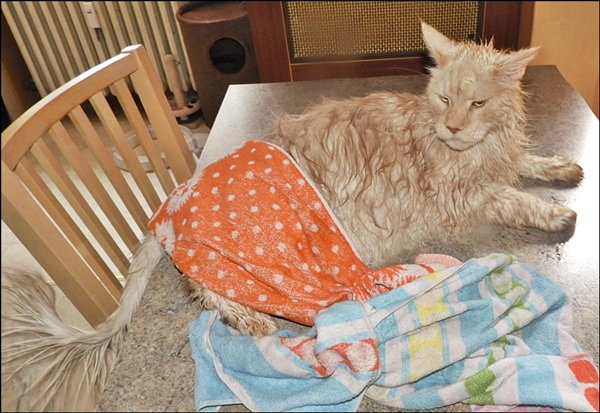

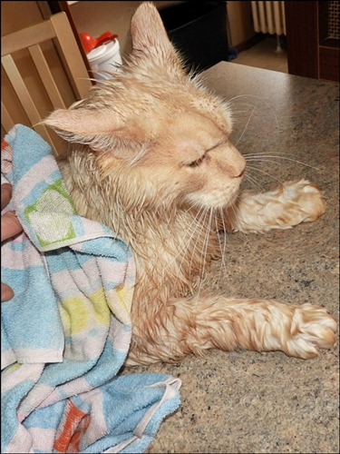

Das Shampoo

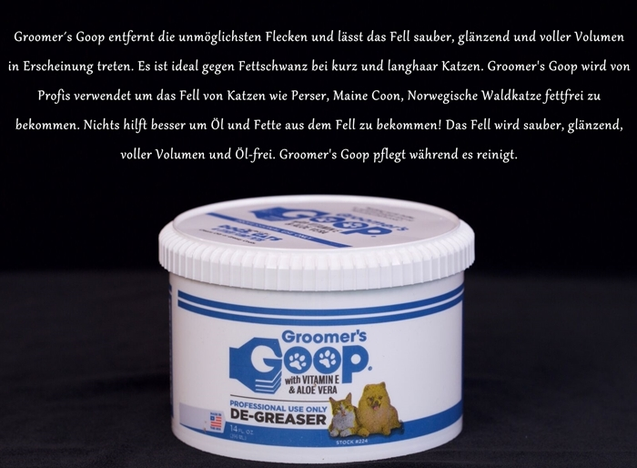

Das Ergebnis sieht dann so aus. Fertig für best in Show!

[Zurück](/)
