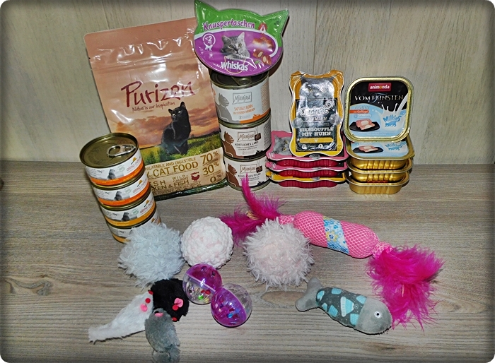

Der Name \>STARBUSHWAY\< steht seit 1982\
Wir haben vor 44 Jahren hier in Deutschland, mit einigen wenigen Züchtern die Rasse Maine Coon bekannt gemacht, als noch kaum einer Maine Coons kannte und haben damals mit einigen US-Importen angefangen und für interessante Blutlinien gesorgt. Wir haben Info Shows organisiert um die Rasse in Deutschland bekannt zu machen. Nachwuchstiere aus unserem Hause finden grosse Anerkennung und sind zu finden in vielen Teilen Deutschlands, bei Liebhabern sowie Züchtern, sowie weit über die Grenzen hinaus in:\
Polen, Dänemark, Holland, Belgien, Frankreich, Österreich, Schweiz, Italien, Tschechien, Weißrußland, Ungarn, Kroatien\
und sogar in Thailand.\
Unser Verein ist der \>Delicat\<

die Arbeit eines guten Züchters kann man am Ende des Tages gar nicht bezahlen, aber der Schlüssel liegt in:\
\* regelmässigem Gesundheitscheck der Elterntiere, Herzschallungen, Nierenschallungen, Gen-und Bluttests\
\* genauer Auswahl der Elterntiere, nach Gesundheit, Typ, Charakter und Genetik\
\* super Aufzucht und Sozialisierungsbedingungen zu Umgebung, anderen Tieren und Menschen\
\* guter/hochwertiger Fütterung, sowohl der Elterntiere, als auch der Kitten\
...die Liste ist eigentlich noch endlos...

**Der Preis, den ich für mein Kätzchen berechne, ist NIE Gewinn, sondern es sind Investitionen in die nächste Generation.**

Zur Abgabe unserer Kitten\
Abgabe unserer Kitten ist mit 13-14 Wochen. Wenn sie ins Ausland reisen bleiben sie bis 4 Monate hier bei uns. Wir versenden nicht per Flieger oder Bahn, auch von ausländischen Käufern müssen die Kitten hier bei uns abgeholt werden.\
Zur Reservierung\
Ein Kitten ist erst fest reserviert, wenn eine kleine Reservierungsgebühr geleistet wurde.  Optionen oder mündliche Reservierungen sind bei uns nicht möglich, **ebenso gibt es bei uns keine Raten oder Teilzahlung.**

Eine Reservierung wird nur von uns zurückgezahlt, im Falle von:\
Krankheit oder Tod des Kitten oder sollten sich für den künftigen Züchter zuchtrelevante Mängel bei dem Kitten entwickeln. Ansonsten wird eine Reservierung nicht zurückgezahlt, egal aus welchen Gründen!!

Gesundheitsvorsorge\
Ab der 8.oder 9. Woche bekommen die Kitten ihre 1. Impfung vom Tierarzt gegen Katzenseuche/Schnupfen sowie vorher eine gründliche tierärztliche Untersuchung mit allem was dazugehört. Mit der 12./13. Woche bekommen sie die 2. Impfe, dann werden sie auch gechipt und haben einen EU-Pass .  Zu dieser Zeit sind sie mehrfach tierärztlich untersucht. Unsere Tierärztin kommt zu uns ins Haus, auch für sämtliche Untersuchungen, Blutabnahmen etc.

Tierärzte unseres Vertrauens.\
Unsere Tierärztin Frau Ricking (links) mit Praxisassistentin Frau Benk\
Wenn Sie noch Fragen haben, es gibt kaum eine Frage die ich Ihnen nicht beantworten kann

**Frau Dr. Ricking (links) mit ihrer TM-Fachangestellten M. Jansen**

Ausreichend von dem gewohnten Futter für die ersten Tage geben wir mit,\
sowie ein bißchen Spielzeug.

Wenn Sie noch Fragen haben, es gibt kaum eine Frage die ich Ihnen nicht beantworten kann

**Die Links bitte anklicken um auf die Seiten zu kommen**

**[Unsere Aufzucht](/wuerfe/aufzucht/)**

**[Prägung und Sozialverhalten](/wuerfe/1abab7/)**

[So werden unsere Kitten aufgezogen](/wuerfe/babyysalon/)

[Alltagsfotos bei uns](/wuerfe/alltag/)

[Zurück zum Index](/)
