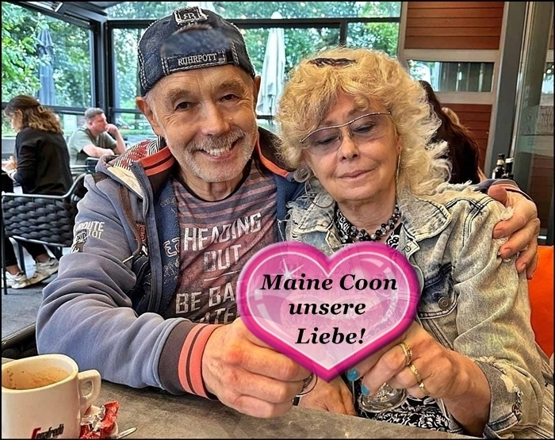
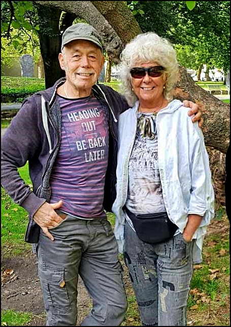

Der Name **\>**STARBUSHWAY**\<** steht seit 1982\
Wir haben vor 44 Jahren hier in Deutschland, mit einigen wenigen Züchtern die Rasse Maine Coon bekannt gemacht, als noch kaum einer Maine Coons kannte und haben damals mit einigen US-Importen angefangen und für interessante Blutlinien gesorgt. Wir haben Info Shows organisiert um die Rasse in Deutschland bekannt zu machen. Nachwuchstiere aus unserem Hause finden grosse Anerkennung und sind zu finden in vielen Teilen Deutschlands, bei Liebhabern sowie Züchtern, sowie weit über die Grenzen hinaus in:\
Polen, Dänemark, Holland, Belgien, Frankreich, Österreich, Schweiz, Italien, Tschechien, Weißrußland, Ungarn, Kroatien\
und sogar in Thailand.\
Unser Verein ist der \>Delicat\<

**Wir**, Karin und Tony seit 52 Jahren gemeinsam.\
Und seit 44 Jahren Leidenschaft für die Maine Coon

**Wir - das sind Karin und Tony** sind seit 52 Jahren ein Paar, sozusagen Unzertrennliche! Unsere Maine Coon Familie halten und betreuen wir zusammen mit viel Freude, Energie, Disziplin und auch einem gesundem Maß an Ehrgeiz. Die Ausstellungszeiten haben wir 25 Jahre ausgelebt und darum sieht man uns auf Ausstellungen nur noch sehr selten. Mit unseren 2 Hunden und unserer Maine Coon-Katzenfamilie leben wir sehr zufrieden mit unserem Leben, mitten in der Großstadt wo das Leben pulsiert und nie langweilig ist. Beide sind wir rheinische Frohnaturen, sind junggeblieben, aufgeschlossen, tolerant, unkompliziert und immer fröhlich und kontaktfreudig!

Tony der absolute Boss im Hause Starbushway

Ohne seinen Segen und seiner Genehmigung geht hier bei uns in der Planung garnichts. Er sorgt dafür, das es uns und unseren Katzen an NICHTS fehlt und unsere Finanzen immer stimmen. Auch ist er für die enorme Futter und Streubeschaffung zuständig, fährt alle 6 Wochen unsere Grossrationen Futter für Hund und Katz holen. Er verhandelt mit den Futteranbietern für gute Preise.

Im Januar 2013 ist Tony mit 65 Jahren in Rente gegangen und obwohl er nebenbei auf seiner Firma 3-4 Stunden am Tag arbeitet hat er sehr viel Zeit für uns und unsere Tiere.

Durch sein handwerkliches Können verwirklicht er hier baulich alle meine Träume und die der Katzen und natürlich hilft er mir, wo immer er kann und ist extrem belastbar. Ihm ist einfach nichts zuviel, wenn es um uns, unsere Tiere und unsere Zucht geht. Alle unsere Katzen lieben ihn, sowie natürlich auch ich. Für uns alle ist Tony in jeder Hinsicht unentbehrlich!! Ohne ihn könnte diese Zucht wie sie ist, nicht bestehen.

**Karin, ich bin zuständig für ALLES hier.**

Ich bin seit 2018 auch in Rente und somit den ganzen Tag zu Hause. Ich mache die Kontakte der Interessenten, beantworte unsere Emailfluten aus dem In- und Ausland, bin Gastgeber und Berater für unsere Besucher, mache unsere Planung des ein oder anderen Wurfes, das aussuchen der Linien und ab und zu Einkäufe des ein oder anderen Jungtieres und ich suche auch die neuen Katzenbesitzer unserer Kitten aus.

Ich mache die Vereinsarbeit wie Stammbaumbeantragungen usw., ich sorge dafür das die Katzen geimpft, getestet werden und alles was an der gesundheitlichen Betreuung hängt.

Ich bin Hebamme, Krankenpflegerin (falls nötig), Nahrungszubereiterin, sowie der Chef der Katzencrew, sorge für Harmonie und Ruhe in unseren Katzengruppen, bin sozusagen die Oberkatze und Raubtierdompteurin

Die Werbung, einschliesslich Fotos und Filme für Facebook mache ich ganz alleine, ebenso bin ich Webmaster unserer Homepage. Auch für die Hygiene und Sauberkeit im Wohnbereich bin ich zuständig.

[Zurück](/)
