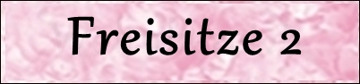

**Hier präsentieren wir unseren gesamten Wohn - und Zuchtbereich, machen Sie einen Rundgang.**

Wir legen Wert auf Sauberkeit und Hygiene!!!! Unsere Zucht hat höchstes Niveau. Und Sie finden unseren Wohnbereich genauso hier bei uns vor wie es auf den Bildern aussieht!! Wir leben **seit 45** **Jahren** in einer großen geräumigen, für uns und unsere Katzen sehr gemütlichen 95 m² Dachgeschosswohnung. Auf mehreren Ebenen können unsere Katzen toben und spielen. Frischluft und Sonne können unsere Coons auf gesicherten Freisitzen genießen, teilweise mit Überdachung und wetterfesten Kratzbäumen und erhöhten Liegeplätzen.\
Unsere Katzen leben mit uns zusammen im gesamten Wohnbereich. Bis in die kleinsten Ecken haben wir ihnen Spielbereiche und Möglichkeiten zum Klettern gebaut, so das sie genug Raum und auch Rückzugsmöglichkeiten haben. Bei uns ist kein Tier isoliert, da wir eine transparente Wohnung haben!!!

Klicken Sie die Seiten an und Sie sehen alle unsere Räume

[Zurück](/)
