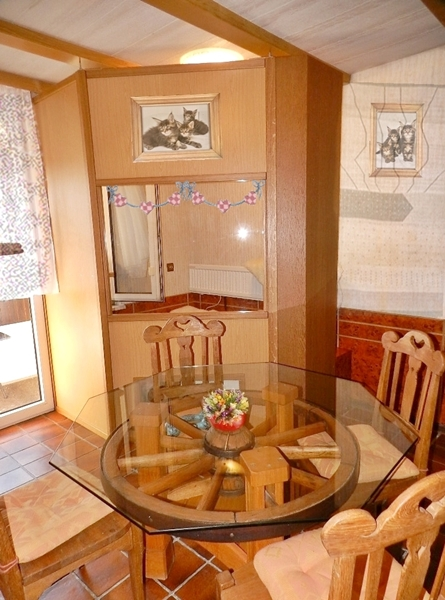
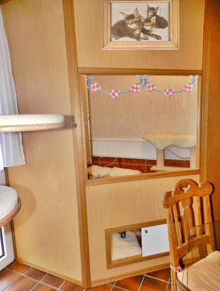
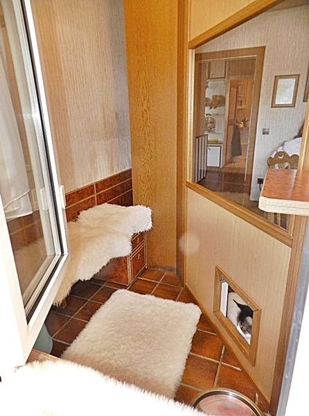
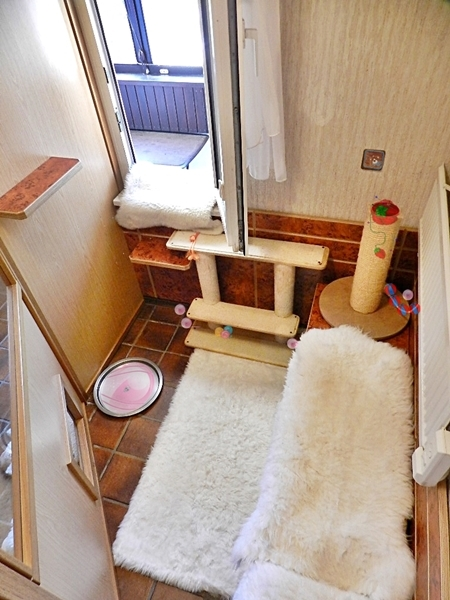
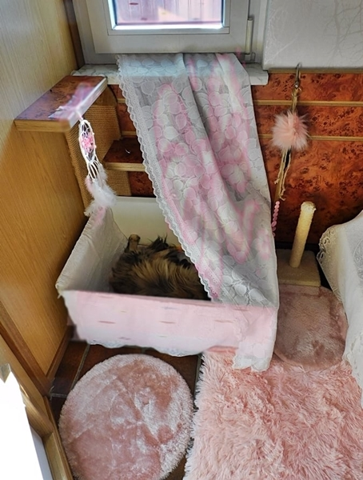
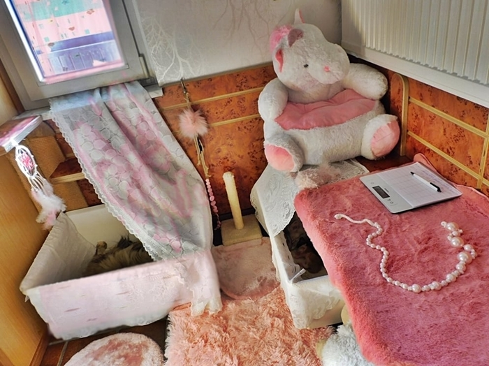
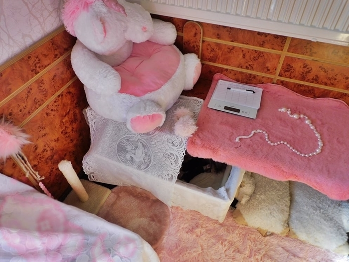

Das ist unser Geburtzimmerchen.

Hier kriegen **wir** unsere Babys. Integriert haben wir diesen abgeteilten Bereich in unserem Wohnzimmer. Hier ist Mama 3 Wochen alleine mit den Babys, sie kann aber jederzeit raus und am Katzenleben teilhaben. Es ist kuschelig eingerichtet. Meine Kätzinnen lieben es und wollen schon vor den Geburten dort rein und das Nest umgraben. Wenn die ersten Wehen kommen rennen sie dort hin, wollen rein und hüpfen sofort in die Wurfkiste

Hier von außen

Von Innen

Und so sieht es aus wenn die Mütter Kitten haben

