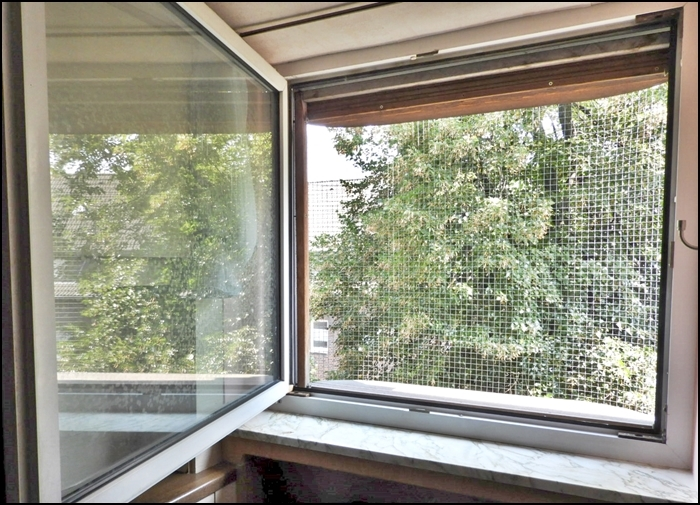
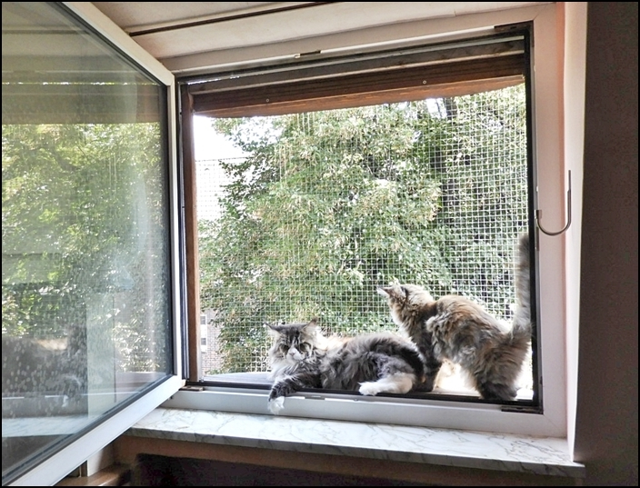
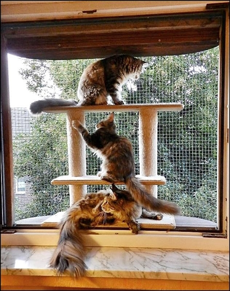
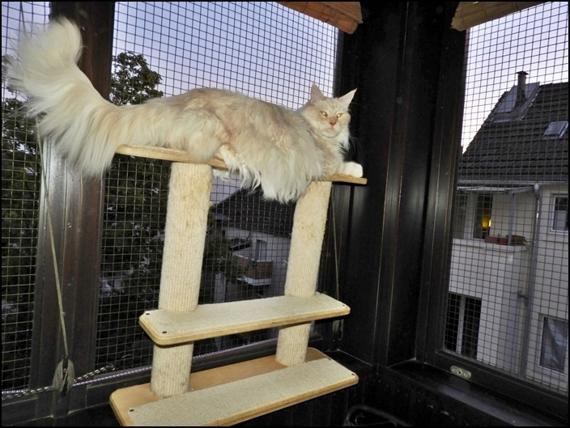
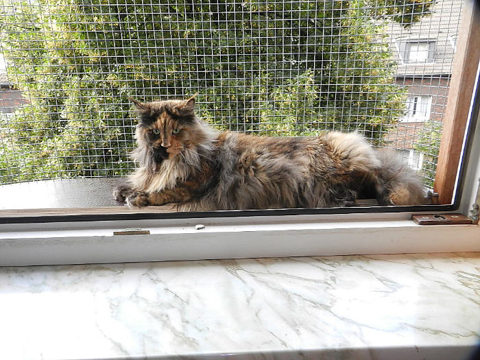
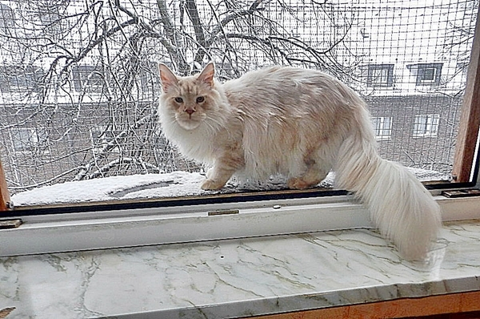
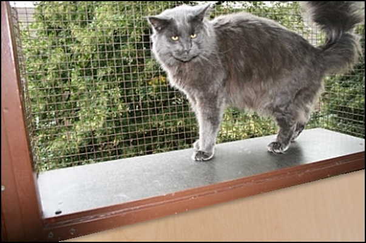
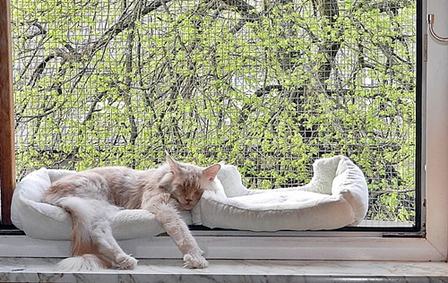

**Außerdem haben wir einige unserer Fenster mit kleinen nach aussengehenden vergitterten Freisitzen gesichert, denn unsere Wohnung liegt im Dachgeschoss. So können unsere Katzen ohne Gefahr im Sommer, teilweise auch im Winter, jedes Fenster als Freisitz nutzen. Wir können ohne Angst, das eine Katze** **verschwindet, lüften. 40 cm Sitzplatte. Stabil gebaut und absolut Katzensicher auch für Maine Coons!**

.......und im Winter

Unsere Kater lieben diese Freisitze!!

