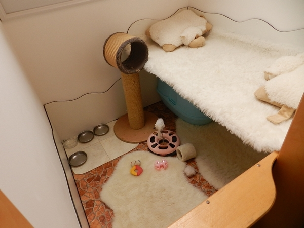
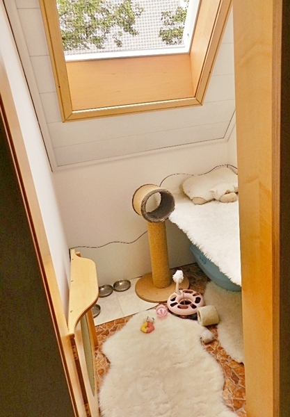
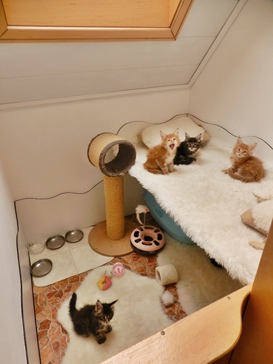
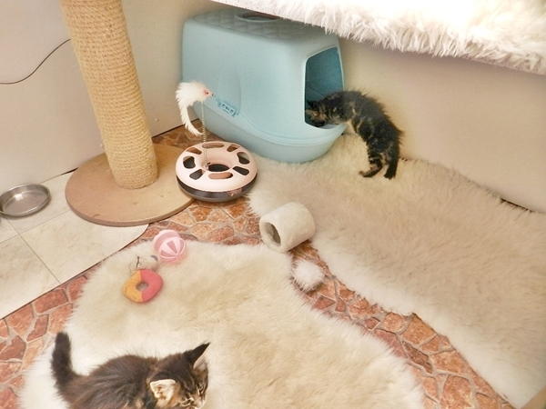
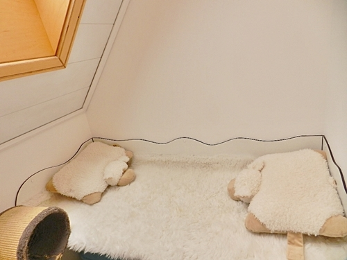

Ein Wurfgehege für die Kleinsten, für Mutter und Kitten für die erste Zeit nach der Geburt. Es ist wärmeisoliert und ein neues Veluxfenster ist auch eingebaut. Alles ist sehr leicht zu reinigen und aus strapazierfähigem Material. Auch mitten in unserem Wohnbereich\
**Ab der 6. Woche kommen die Kitten über den Rand und dürfen die Wohnung entdecken.**

Über die 60 cm Tür kann die Mutter raus und reinspringen in die angrenzende Küche und am normalen Leben nach wie vor teilhaben.

Und die Babys hören und sehen alles, sind geschützt und haben es sehr kuschelig, können spielen futtern und die ersten Kloversuche starten. Ein hübsches freundliches kleines Babygehege mit ganz viel Spielzeug, unsere Katzenmütter lieben es sehr, die Babys fühlen sich dort wohl.

Ist auch gleichzeitig die Fotoecke für unsere Babyfotos

