**Die Baby-Lounge**\
in kuscheligem Pink und rosa

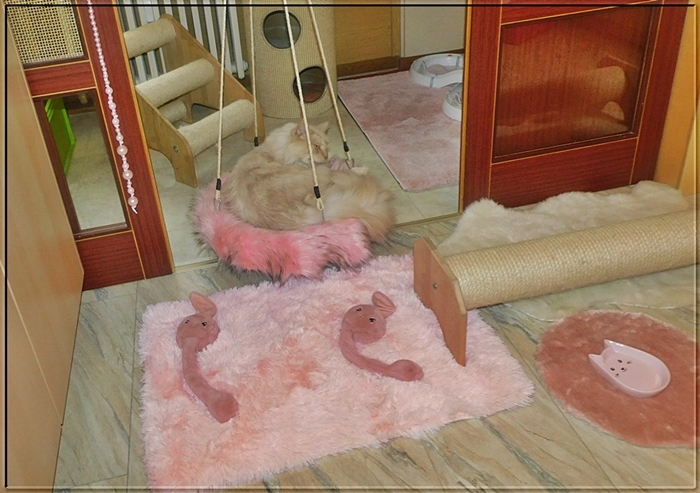
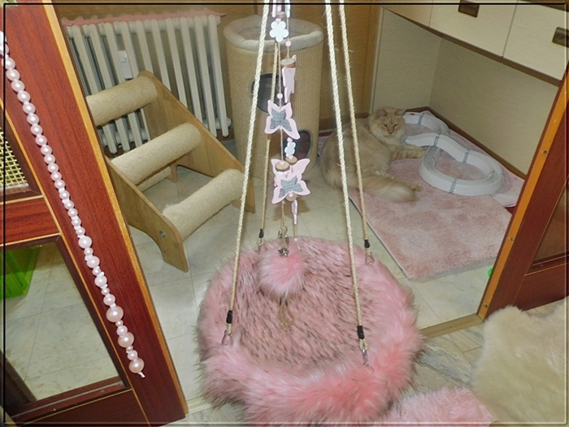
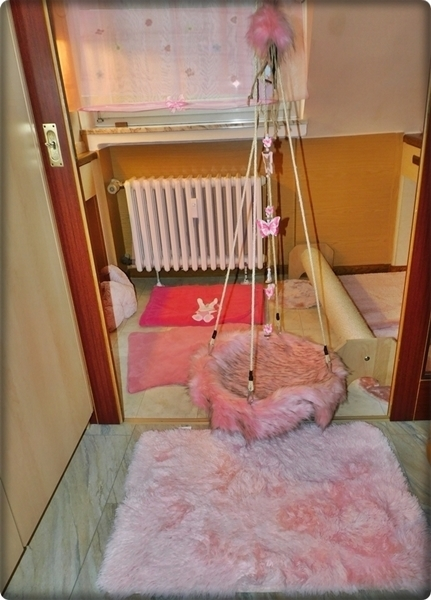
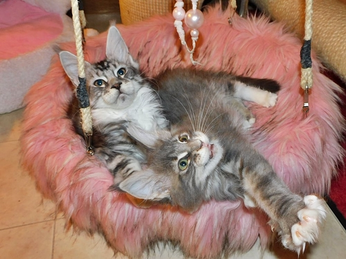

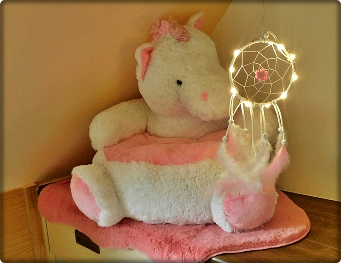

Spielparadies

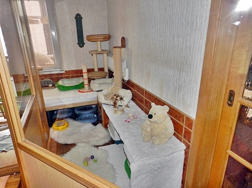
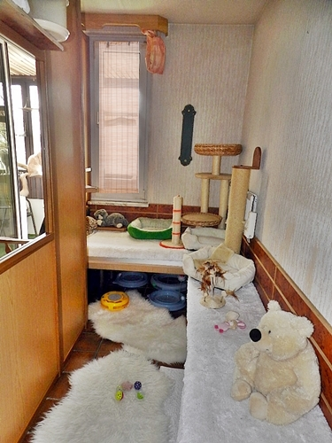

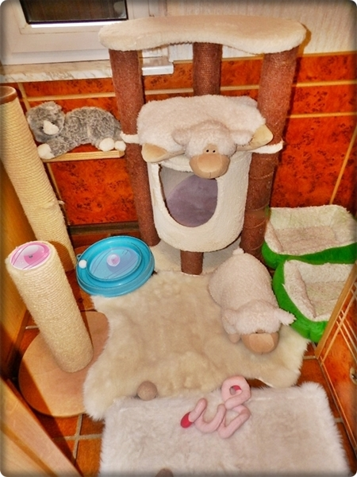

Wenn sie ca. 8 Wochen alt sind können sie in den Freisitz.\
Spielen bei Frischluft und Sonne

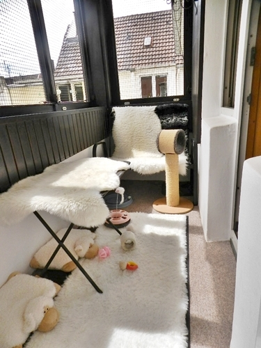
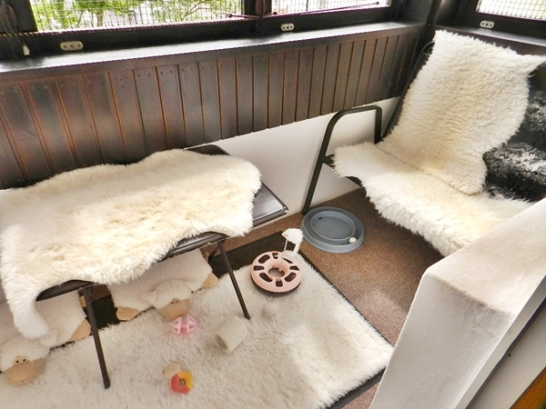
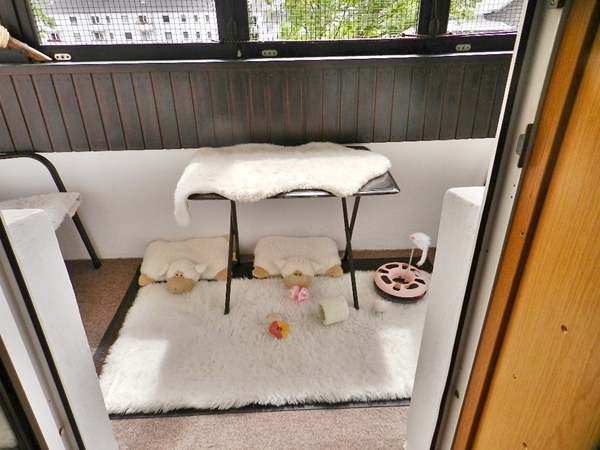
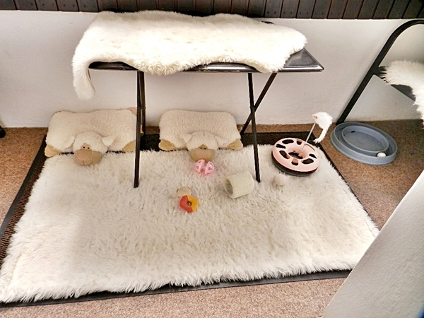
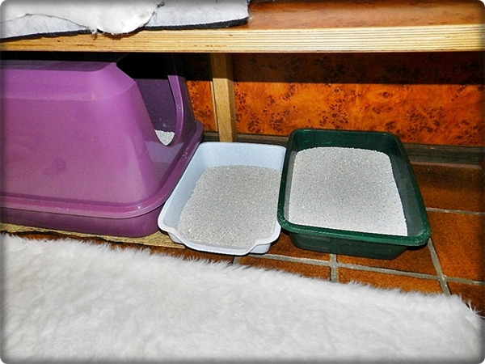
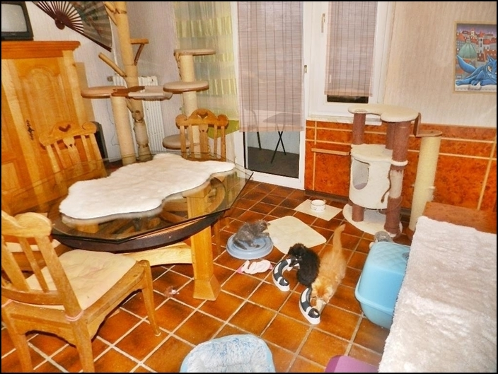

Angrenzend mitten in unserem\
Wohnbereich ein kleines\
Babystübchen

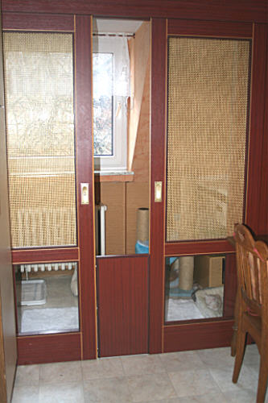

Hier kuschelig, warm und sie sind gut behütet geniessen\
mit Mütter immer ihre Ruhe die erste Zeit

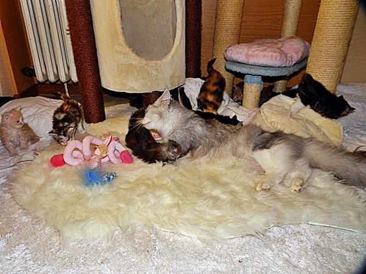

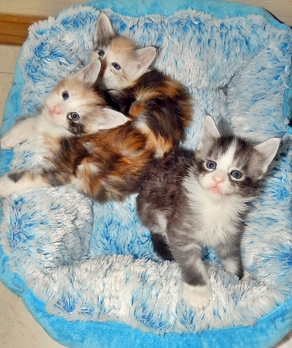
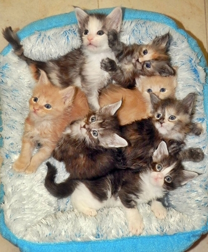

Regelmässig wird renoviert und erneuert!!

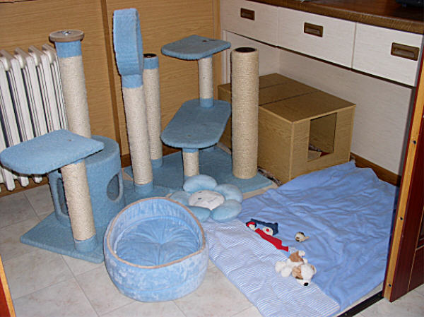
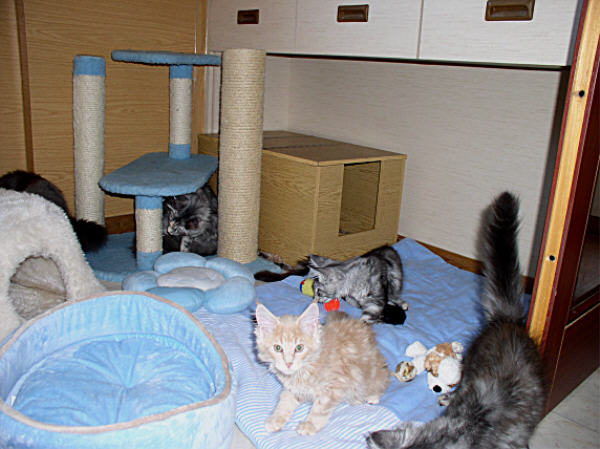
