Bereiche die wir für unsere Katzen ausgebaut haben

Eingebaut in unseren Wohnbereich, haben wir viele Klettermöglichkeiten mit Gelegenheit für Frischluft und Sonne. Bei uns lebt keine Katze isoliert, sondern nur situationsbedingt separiert, z.B. bei Rolligkeiten der Kätzinnen. Die Kater haben rund um die Uhr menschlichen Kontakt, sowie ständigen Kontakt zu ihren Mitkatzen und unseren Hunden und sind niemals ausgegrenzt

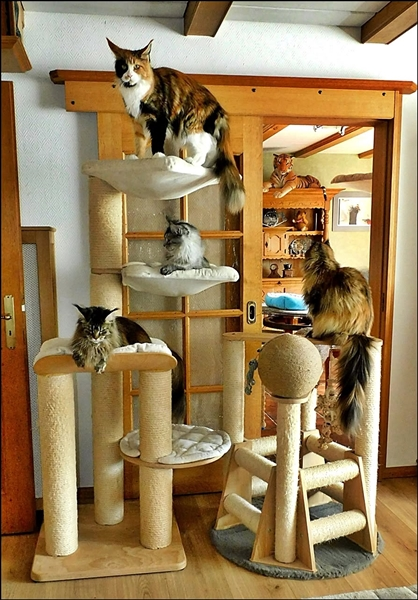

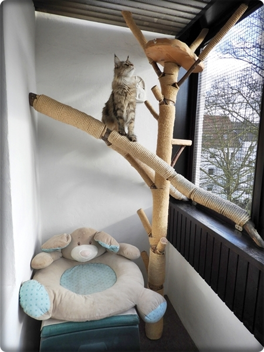
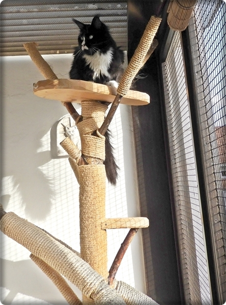

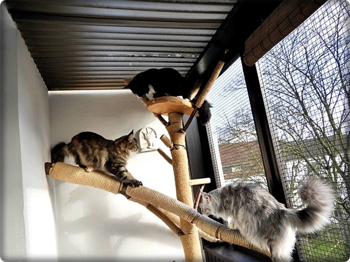
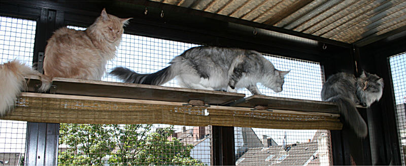
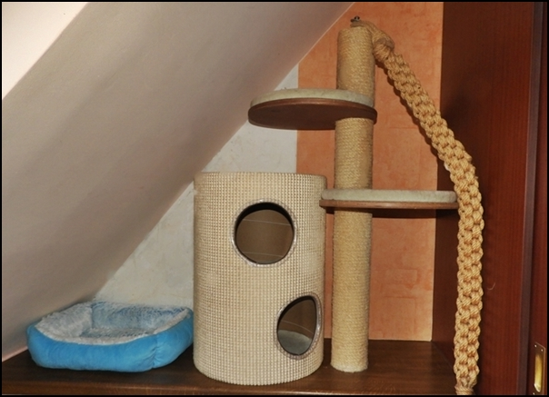
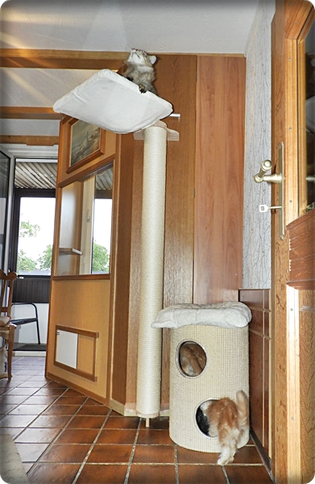

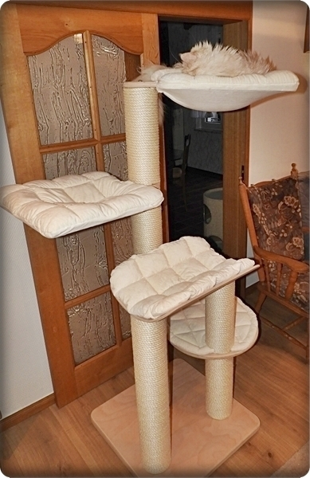
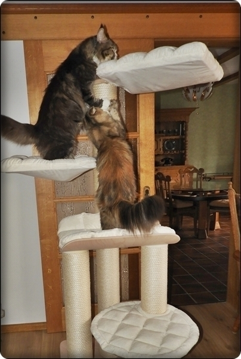

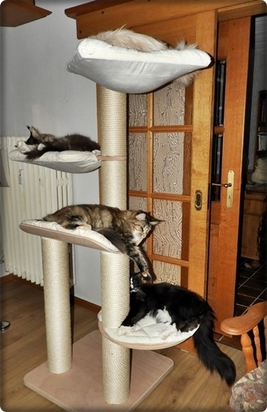
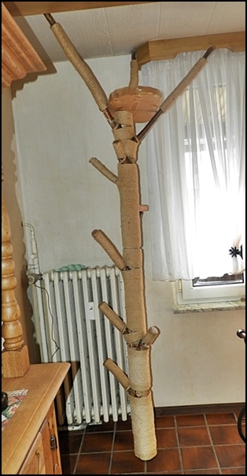

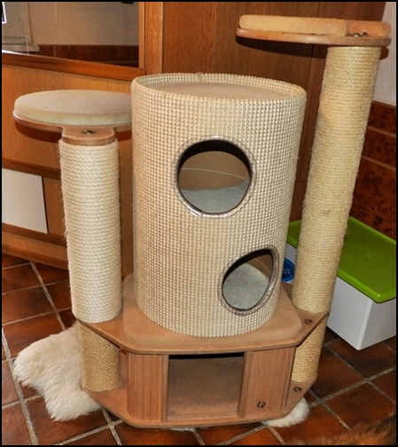

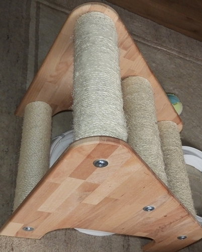
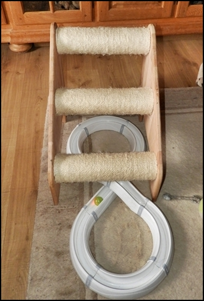

Der Baldachin im Wohnzimmer! Die 2. Ebene für unsere Cats\
Sie lieben diesen Bereich!!

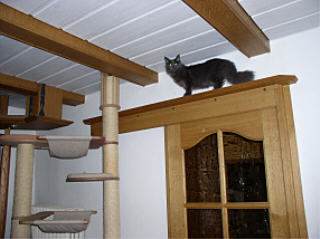
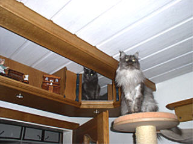

Hier können die Katzen rundum die ganze Wand laufen und sich in die Nischen zurückziehen\
und die Besucher von oben beobachten.

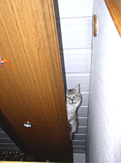
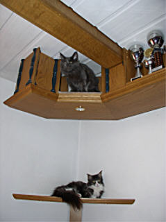

Geht hinten noch um die Ecke.

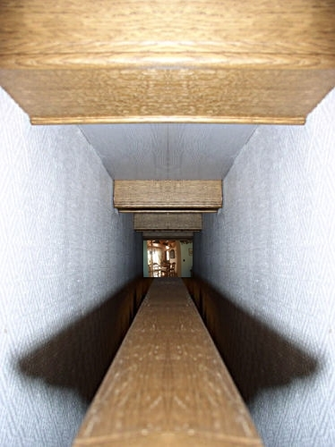

Zum Toben und Klimmen in eigener Handarbeit

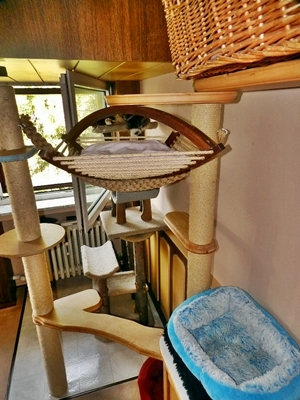
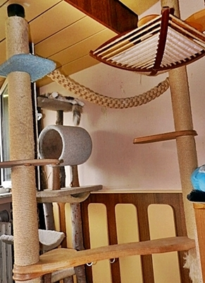

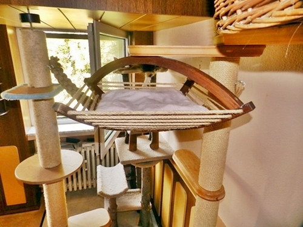

Alle Fenster sind bei uns absturzsicher

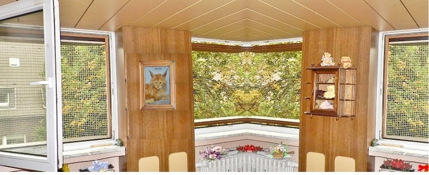
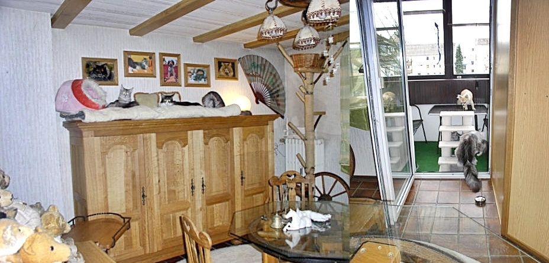

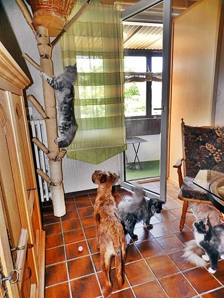
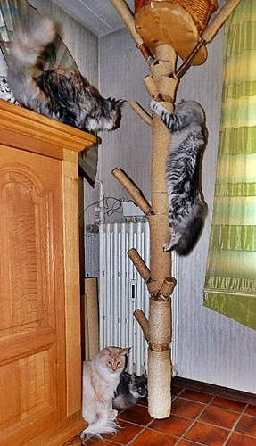

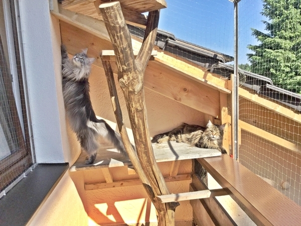
