Unsere Küche

Hier haben die Katzen und Hunde ihre Futterecken. Wir haben die ehemalige Speisekammern umfunktioniert und ausgebaut als Futterecken und als Toiletten-Ecken.

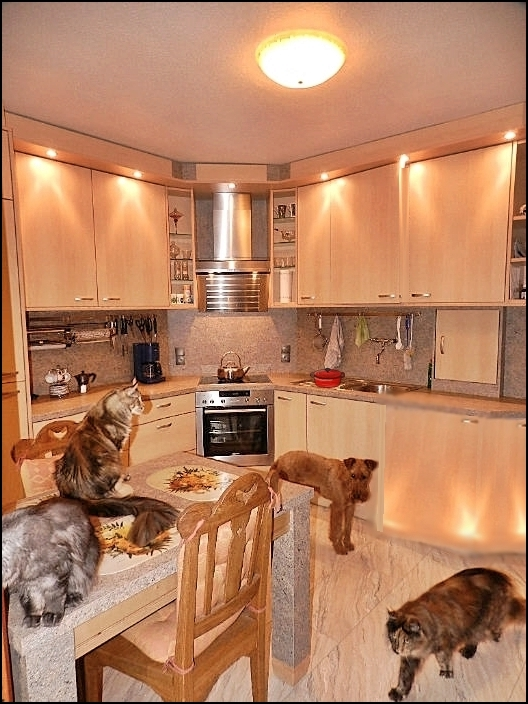
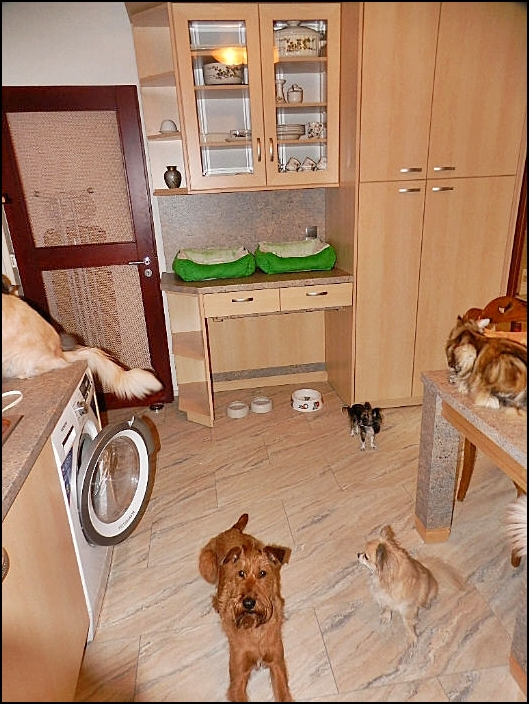
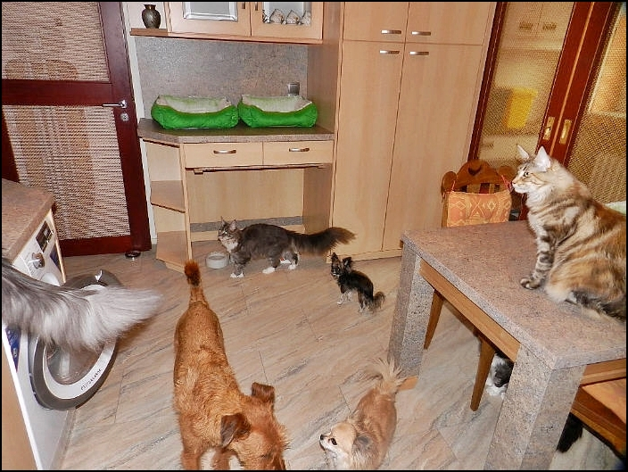

in der Küche sind einige angrenzenden Kittengehege für die ersten\
6 Wochen für Mama mit Babys

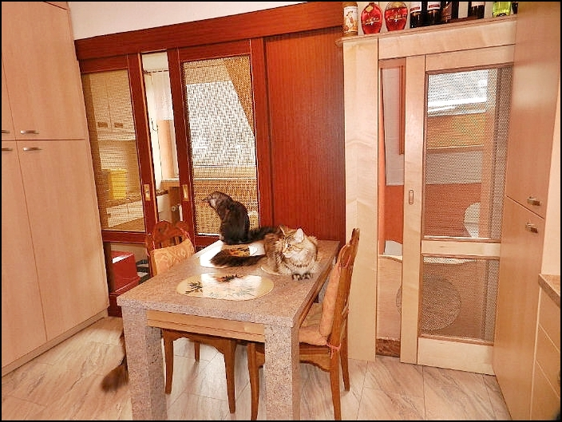

Es gibt mehrere Futterplätze wo sie immer in Gemeinschaft\
fressen können

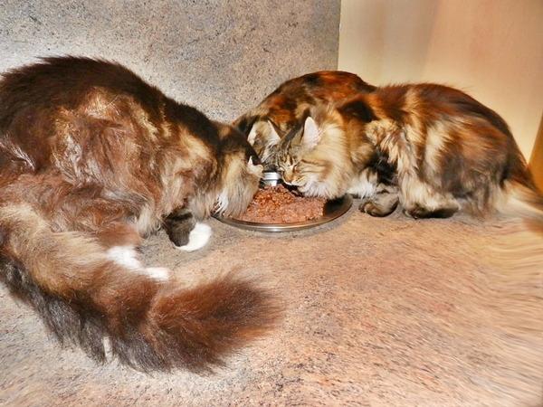

Die Katzen sortieren sich meist selber wo sie am liebsten fressen.

Hier ist noch ein Futterplatz, der sehr gerne von unseren\
Katzen genutzt wird.

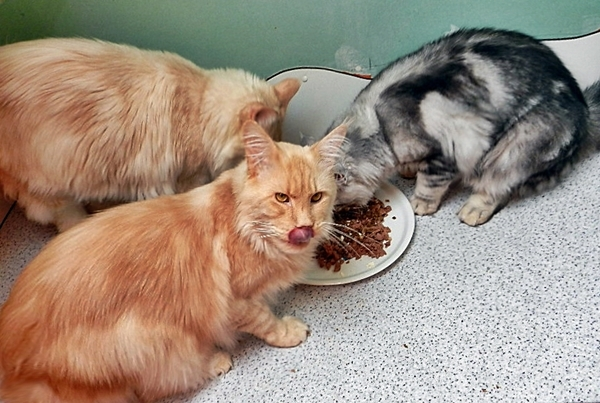
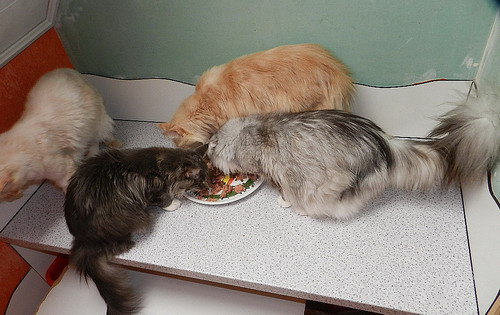

Futterplatz für unsere Hunde

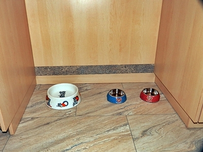

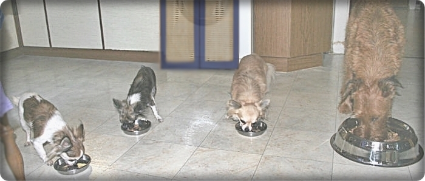

Unsere Katzenklos stehen in seperate Bereiche, damit die Katzen ganz in Ruhe ihre Geschäftchen verrichten können. Unsere Mega Katzenklos. Es gibt 2 weiße und 5 rote Klos mit und ohne Überdachung.

Maße der offenen Katzentoiletten:\
75 cm Länge, 60 cm Breite, 35 cm Höhe

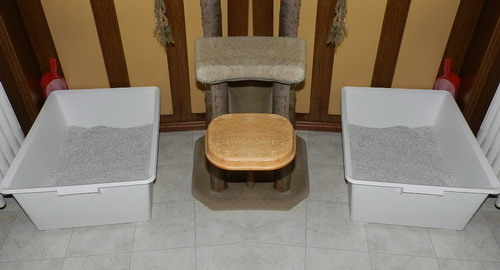

Große Kater brauchen Platz zum buddeln. Die Einstreu halten wir immer auf 18 cm. Foto: "Deputi" 6,5 Monate alt.

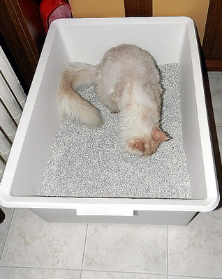
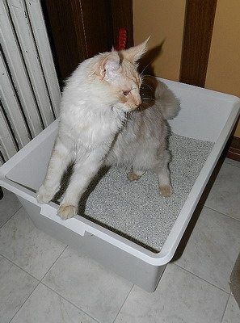
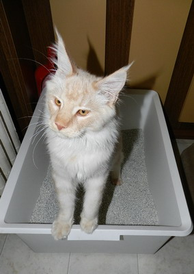

Eine ehemalige Abstellkammer haben wir zur Klo-Ecke ausgebaut mit Absperrung.\
Hier die 2 riesigen roten Klos.

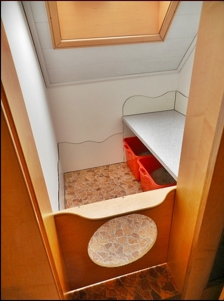
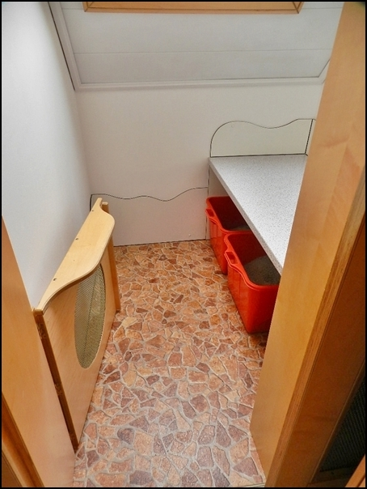

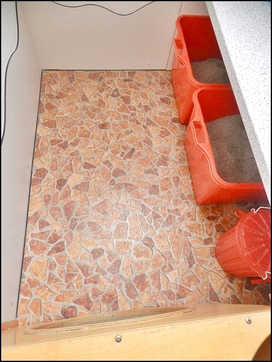
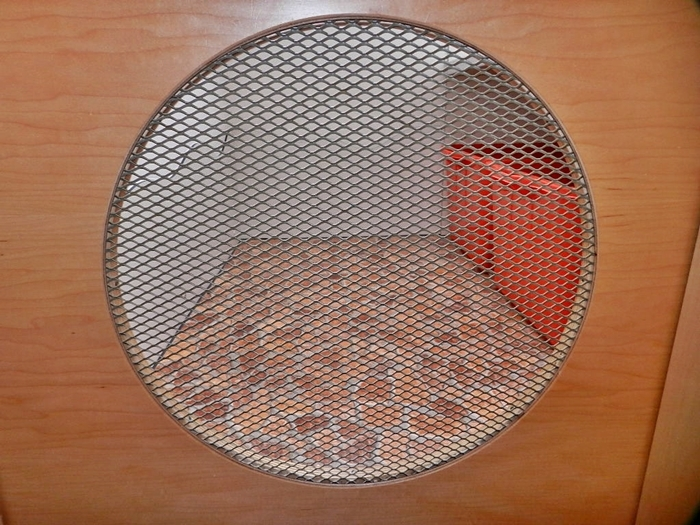

Sowie 2 überdachte Klos

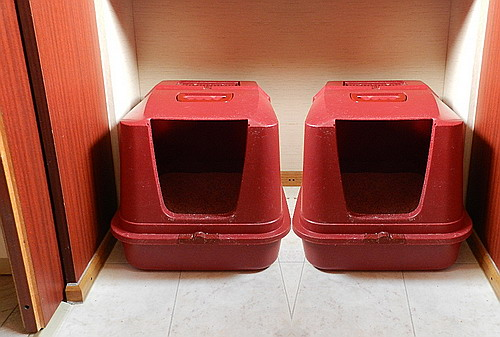
