Unser Wohnzimmer

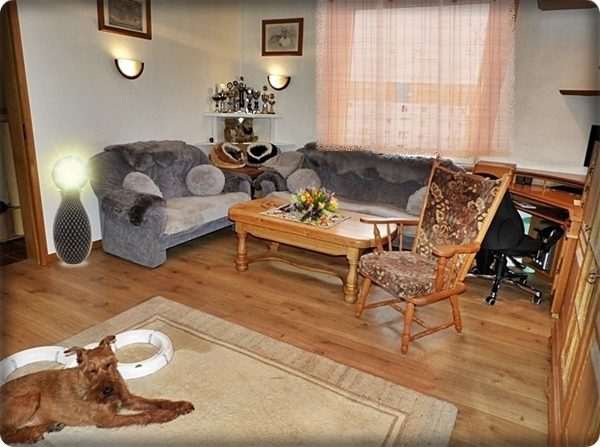
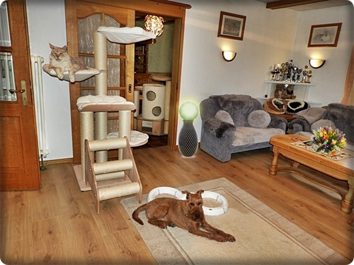
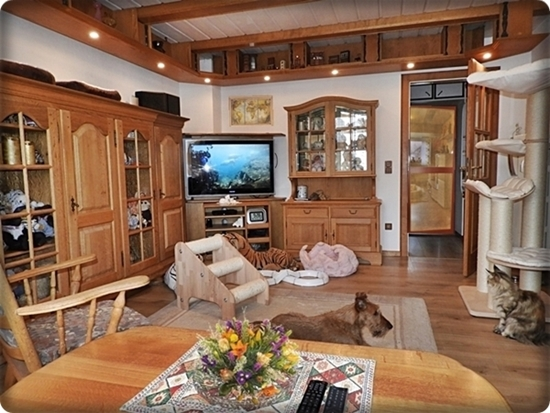

Der Eingangsbereich

Hier gehts zu unserer Wohnung. Das ist der Korridor von da aus kommen die Katzen in alle Räume. Der lange Korridor geht noch hinten um die Ecke und wird von unseren Katzen gerne als Rennstrecke benutzt.

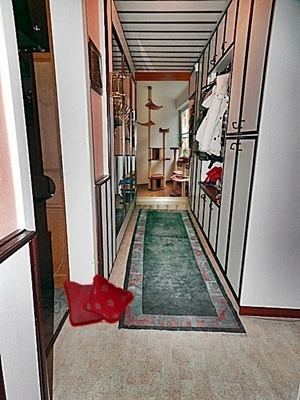
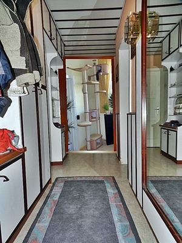
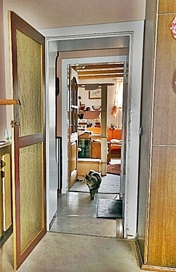

Einblick in unser Wohnzimmer und Haupttreffpunkt aller unserer Katzen. Es gibt hier keinen Punkt wo unsere Katzen nicht hindürfen. Es gibt ganz viele Hochplätze bis unter die Decke. Oben unter der Decke ist ein Baldachin wo die Katzen rauf können in ihre 2. Ebene, dort haben sie eigens für sie ausgebaute Ruheecken und einen Tobebereich.

**Wohnzimmer**

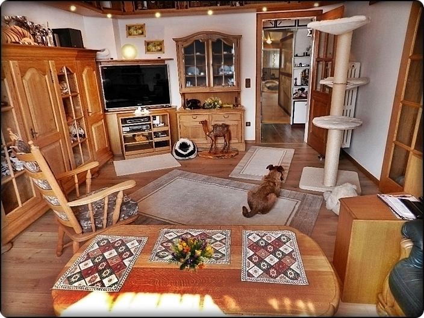

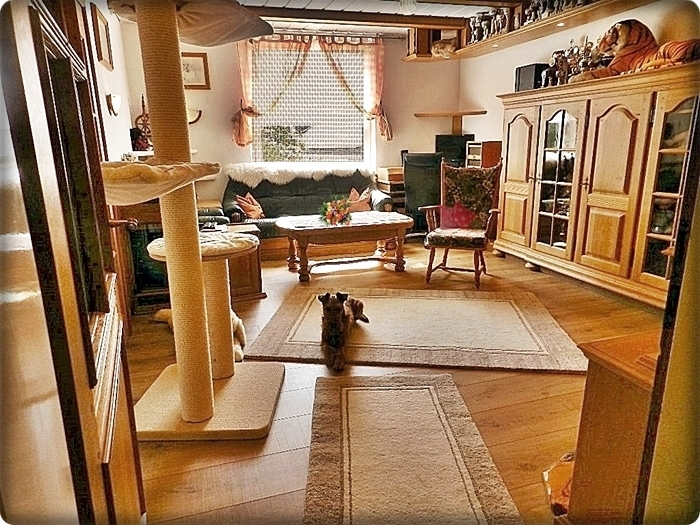

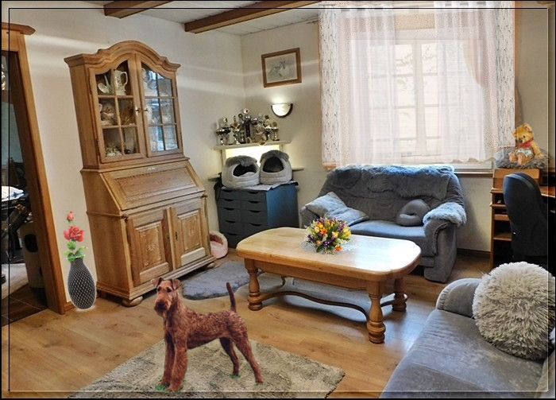

Unter der Decke haben wir für die Katzen einen Baldachin gebaut.\
So können sie rundum in ihre 2. Ebene

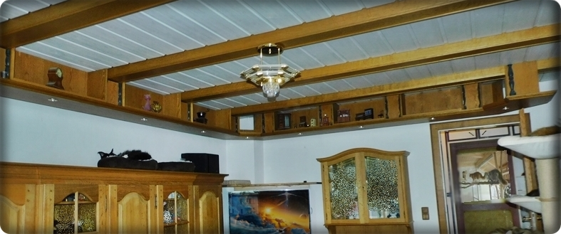

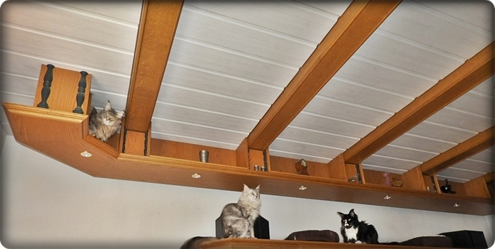

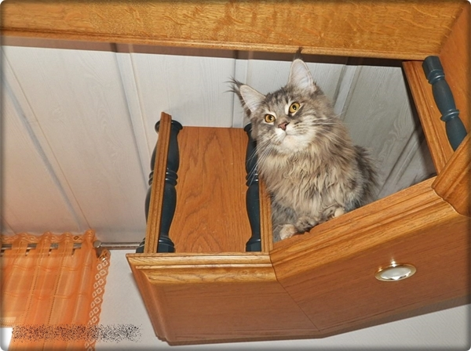

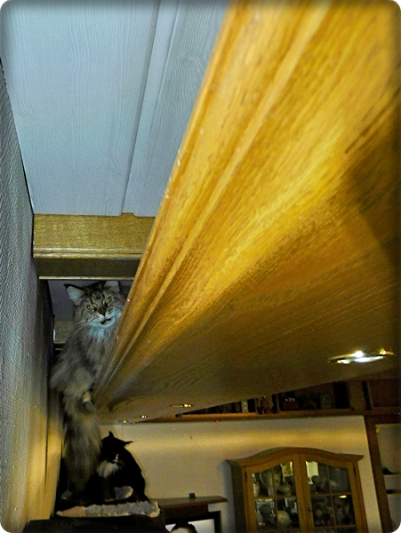
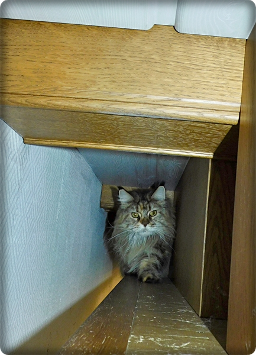

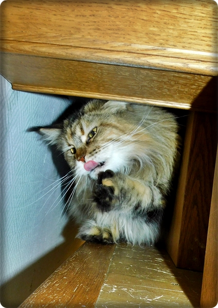

**Eßzimmer**\
und liebstes Tobezimmer unserer Katzen mit anschliessendem gesichertem Freisitz\
Auch hier dürfen die Katzen überall hin und können von da aus nach draussen an die Luft.

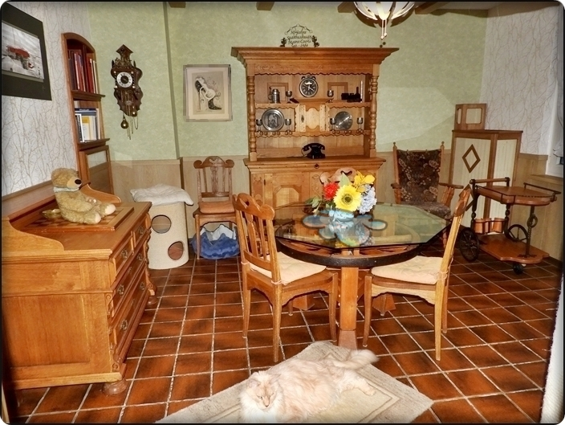

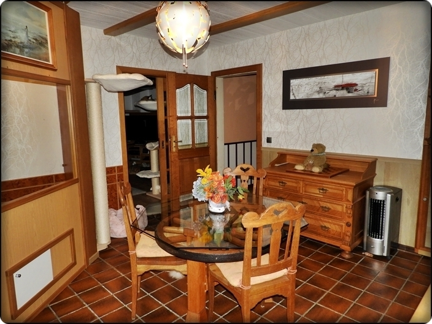

rechts ist unser kleines Geburtszimmerchen. Dort kriegen\
wir zusammen die Babys

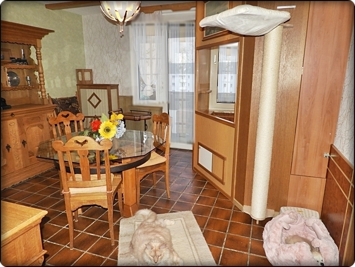

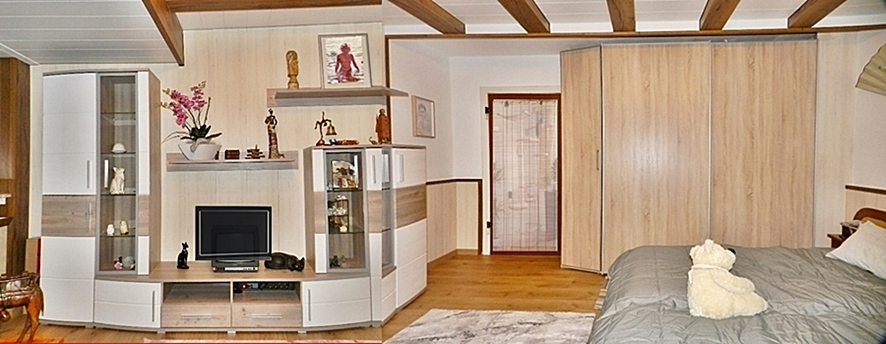
