Immer wieder schön anzusehen wie sich bei unseren Zuchttieren und deren Nachwuchs solch ein liebes und soziales Verhalten festigt. Erst wenn die Kitten das ausgelebt haben gibt es keine Probleme im neuen Zuhause. Sie lernen untereinander Spiel und Kuschelzeit. Sie lernen den Respekt zu unseren großen Katzen und den Umgang mit Hunden.

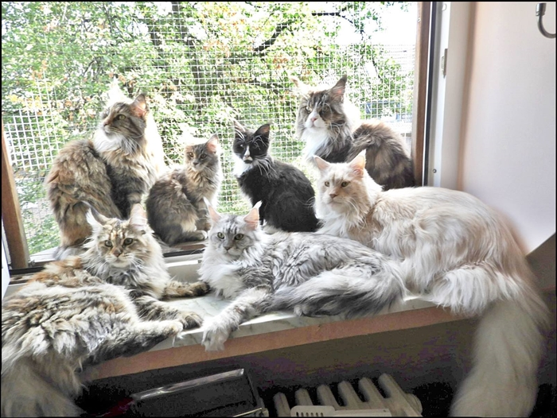

Hier mal ein Beispiel. Einer unserer potententen Deckkater\
mit seinem Nachwuchs

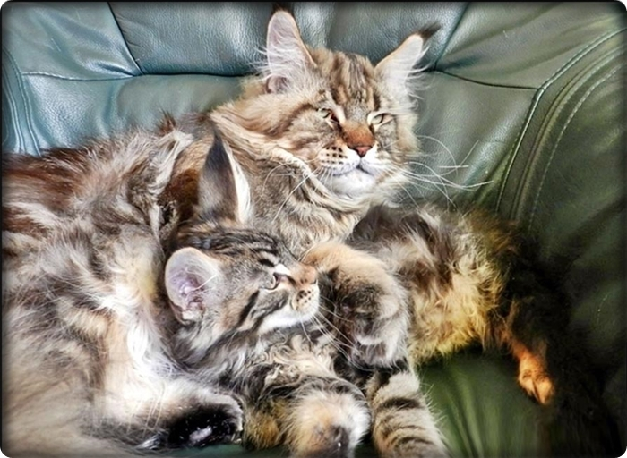

Kuschelzeit der Babys

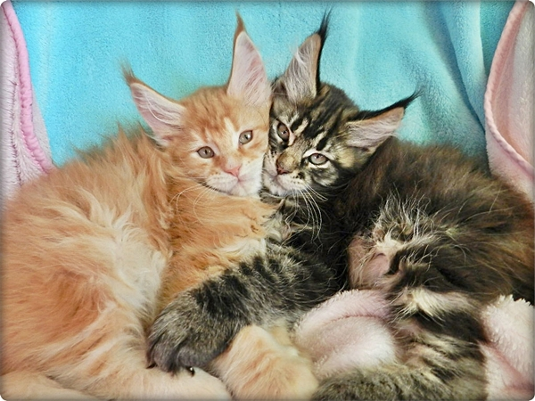
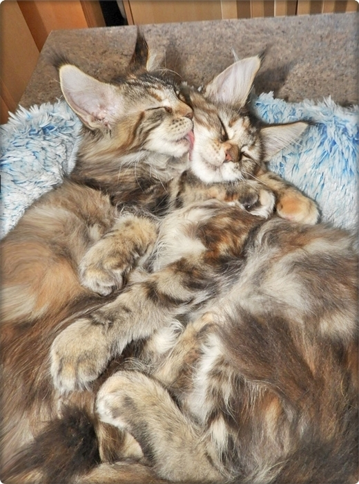

Spielen zusammen

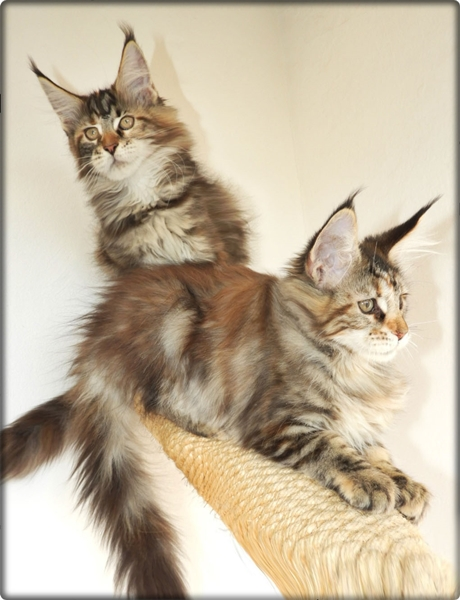

und lauschen zusammen den Vögeln, am Fenster

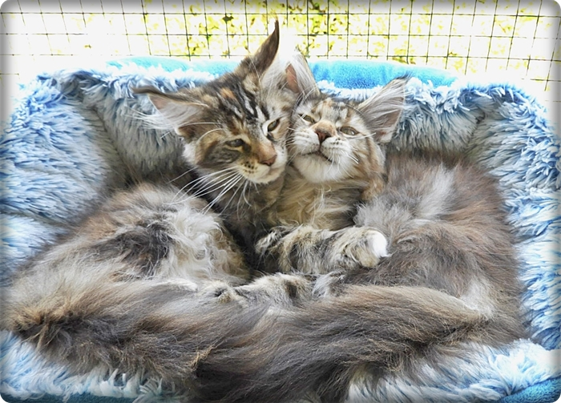
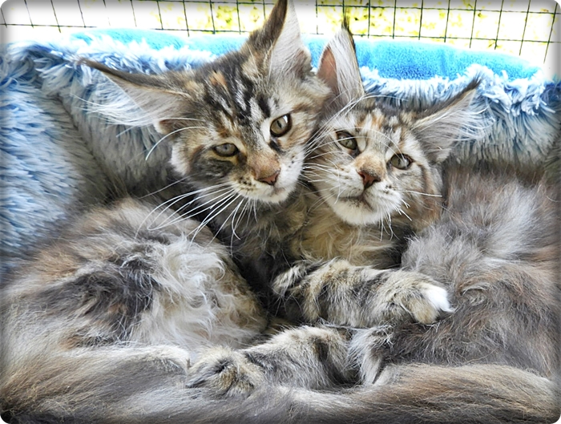

Auch gut für die Prägung unserer Kitten ist der gutmütige Deputi. Er ist der geduldige große dicke Onkel. Alle Babys lieben das große blonde Plüschsofa.

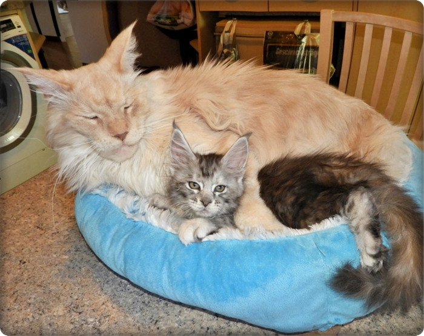

Manchmal wird er auch als Hüpfburg mißbraucht......

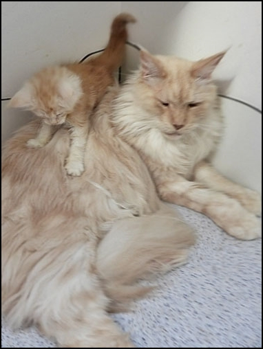
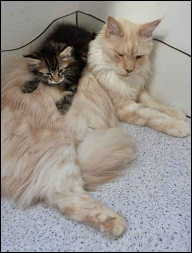

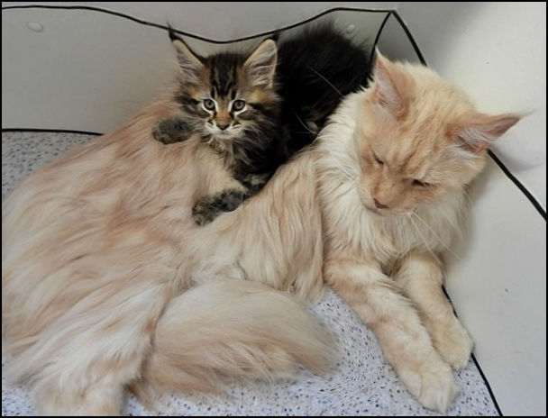
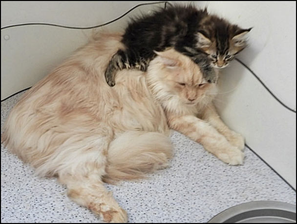
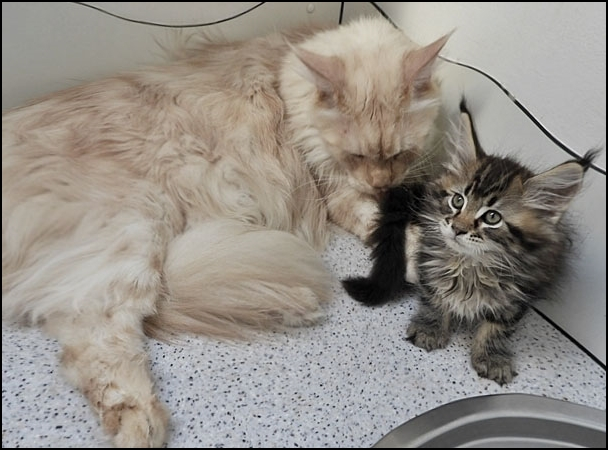

......oder als warmes weiches Kissen

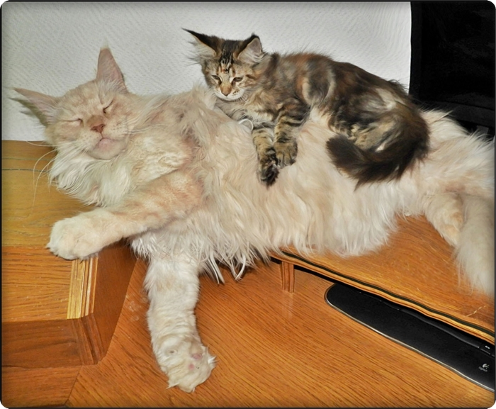

Zwei potente Deckkater bei uns. Unsere Kitten beobachten wie die\
erwachsenen Katzen miteinander umgehen und lernen dadurch gutes\
Sozialverhalten.

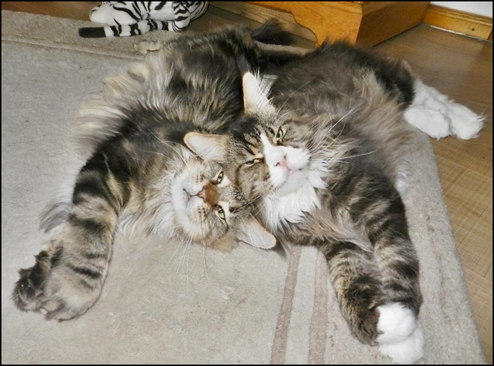
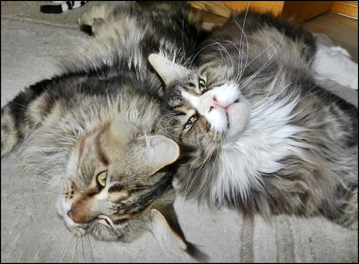
