**Einblick in unsere Kittenaufzucht**\
Wir haben den Luxus das unsere Katzen und Kitten mit uns 24 Stunden am Tag eng in\
unserem Wohnbereich zusammenleben.\
Unsere Kitten wachsen vom ersten Tag an in unserer Gemeinschaft auf. Anfangs geschützt und wenn\
sie laufen und stubenrein sind, dürfen sie in der ganzen Wohnung rumflizen

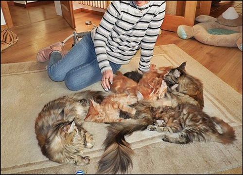

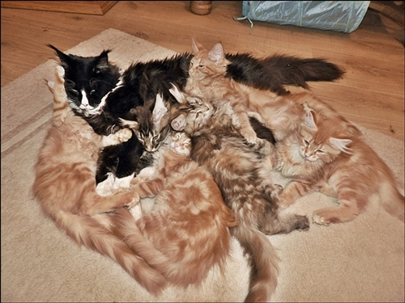

Geburtsvorbereitung für die ich mir Zeit nehme. Ich mache die Geburt\
immer ganz alleine mit meiner Katze, ganz entspannt und ganz in Ruhe.

**Klicken Sie die Bilder zum Vergrößern an.**

[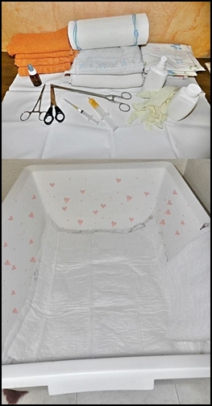](aufz2.jpg)
[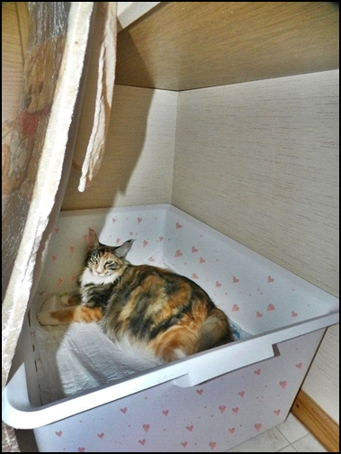](aufz3.jpg)

Ein freundliches warmes Geburtszimmer

[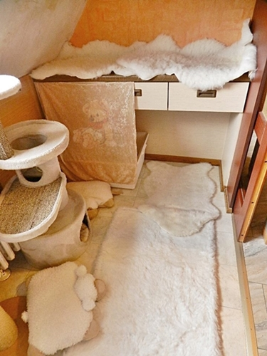](aufz5.jpg)

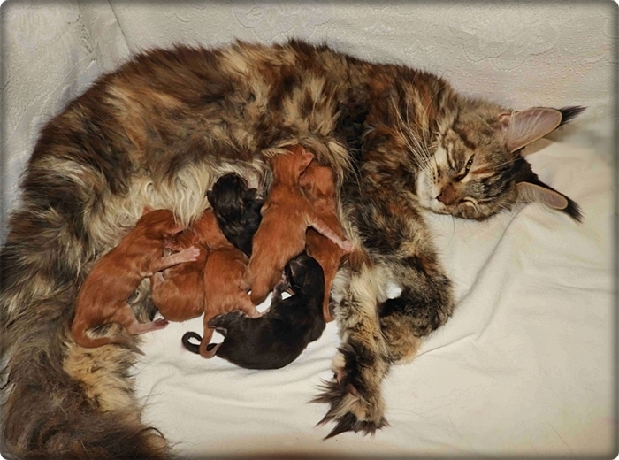

Manchmal ziehen wir 2-3 Würfe zusammen auf, wo die Mütter eine große Kittenstube haben. Die Mutter oder die Mütter haben mit ihren Kitten einen eigenen Bereich wo sie ganz in Ruhe ihre Kitten aufziehen und Sicherheit haben, damit sie nicht die Kitten schleppen. Sie können aber von da aus immer wann sie wollen aus diesem Bereich heraus und am Alltagsleben mit den anderen teilhaben

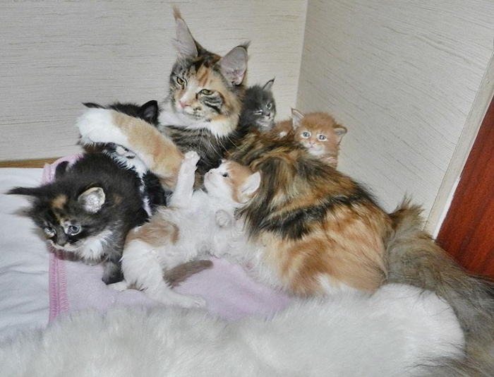

[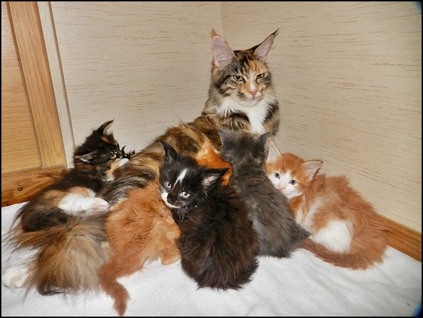](aufz4.jpg)

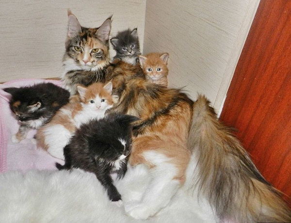

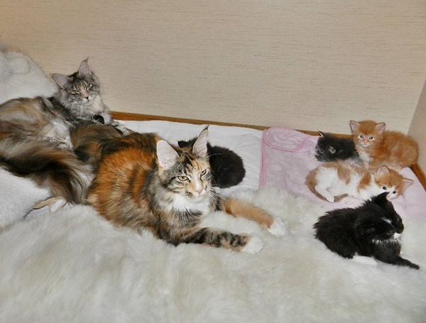

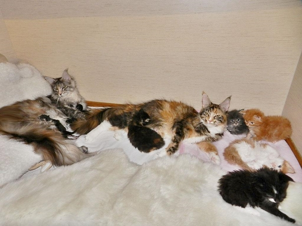

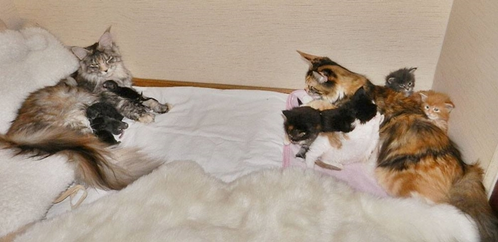

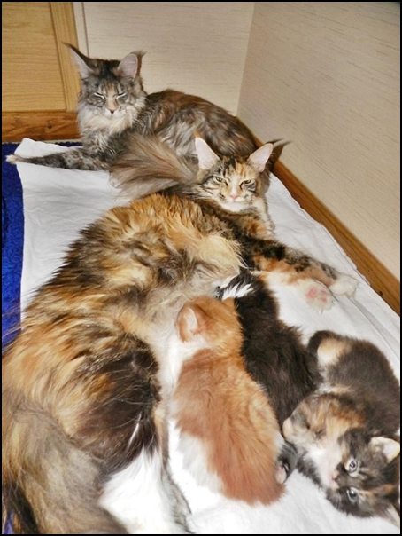

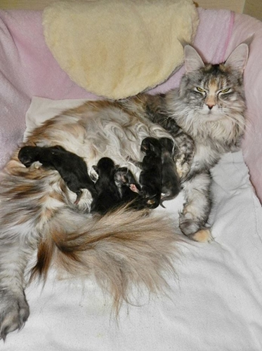

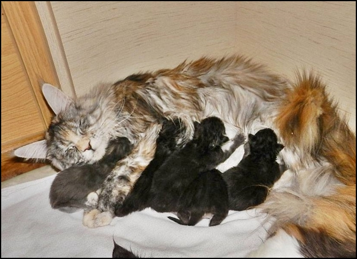

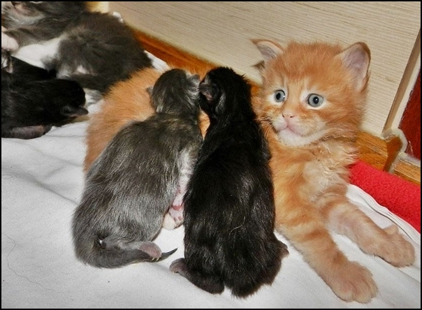

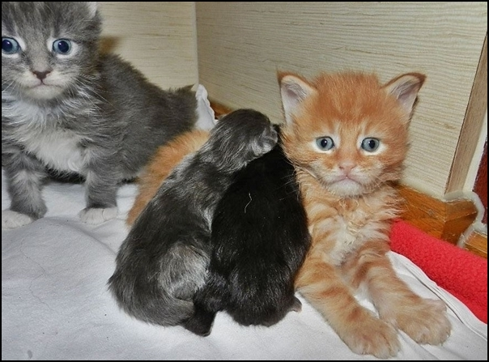

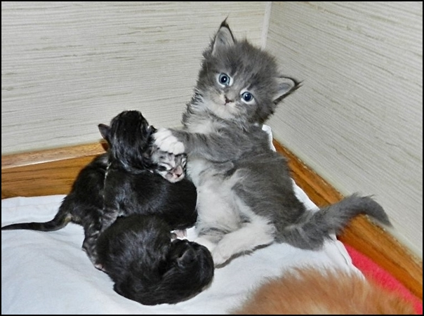

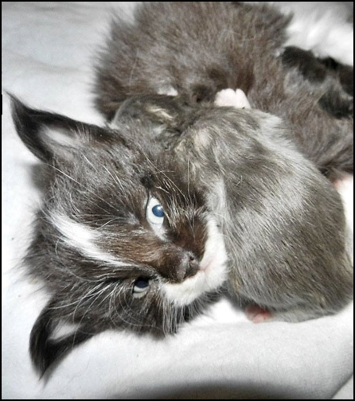

[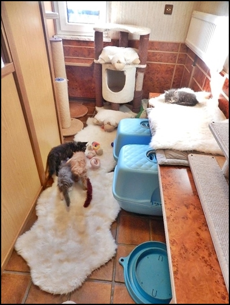](aufz12.jpg)

