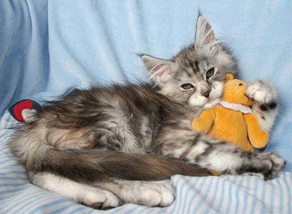
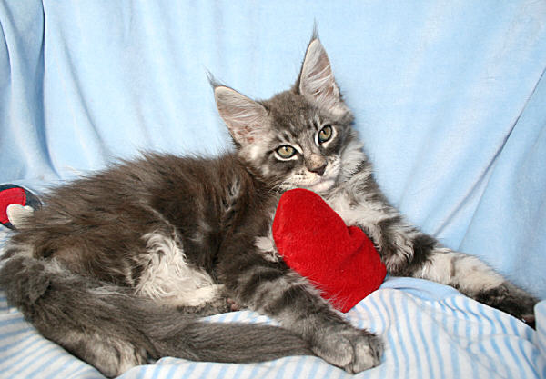
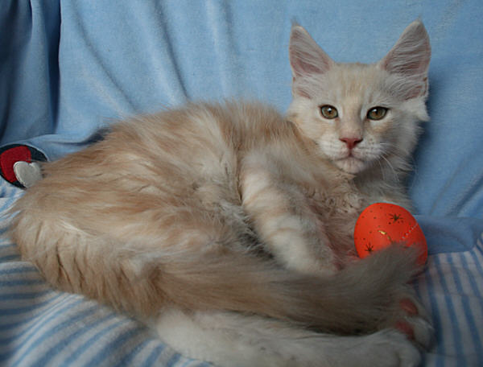
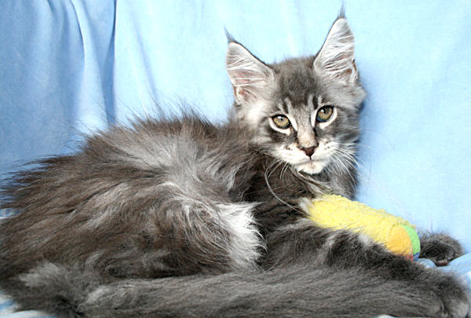

Die Babys von:\
Oxygen of El Dorado X Jack D. of Saxonyforest\
geb. Juli 2009

\>Starbushway Sweet Femina\<\
blue silver torbie

12 Wch. alt.\
Unsere wunderschöne Puderquaste mit ihrer sehr hellen Silberausfärbung. Sie ist unser.\
absoluter Fotostar. Hinsetzen, liebgucken, abdrücken, fertig - Fotos im Kasten.

\>Starbushway Mega Blue\<\
blue silver tabby

12 Wch. alt.\
Unser Rennpferdchen auf hohen Beinen, mit langgestrecktem Körper und einem ganz\
aussergewöhnlich markanten Typ. Ein lustiges und immer fröhliches Katzenkind.\
Sie zieht in eine Zucht nach Deutschland

\>Starbushway Laduma\<\
cream silver tabby

12 Wch. alt.\
Ein ganz lieber und sehr typvoller kleiner Löwenmann. Ein markanter Blonder wie\
man ihn selten sieht. Ein bißchen hat er die sensible Seite seines Vaters mitbekommen.\
Er lebt in Dänemark bei Vibeke als Liebhaberkater

\>Starbushway Discover\<\
blue silver tabby

12 Wch. alt.\
Er ist eine Granate in blue silver. An diesem Kater ist alles wirklich Klasse und am\
liebsten (wenn wir nicht andere Pläne hätten) würden wir ihn behalten.\
Jetzt heisst er Milow und bereichert einen Liebhaber-Katzenhaushalt.

Zurück
