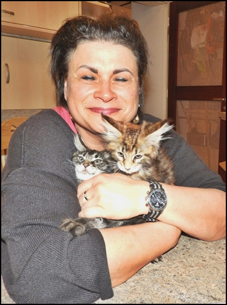

die Arbeit eines guten Züchters kann man am Ende des Tages gar nicht bezahlen, aber der Schlüssel liegt in:\
\* regelmässigem Gesundheitscheck der Elterntiere, Herzschallungen, Nierenschallungen, Gen-und Bluttests\
\* genauer Auswahl der Elterntiere, nach Gesundheit, Typ, Charakter und Genetik\
\* super Aufzucht und Sozialisierungsbedingungen zu Umgebung, anderen Tieren und Menschen\
\* guter/hochwertiger Fütterung, sowohl der Elterntiere, als auch der Kitten\
...die Liste ist eigentlich noch endlos...

**Der Preis, den ich für mein Kätzchen berechne, ist NIE Gewinn, sondern es sind Investitionen in die nächste Generation.**

Zur Abgabe unserer Kitten\
Abgabe unserer Kitten ist mit 13-14 Wochen. Wenn sie ins Ausland reisen bleiben sie bis 4 Monate hier bei uns. Wir versenden nicht per Flieger oder Bahn, auch von ausländischen Käufern müssen die Kitten hier bei uns abgeholt werden.

Zur Reservierung\
Ein Kitten ist erst fest reserviert, wenn eine Reservierungsgebühr geleistet wurde.  Optionen oder mündliche Reservierungen sind bei uns nicht möglich, ebenso gibt es bei uns keine Raten oder Teilzahlung.

Eine Reservierungsgebühr wird nur von uns zurückgezahlt, im Falle von:\
Krankheit oder Tod des Kitten oder sollten sich für den künftigen Züchter zuchtrelevante Mängel bei dem Kitten entwickeln. Ansonsten wird eine Reservierung nicht zurückgezahlt, egal aus welchen Gründen!!

Zum Preis\
Nur Preisabfragen ohne Interesse an einem Kitten beantworte ich nicht mehr.

Gesundheitsvorsorge\
Ab der 9. Woche bekommen die Kitten ihre 1. Impfung vom Tierarzt gegen Katzenseuche/Schnupfen sowie vorher eine gründliche tierärztliche Untersuchung mit allem was dazugehört. Mit der 13. Woche bekommen sie die 2. Impfe (evtl. plus Tollwut), dann werden sie auch gechipt und haben einen EU-Pass .  Zu dieser Zeit sind sie mehrfach tierärztlich untersucht. Unsere Tierärztin kommt zu uns ins Haus, auch für sämtliche Untersuchungen, Blutabnahmen etc.

Tierärzte unseres Vertrauens. Viele lange Jahre begleiten\
sie unsere Zucht

Unsere Frau Dr. Ricking (links) mit Praxisassistentin Frau Benk

**Frau Dr. Ricking (links) mit ihrer TM-Fachangestellten M. Jansen**

Wir freuen uns immer über nette Interessenten, sowie Liebhaber für unsere Kitten. Bei uns erhalten Sie alle Informationen die Sie brauchen und wollen, kompetent und ausführlich. Es gibt keine Frage die ich Ihnen nicht beantworten kann!

Zurück
