Kitten von Starbushway Push Balboa und Mainefield Sgt. Pepper

Am frühen Silverstermorgen bekam unsere Push 10 Kitten!!\
Es ist eine Verpaarung die nicht wiederholt wird. Push wird\
nach absetzen der Kitten kastriert. Nochmal wollen wir ihr\
so einen großen Wurf zumuten.

1 Kitten nuckelte grad bei Mama, darum sind nur 9 auf dem Foto

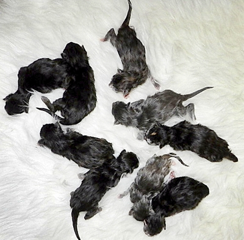

Fotos der Babys im Alter von 12 Wochen

\>Santa-Ninfa\< vergeben\
black silver torbie classic\
lebt in einer kleinen Zucht bei Kassel

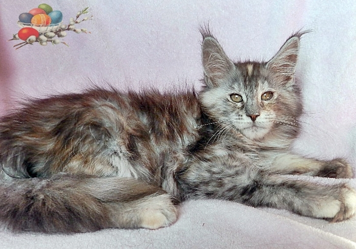

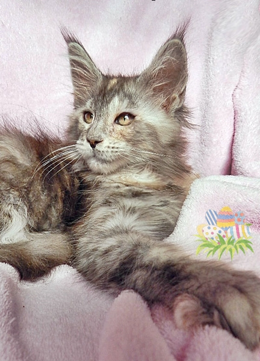
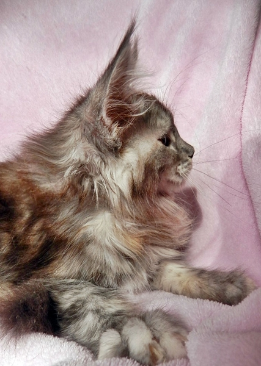

Sie ist schon ausgezogen, somit nur dies Foto mit 10 Wochen

\>Pa-Muka\< vergeben\
black tortie\
Lebt Liebhabern

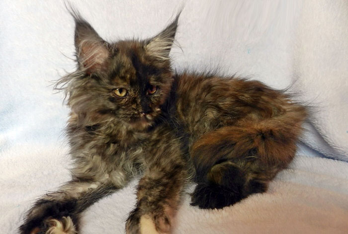

\>Bi-Sione\< vergeben\
black tortie smoke\
Lebt in einer sehr netten Zucht am Starnberger See

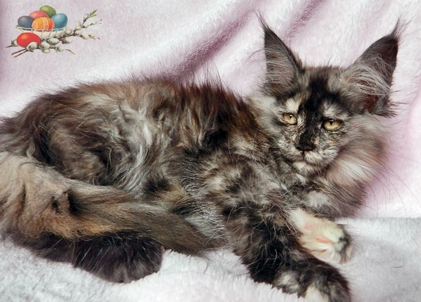

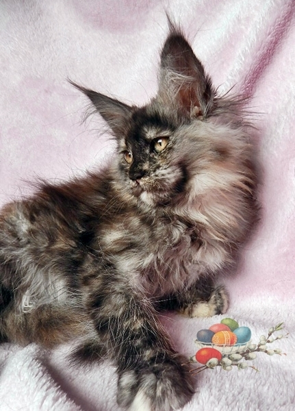
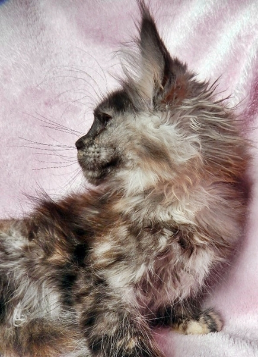

\>Pata-Gonia\< vergeben\
blue silver torbie classic\
Lebt in einer Zucht im Siegerland

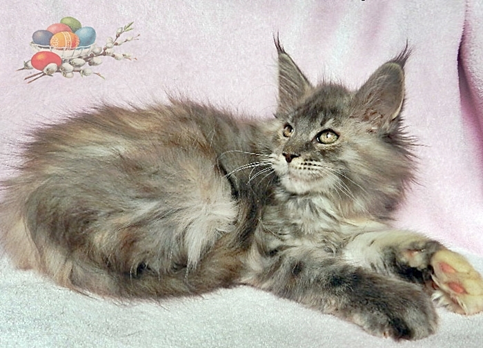

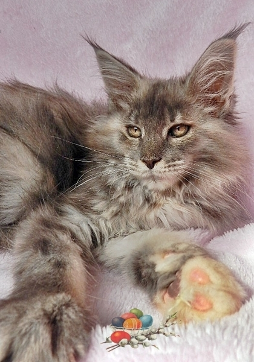
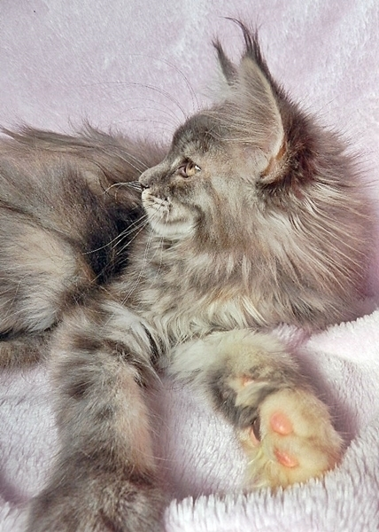

\>Ca-Tonia\< vergeben\
blue silver torbie classic\
Lebt bei netten Liebhabern in Augsburg

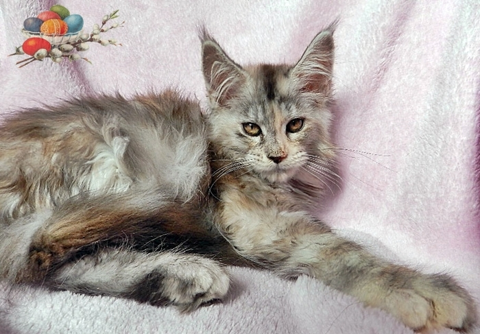

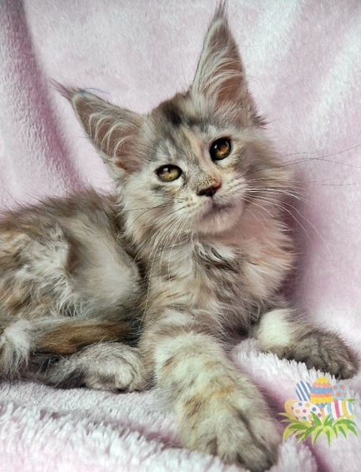
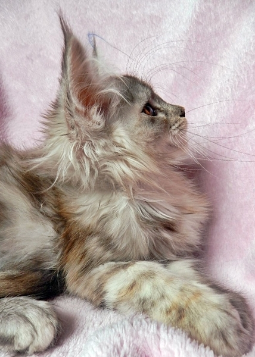

\>Fal-Cone\< vergeben\
blue smoke\
lebt in einer netten Zucht in Franken

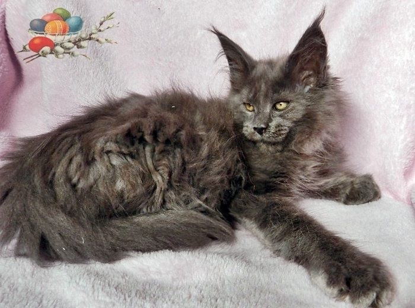

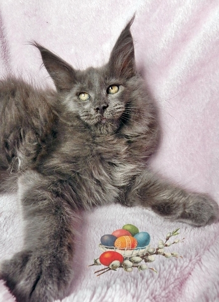
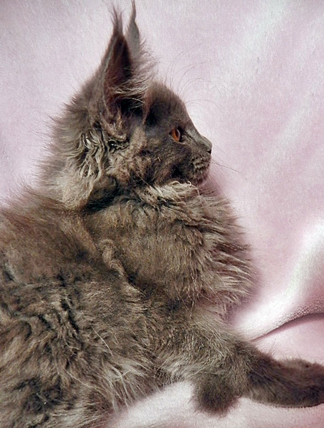

\>Mi-Lazzo\<  vergeben\
black smoke\
Lebt bei Liebhabern in Duisburg wo es sich schon 3 Starbushways gut gehen lassen

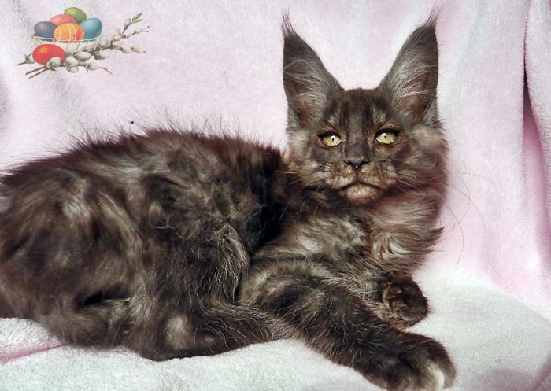

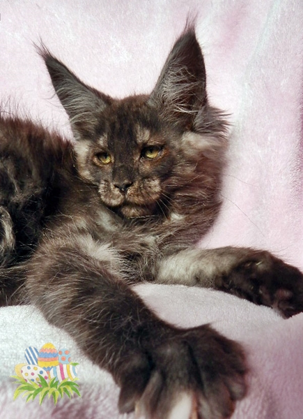
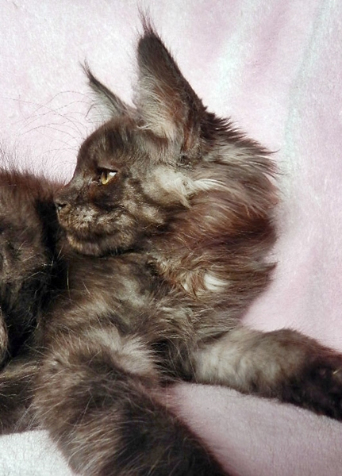

\>Pa-Chino\< vergeben\
black smoke\
Lebt in einer netten Zucht in Bad Dürkheim

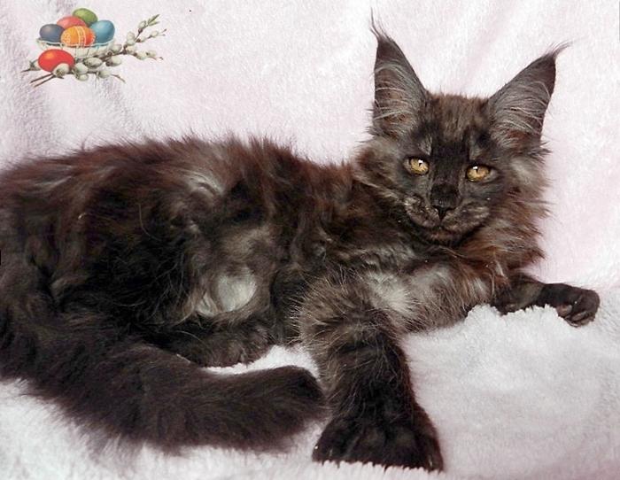

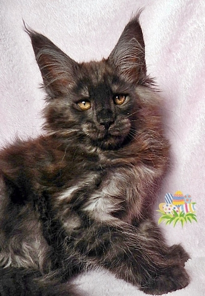
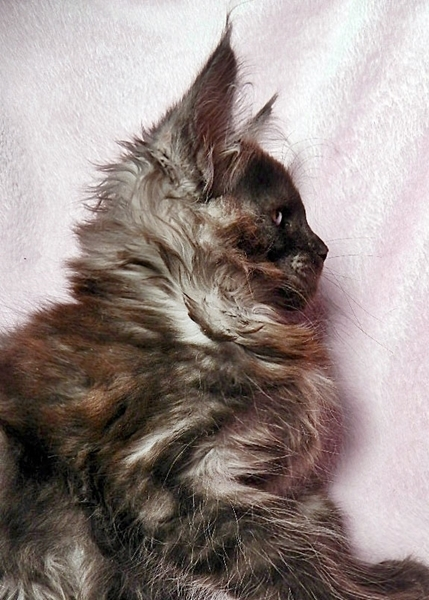

\>Sci-Latto\< vergeben\
black silver classic tabby\
lebt bei Liebhabern in Bocholt

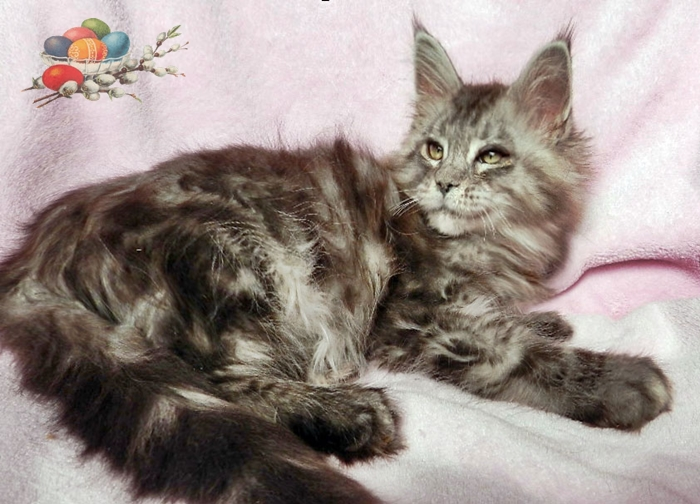

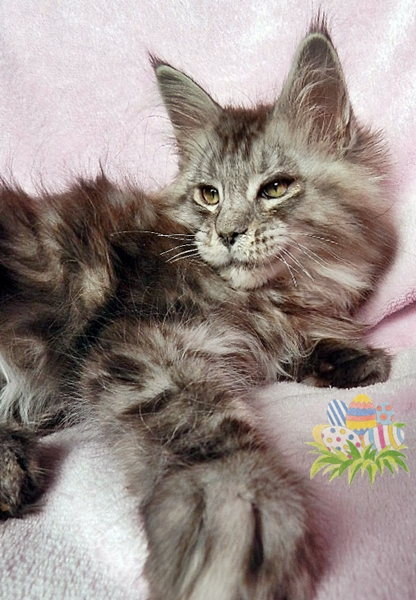
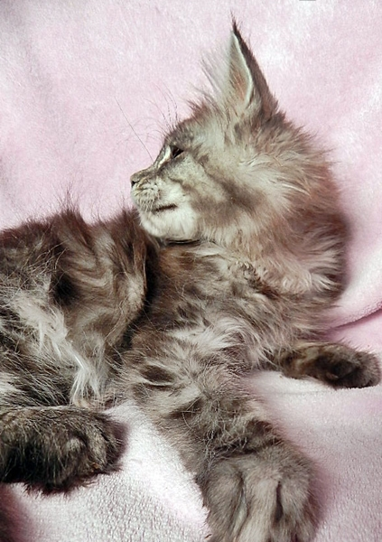

\>Mazza-Rone\< vergeben\
black silver classic tabby\
Lebt in unserer Familie wo schon einige Starbushways verwöhnt werden.

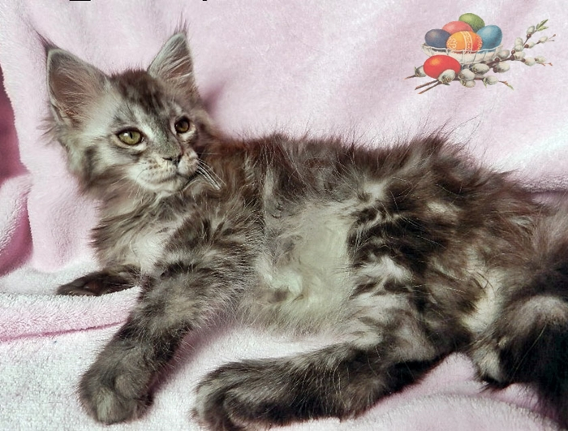

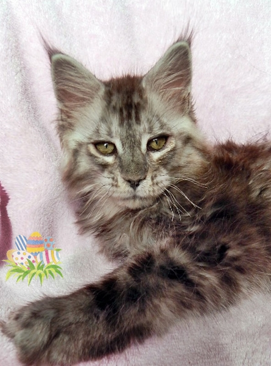

Zurück
