Die Babys von Arizona und Bosswell\
7 Kitten 4 weiblich, 3 männlich

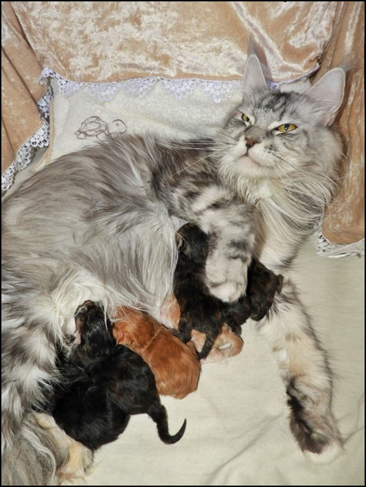

Abschiedsfotos der Babys mit 13 Wochen

\>Brown Sugar\<\
black torbie

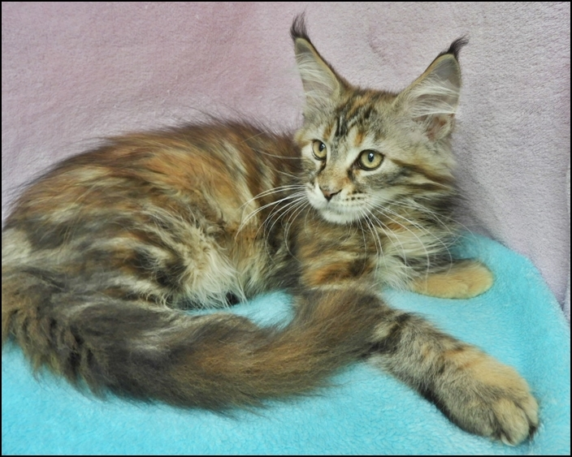

Ist ausgezogen

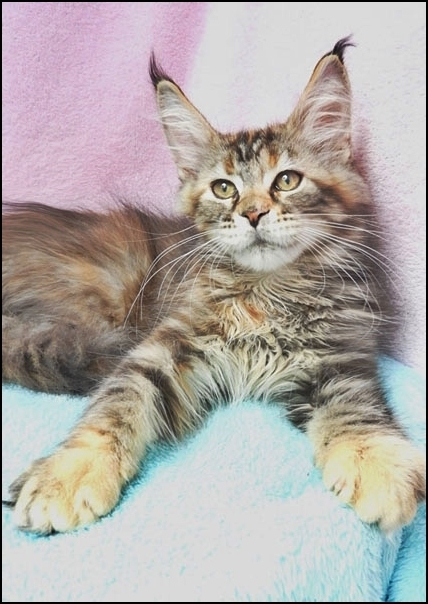

\>Silver Bee\<\
black silver torbie

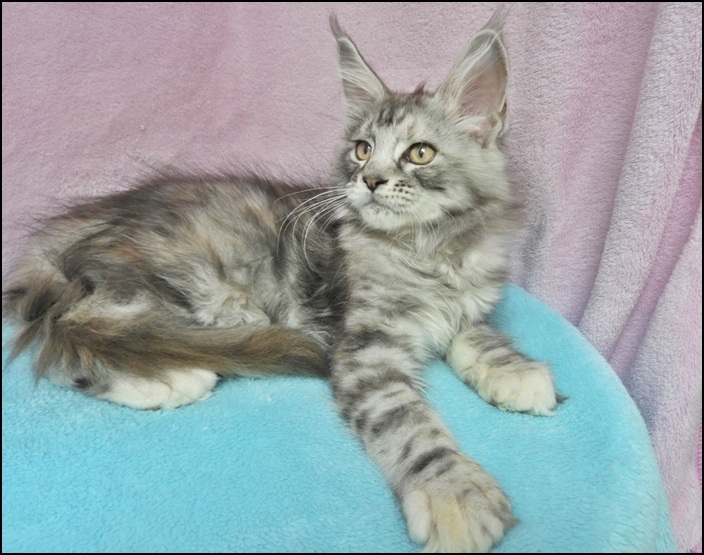

Ist ausgezogen

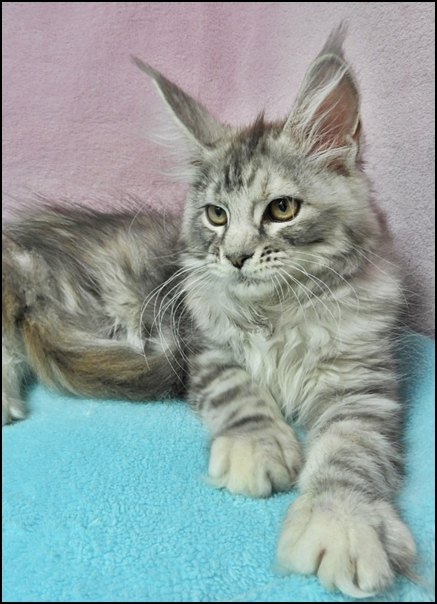

\>Hazelnut\<\
black torbie

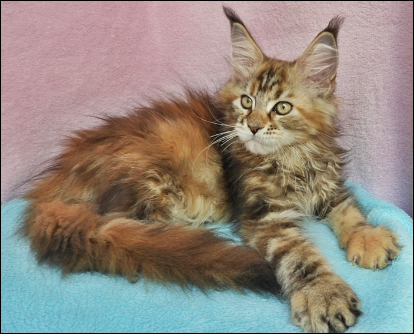

Ist ausgezogen lebt in Italien (Rom)

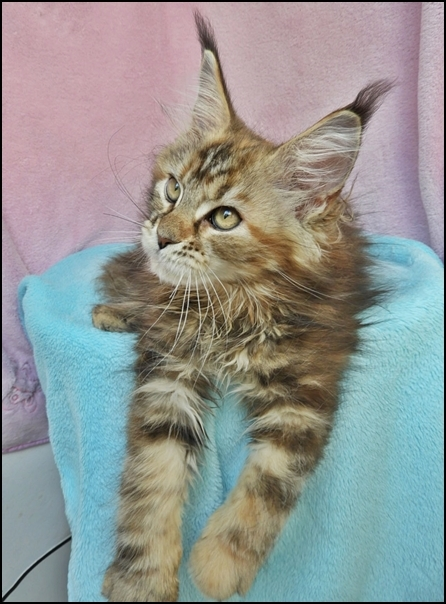

\>Rosebud\<\
black torbie

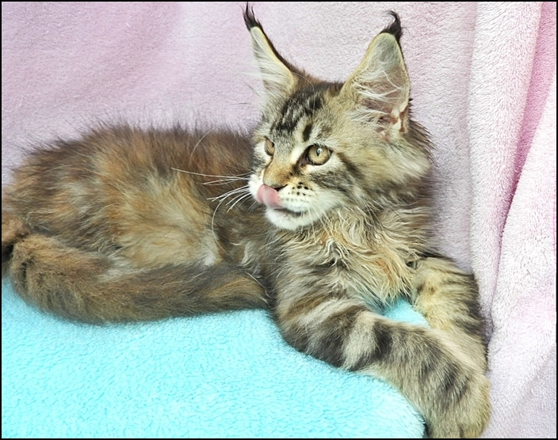

Sie lebt zusammen mit ihrem Bruder "Tabby Lynx" bei netten Liebhabern

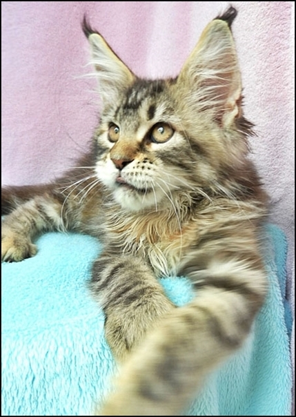
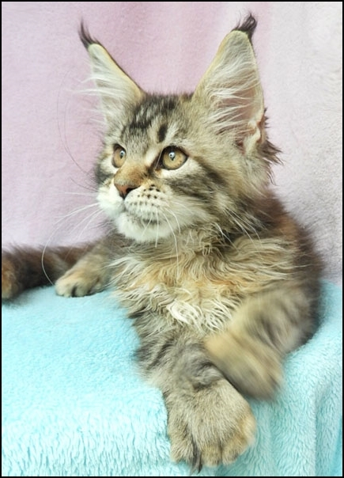

\>Up Town Bimbo\<\
red tabby

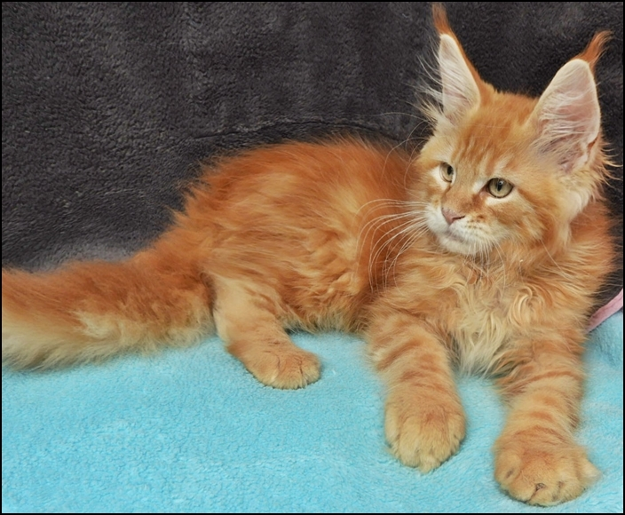

Ist ausgezogen

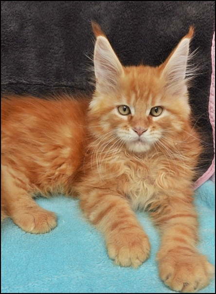

\>Legende of Maine\<\
red silver tabby

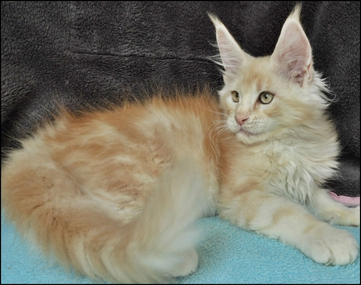

Ist ausgezogen lebt in Österreich

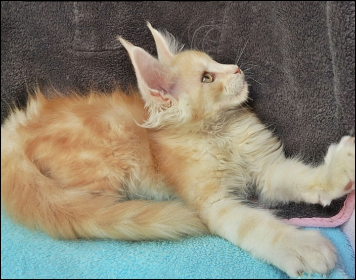
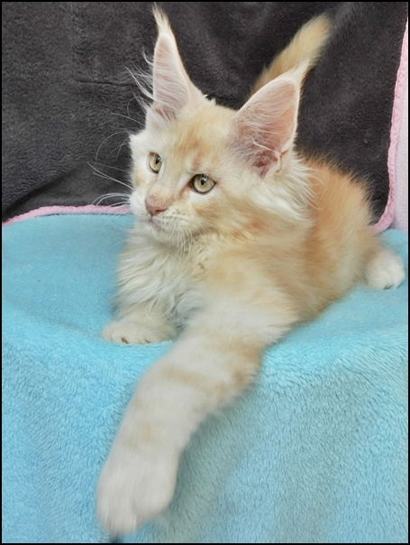

Tabby Lynx\
black tabby

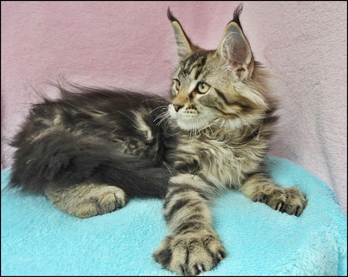

Ist zuammen mit seiner Schwester ausgezogen

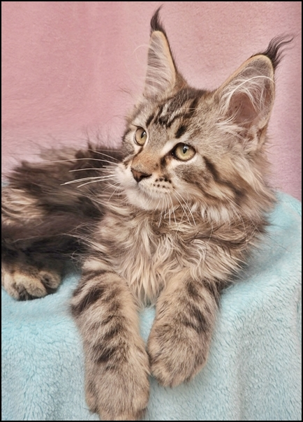
