Die Babys von unserer Ari Zona sind geboren

Alle Kitten sind vergeben

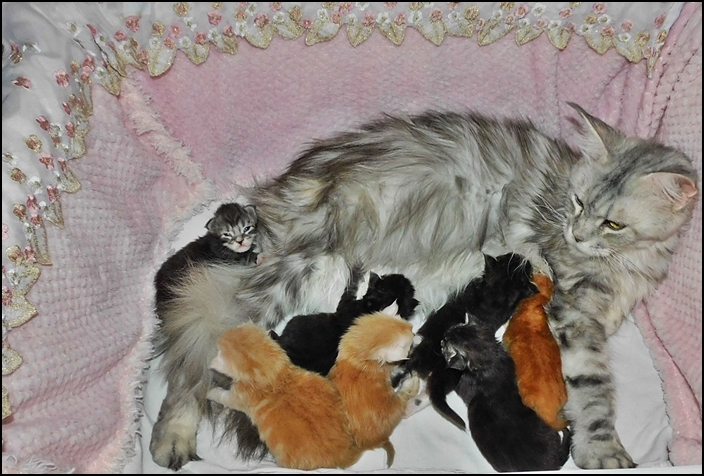

Ein schöner Wurf aus einer bewährten Verpaarung\
Fotos mit 12 Wochen

**Na Mib**

black tabby/white

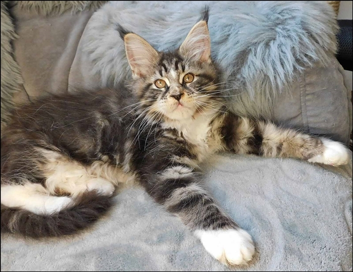
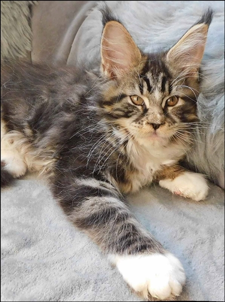

Na Mib mit 3 Wochen

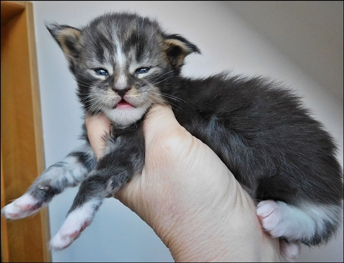

**Ata Cama**

black tabby

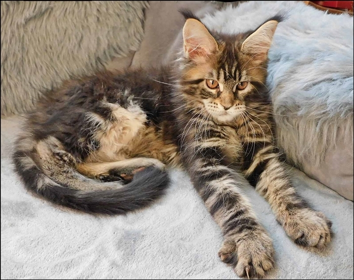

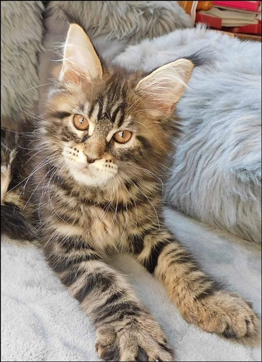
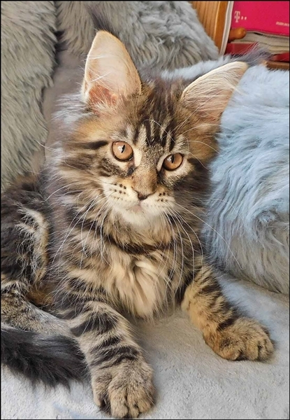

Ata Cama mit 3 Wochen

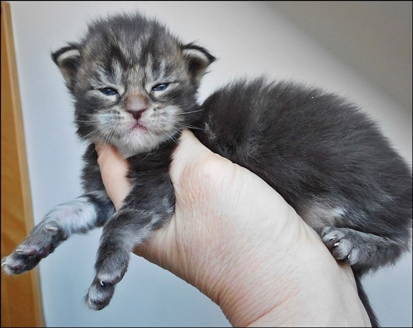

**Sa Hara**

black silver tabby/white

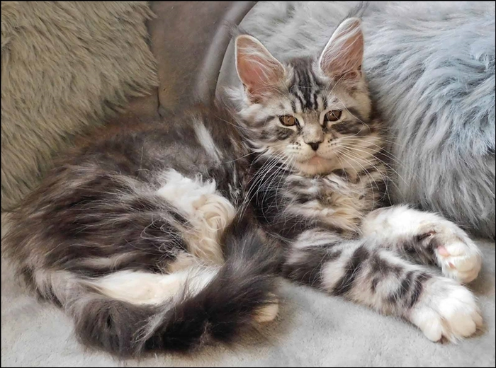
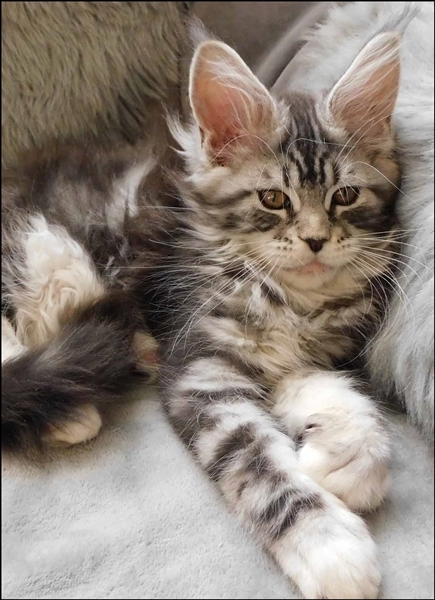

Sa Hara mit 3 Wochen

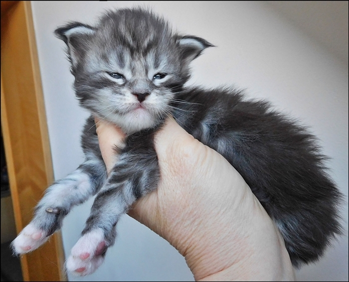

**Mo Jave**

black silver tabby

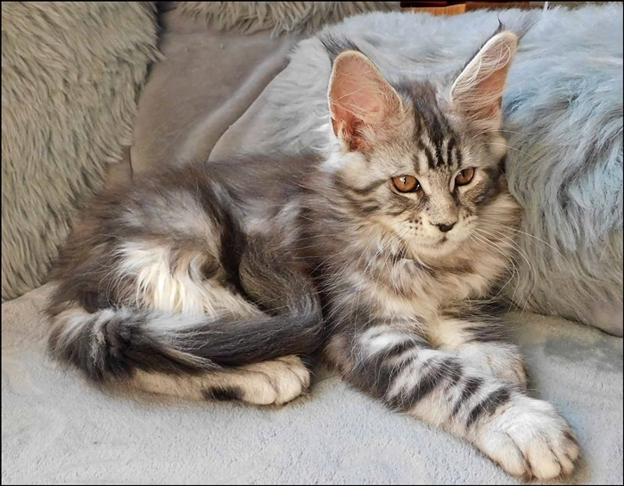
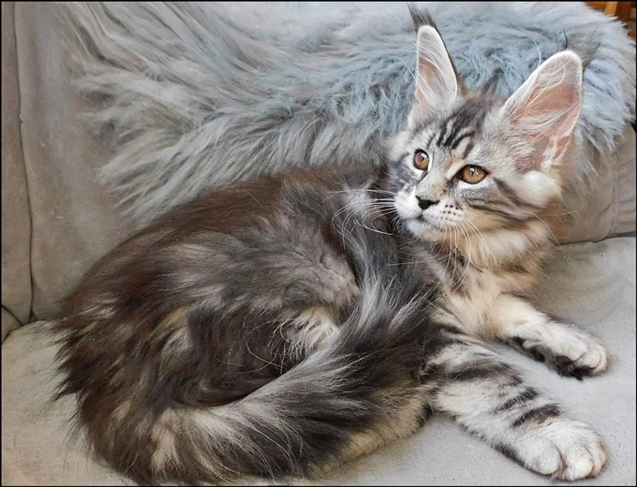

Mo Jave mit 3 Wochen

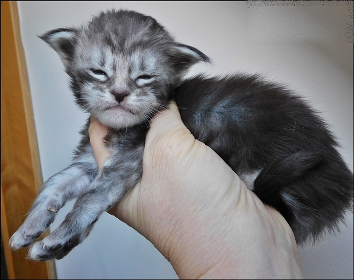

Che Gaga

red silver tabby/white

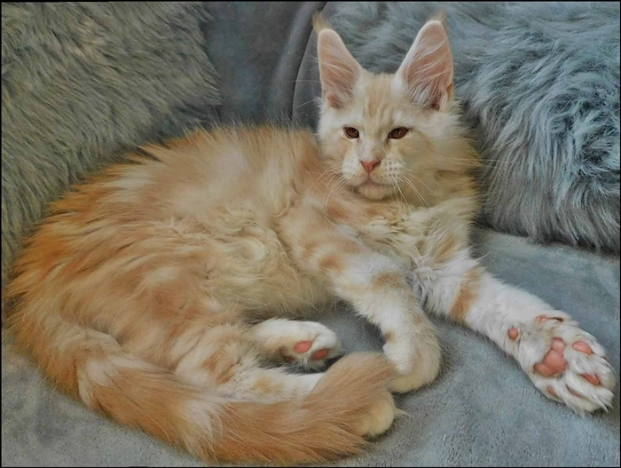
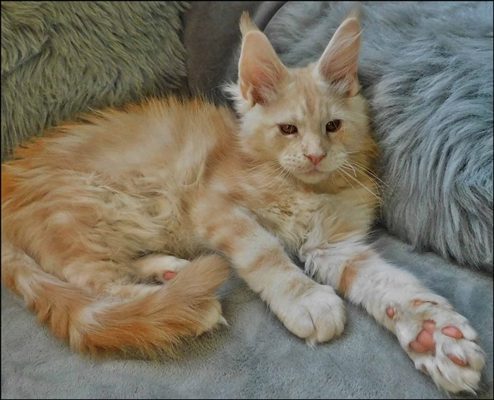

Che Gaga mit 3 Wochen

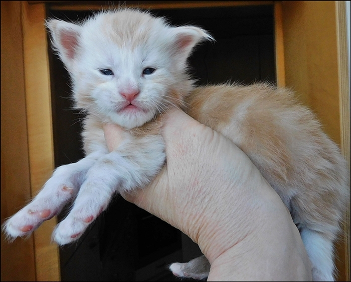

**Colo Rado**

red tabby/white

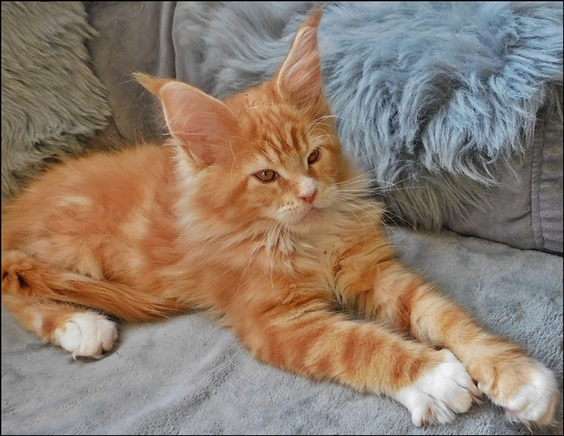

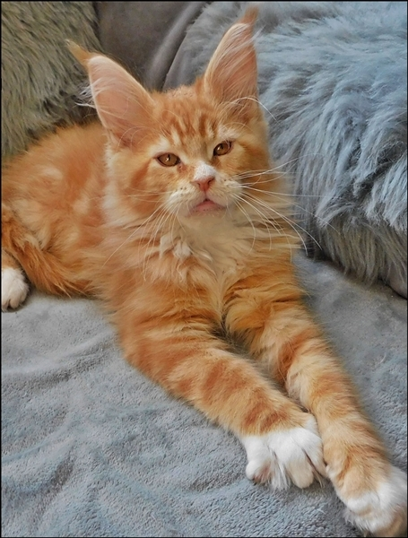
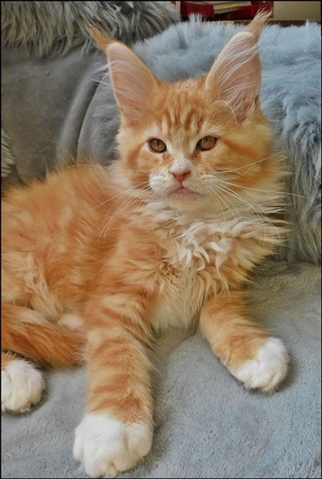

Einst ein kleines Sorgenkitten, hat er sich jetzt bestens entwickelt!!

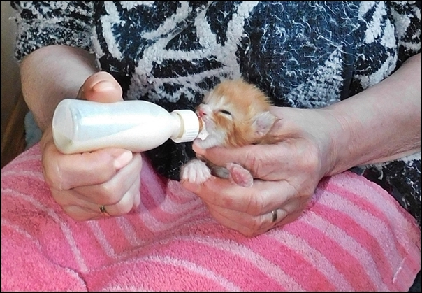

Colo Rado mit 3 Wochen

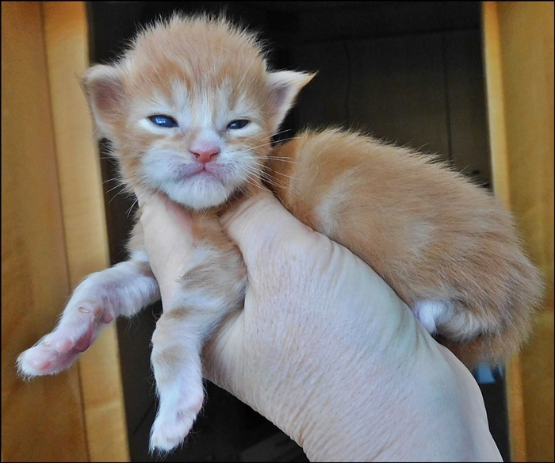

**Go Bi**

red silver tabby/white

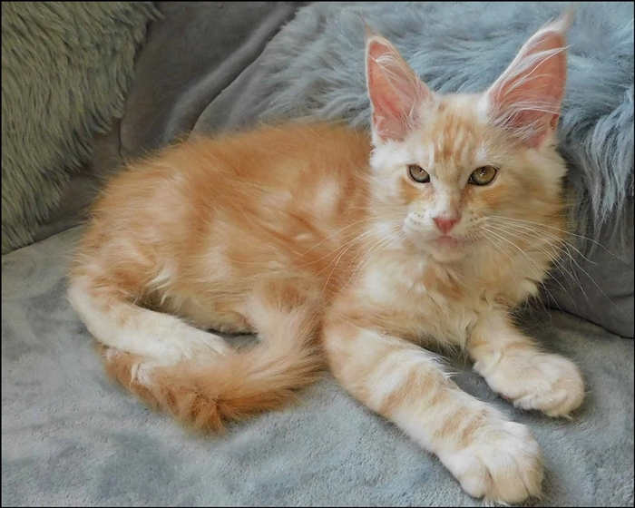

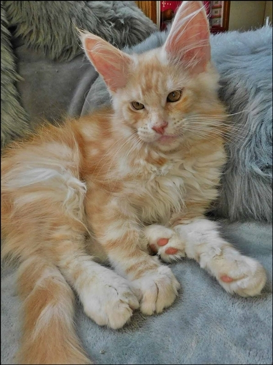
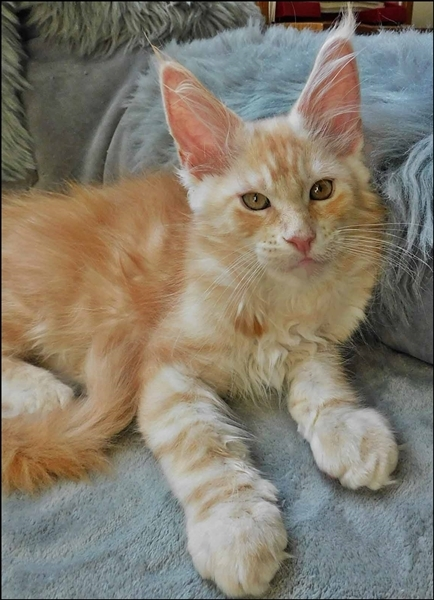

Go Bi mit 3 Wochen

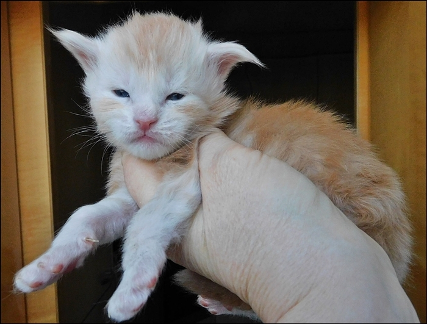
