Unsere Kitten sind allee vergeben bzw. schon ausgezogen!

Pico-Linas Kitten

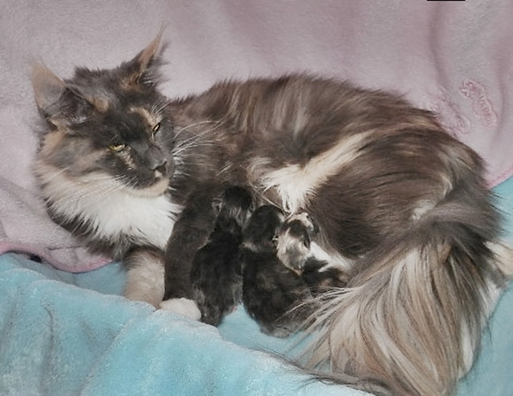

\>Lucky Girl\<\
blue tortie smoke\
13 Wochen\
**vergeben**

Sie ist in ein Zucht nach Frankreich gezogen

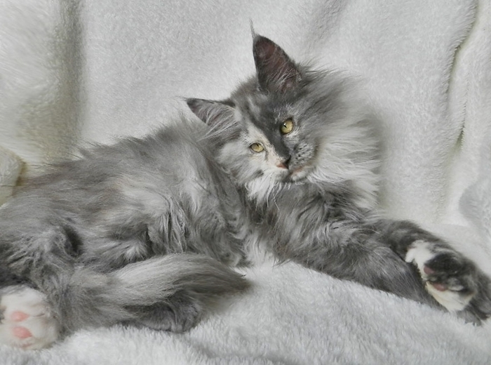
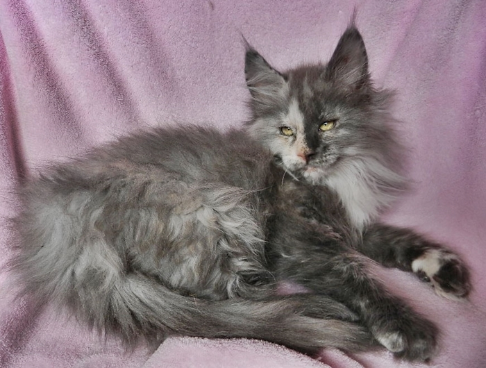

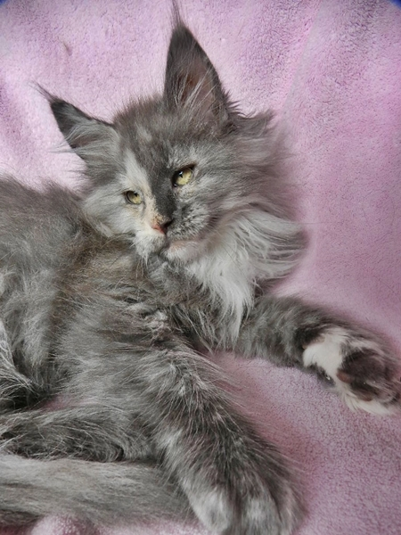
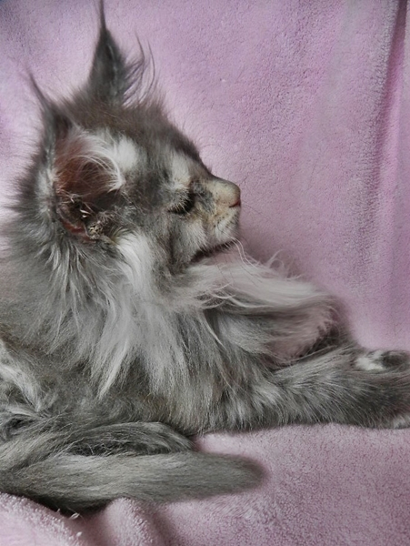

\>Mes-Kalin\<\
blue tortie/white\
13 Wochen\
**vergeben**

Sie ist zu Liebhabern gezogen

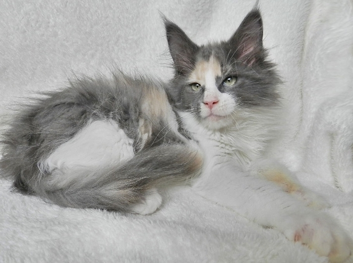
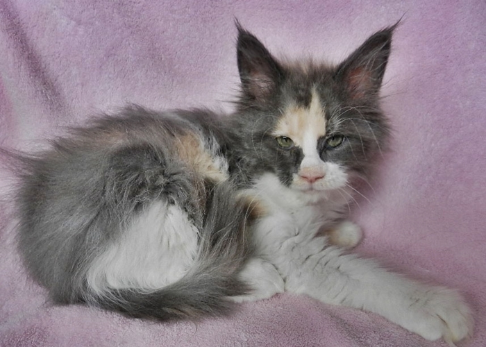

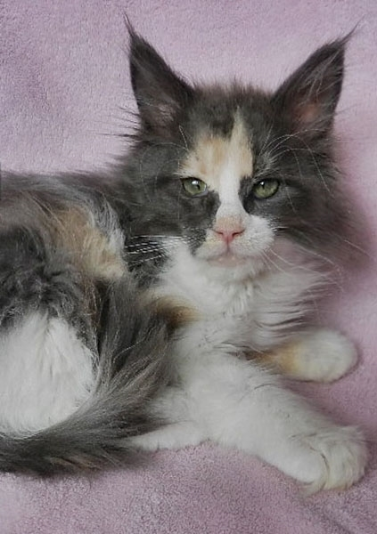
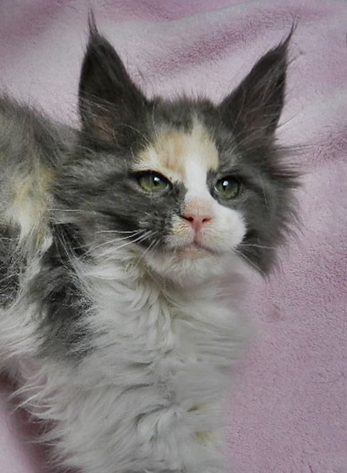

\>Emilio\<\
blue/white\
13 Wochen\
**vergeben**

Er ist zu einer Liebhaberin gezogen wo sich schon einige\
Starbushways verwöhnen lassen.

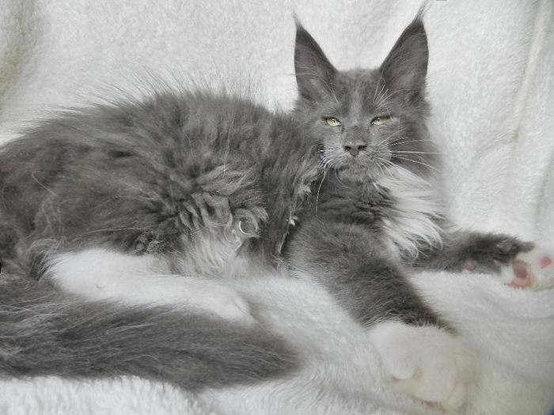
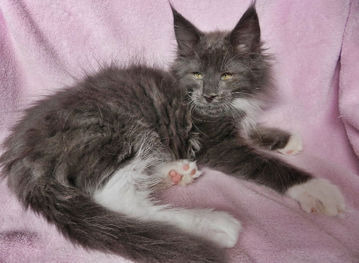

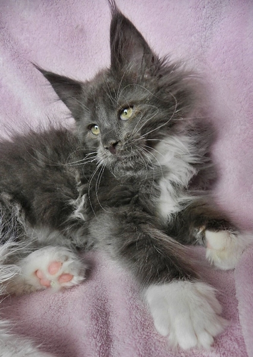

Townwalk hat ein Einzelkitten bekommen\
geboren: 4. März 2015

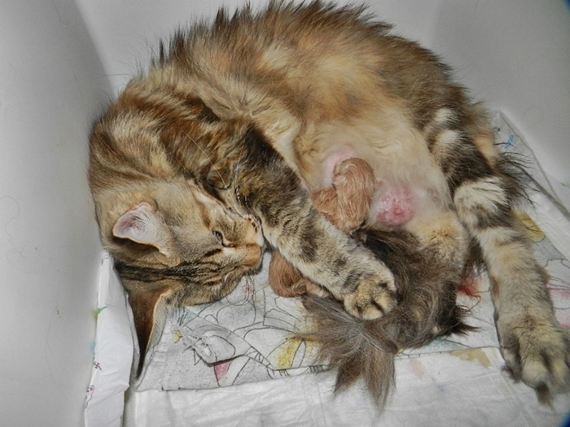

\>Starbushway Kiss-Me\<\
red silver tabby classic\
15 Wochen alt\
**vergeben**

Ist in eine Zucht nach Frankreich gezogen

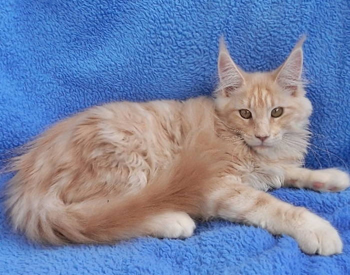
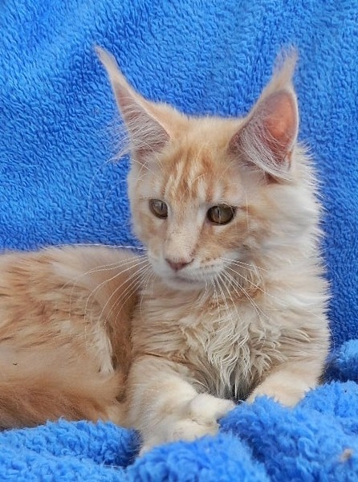

Zurück
