Kitten aus der Verpaarung Towntalk und Bosswell

Foto 12 Std nach der Geburt\
Mama und Kitten geht es gut

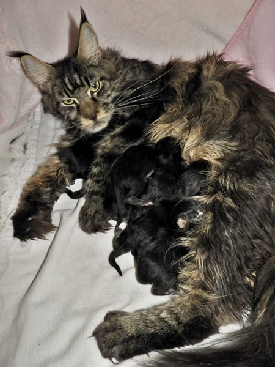

Diese beiden Mädchen sind zusammen ausgezogen\
und haben ein schönes Zuhause bei Liebhabern.

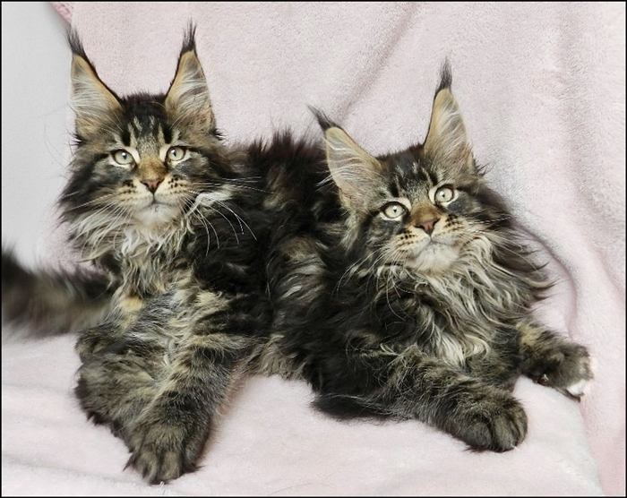

Diese beiden Kater sind zusammen ausgezogen\
und haben ein schönes Zuhause bei Liebhabern.

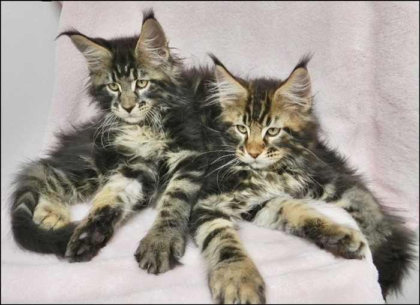

Hier Einzelfotos der Babys mit 12 Wochen

Lone Wolf

\*vergeben

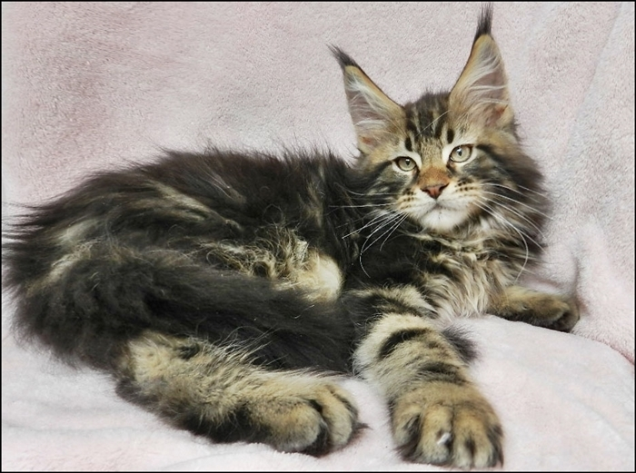

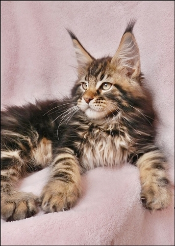
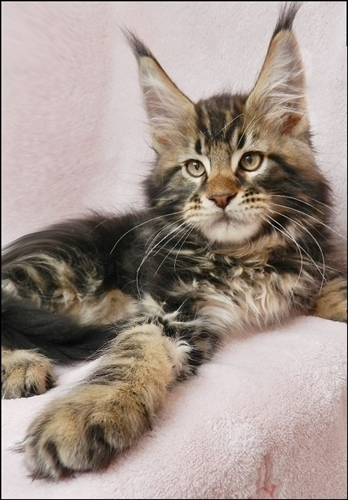

Quana Parka

\*vergeben

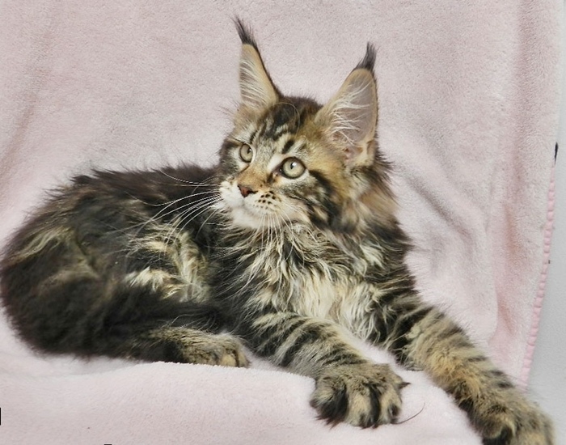

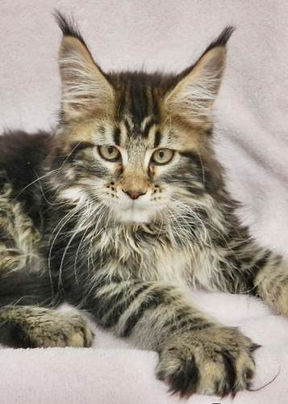

Cochia Nay

\*vergeben

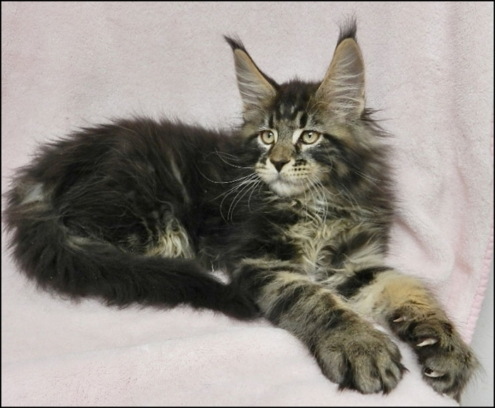

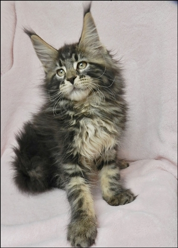
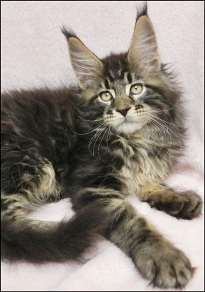

Minoka

\*vergeben

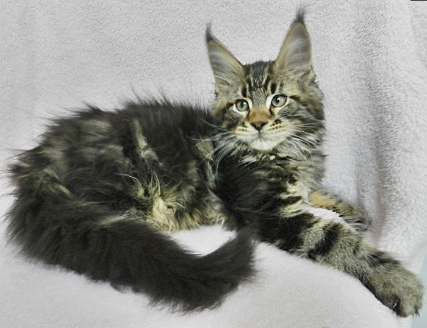

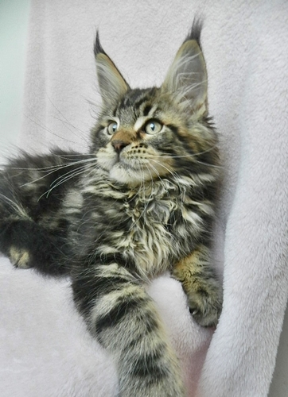
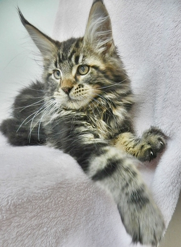

Pakuna

\*vergeben

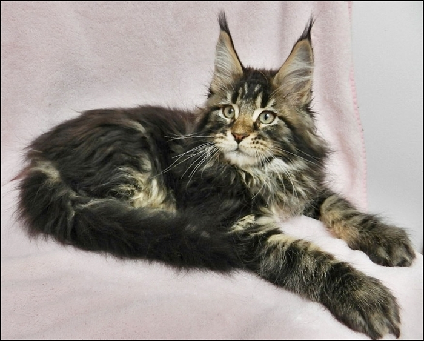

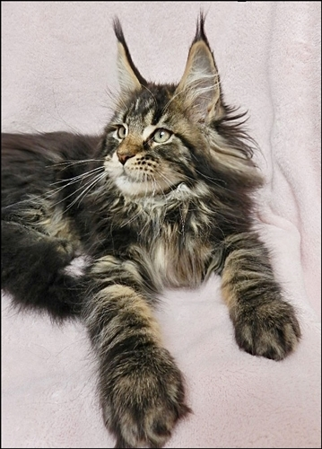
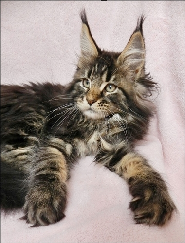

Djuna

\*vergeben

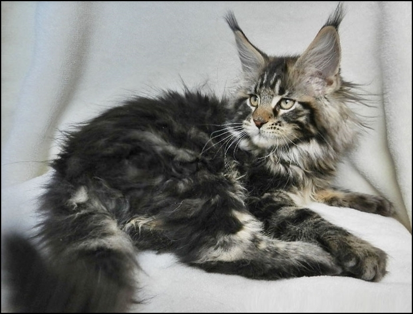

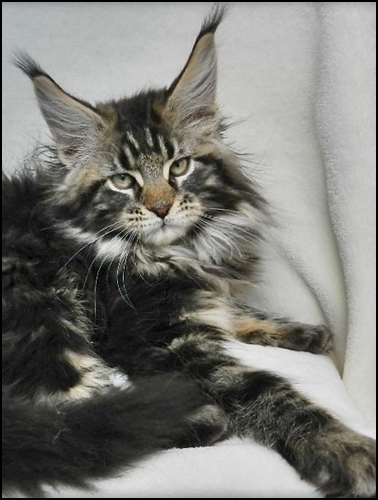
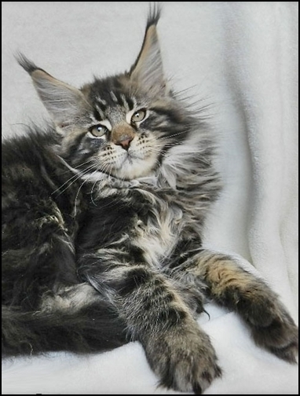

Ribana

\*vergeben

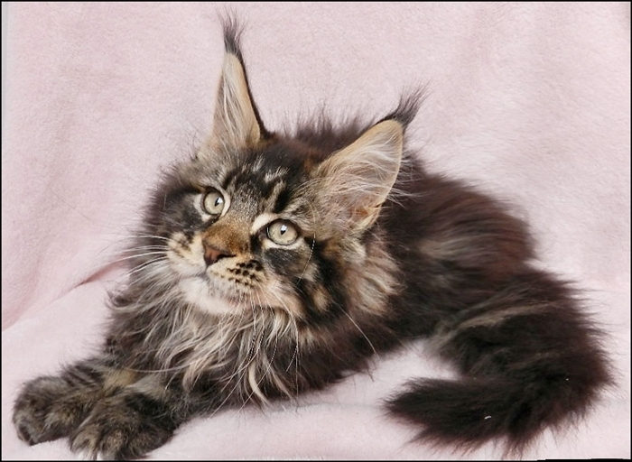

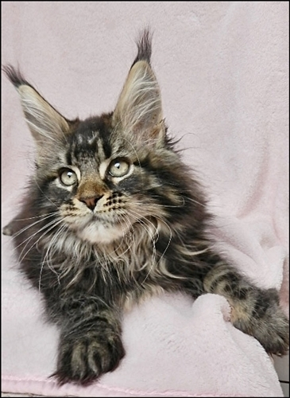
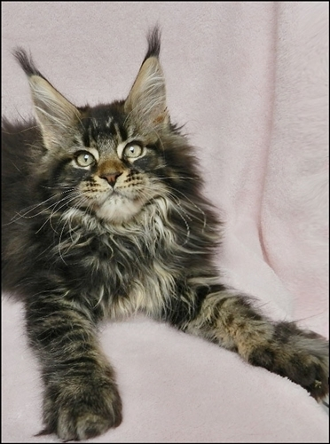

