Die Babys von Arizona und Ouzo

**geboren am 17. März 2020**

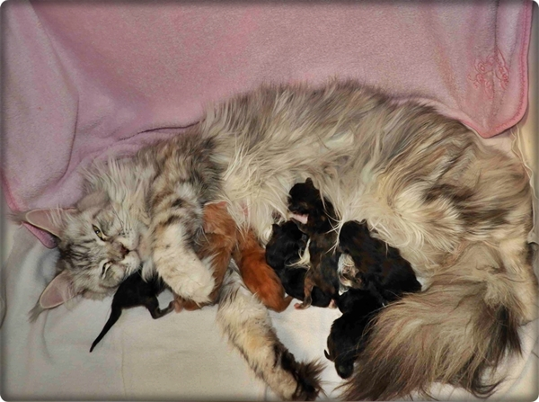

**Alle Kitten sind vergeben**

Hier mit 12 Wochen

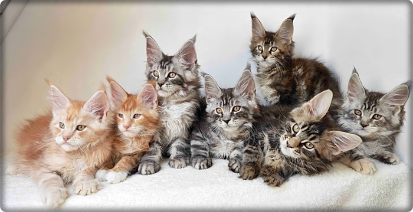

\>La Luna\<\
black torbie cl

Mit 12 Wochen\
**bleibt bei uns**

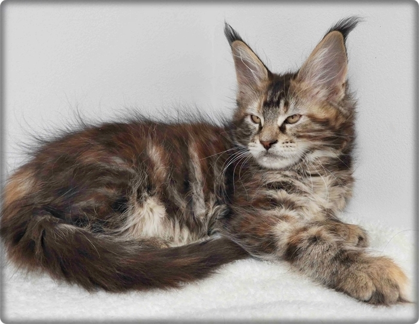

\>La Luna\< mit 3 Wochen

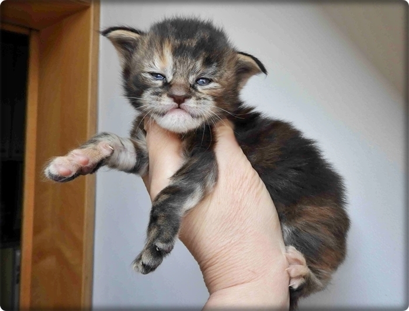

\>La Paloma\<\
black silver torbie cl\
12 Wochen\
**zieht nach Österreich**

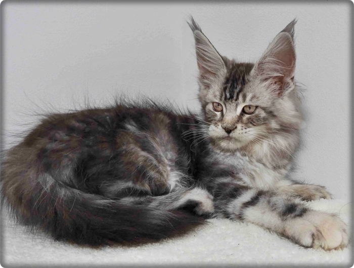

\>La Paloma\< mit 3 Wochen

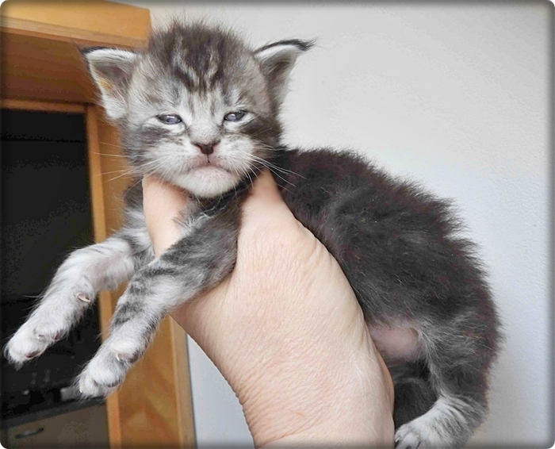

\>La Postuma\<\
black tabby cl\
12 Wochen\
**zieht in die Eifel**

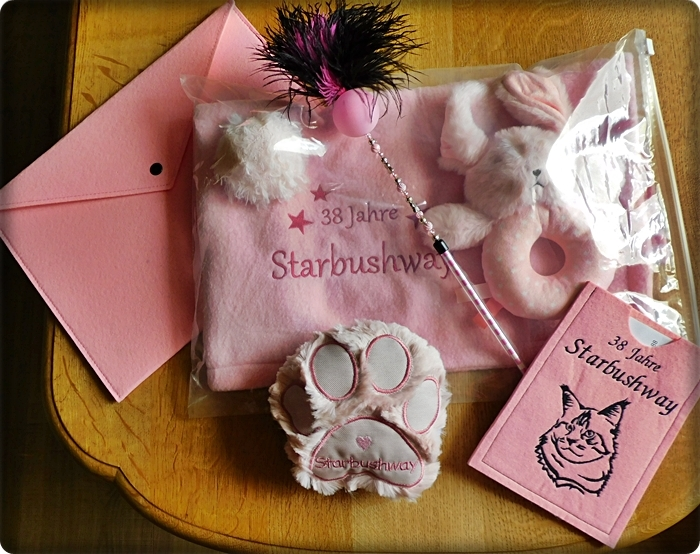

\>La Postuma\< mit 3 Wochen

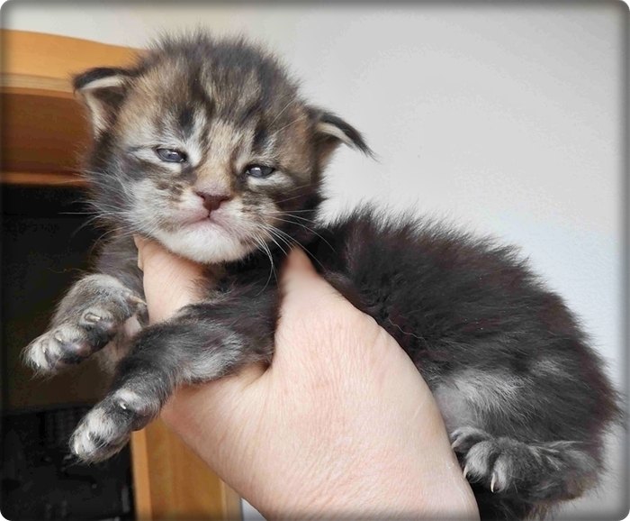

\>Tor-Nado\<\
red silver tabby cl/white\
12 Wochen\
**zieht nach Hamburg**

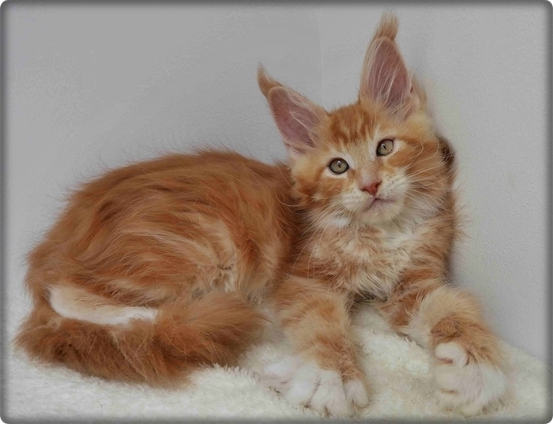

\>Tor-Nado\< mit 3 Wochen

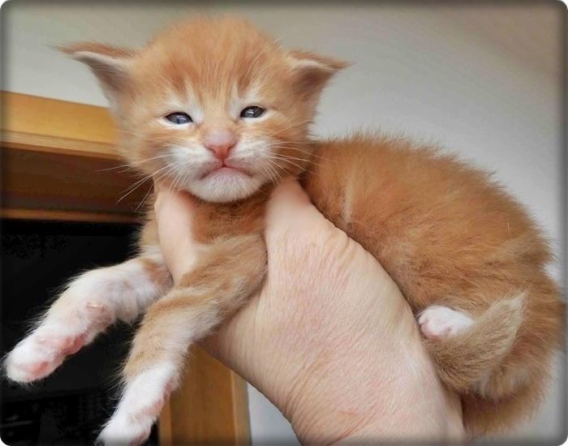

\>Hurri-Kan\<\
red silver tabby cl\
12 Wochen\
**zieht nach Iserlohn**

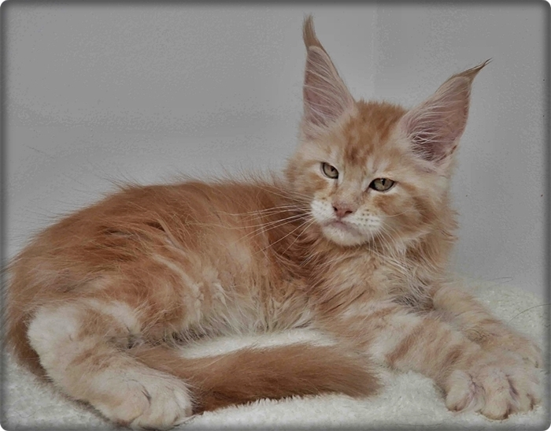

\>Hurri-Kan\< mit 3 Wochen

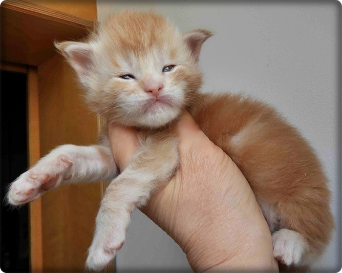

\>Tai-Fun\<\
black silver tabby cl\
12 Wochen\
**zieht nach Wiesbaden**

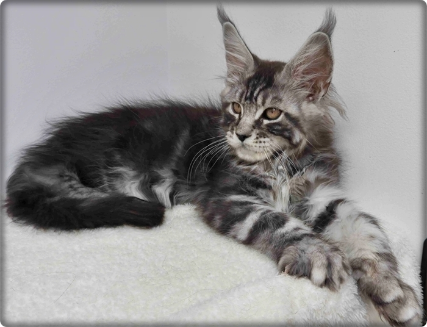

\>Tai-Fun\< mit 3 Wochen

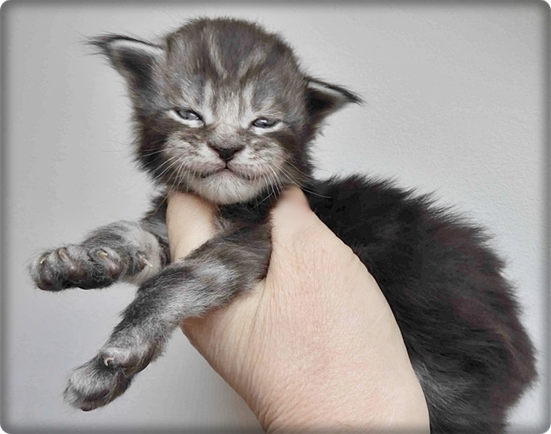

\>Tsu-Nami\<\
12 Wochen\
black silver tabby cl\
**zieht in die Schweiz**

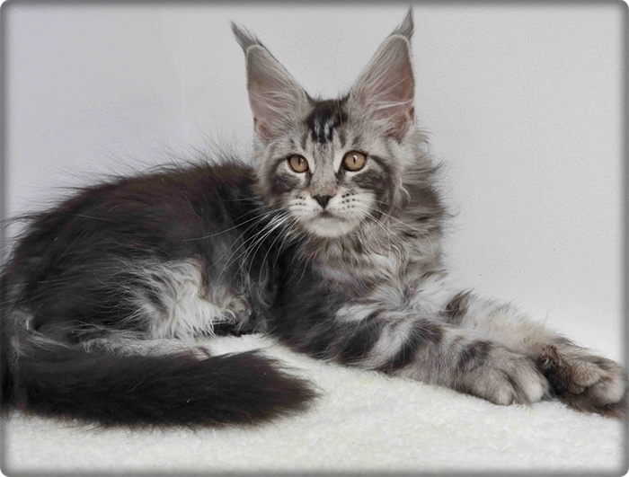

\>Tsu-Nami\< mit 3 Wochen

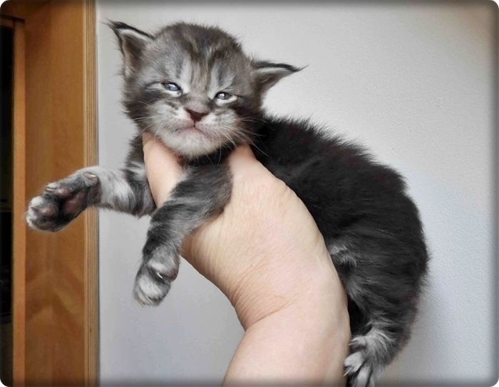

